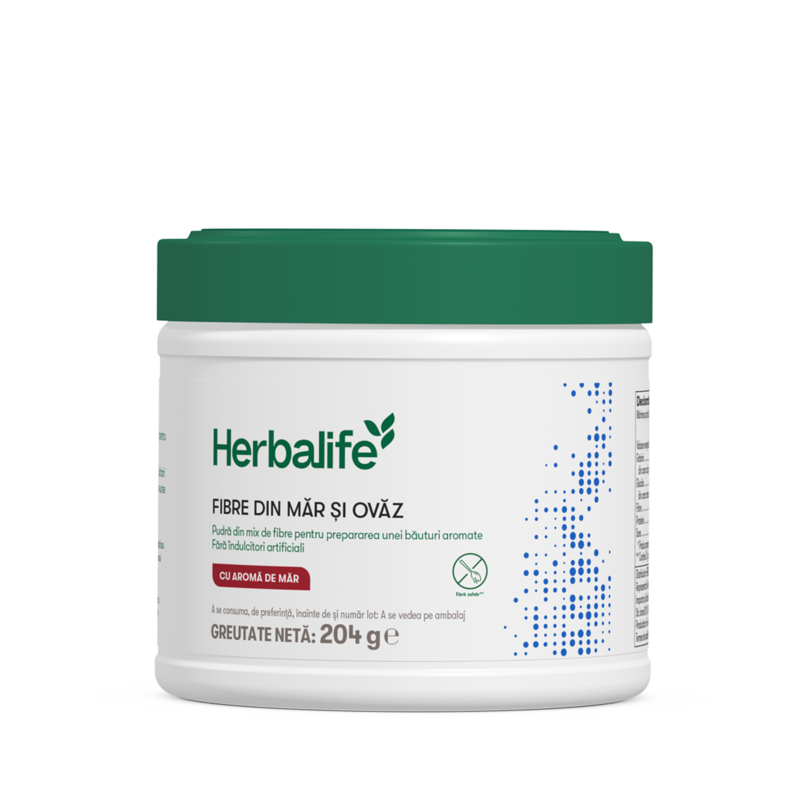
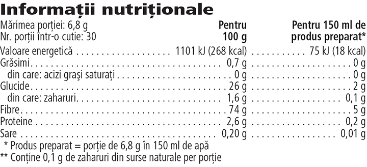

# Fibre din Măr și Ovăz

*Aromă: Măr · Mărime: 204 g · Cod: 2554*

​​Un amestec exclusiv formulat cu fibre solubile și insolubile.​

## Prezentare generală

Crește aportul zilnic de fibre cu Fibre din măr și ovăz, o combinație exclusivă de fibre solubile și insolubile.

Fibre din măr și ovăz nu conține îndulcitori artificiali și este exclusiv formulat cu fibre din șase surse naturale - măr, ovăz, porumb, citrice, cicoare și soia. Fiecare măsură din această pudră delicioasă cu aromă de măr, nu conține zahăr\* și furnizează 5 grame de fibre ce joacă un rol important în susținerea funcțiilor digestive\*\*.

Include cu ușurință în dieta ta Fibre din măr și ovăz. Pur și simplu amestecă în apa, sucul sau shake-ul preferat, sau adaugă o măsură în bolul de ovăz de dimineață. Cu o textură fină și o aromă dulce de măr, această băutură unică sub formă de pudră se poate integra cu ușurință în rutina ta zilnică.

*\*Conține 0,1 grame de zahăr per porție.*

*\*\*Fibrele din ovăz contribuie la creșterea volumului bolului fecal.*

## Caracteristici

Fibre din Măr și Ovăz:

- Formulat atât cu fibre solubile, cât și fibre insolubile
- Furnizează 5 g de fibre per porție
- Are 18 calorii per porție
- Este potrivit pentru vegetarieni și vegani
- Nu conține zahăr\*
- Nu conține îndulcitori artificiali
- Conține 30 de porții

*\*Conține 0,1 g de zahăr din surse naturale.*

## Ce este înăuntru

### Ingrediente

Fibre de **ovăz** (28 %), fibre din măr (24 %), dextrină de porumb (24 %), fibre din **soia** (9 %), fibre din citrice (5 %), inulină (extrasă din cicoare - 5 %), aromă, agenți de îngroșare (gumă de acacia, gumă de xantan), maltodextrină, agent antiaglomerant (dioxid de siliciu).

### Informații despre alergeni

CONȚINE OVĂZ ȘI SOIA.

### Informații nutriționale

## Cum se utilizează

Agită ușor recipientul înainte de fiecare utilizare. Amestecă o măsură (6,8 g) cu 150 ml de apă. Alternativ, poți adăuga o măsură de Fibre din măr și ovăz în shake-ul Formula 1 sau chiar în bolul cu ovăz de dimineață.

Savurează acest produs în cadrul unei diete echilibrate şi variate, ca parte a unui stil de viaţă activ şi sănătos.

A se păstra cu capacul închis, într-un loc răcoros și uscat.

---

*Alimentele prezentate în imagini și/sau videoclipuri sunt ilustrative și nu reprezintă conținutul produsului.*
