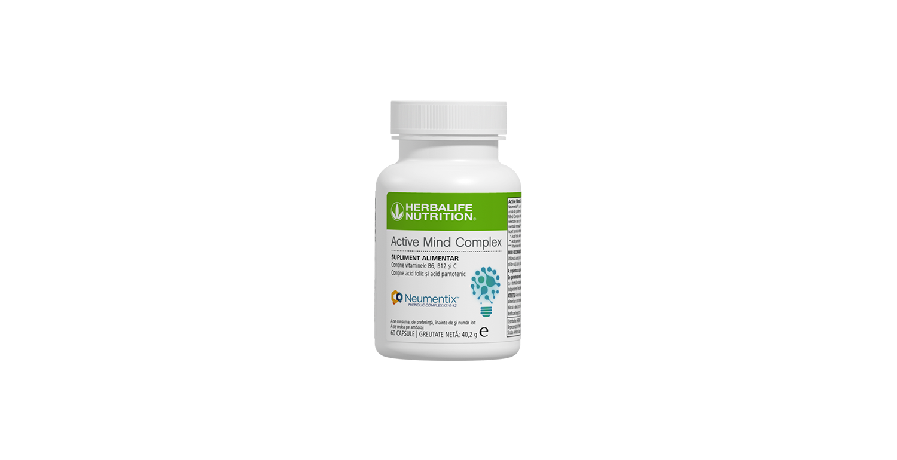
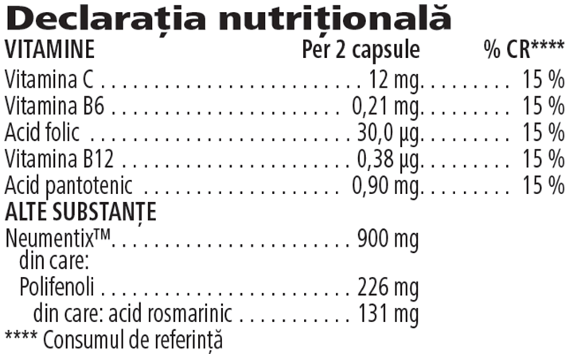

# Active Mind Complex

*Mărime: 60 capsule · Cod: 243K*

​​Nutriție inteligentă pentru performanța mentală.​

## Prezentare generală

Chiar și în cele mai agitate zile păstrează controlul asupra sarcinilor zilnice cu Active Mind Complex.

Această capsulă versatilă este formulată exclusiv cu un extract patentat de mentă, care conține o combinație unică de polifenoli din surse naturale, inclusiv acid rosmarinic1,2.

Active Mind Complex este formulat cu un amestec de vitamine atent selectate, cum ar fi acidul folic, acidul pantotenic și vitaminele C, B6 și B12. Acidul folic, vitaminele B6, B12, C susțin funcția psihologică normală. Vitaminele B6, B12 și C susțin, de asemenea, funcționarea normală a sistemului nervos, în timp ce acidul folic susține performanța mentală normală. În plus, acidul pantotenic susține performanța mentală normală.

Susține-ți rutina cu doza zilnică de Active Mind Complex.

*1Cirlini M, et al. Molecule. 2016;21(8):1007.*

2Narasimhamoorthy B, et al. Ind Crops Prod. 2015; 63:87-91.

## Caracteristici

Active Mind Complex:

- Este formulat cu un ingredient din mentă patentat dovedit științific
- Conține vitaminele C, B6 și B12
- Conține acid pantotenic
- Conține acid folic
- Conține polifenoli
- Este potrivit pentru vegani
- Nu conține gluten
- Conține 60 capsule

## Ce este înăuntru

### Ingrediente

Neumentix™ extras din părțile aeriene de mentă (*Mentha spicata* L.), învelișul capsulei (hidroxipropilmetilceluloză, colorant (complexe de cupru ale clorofilinelor)), agenți de încărcare (fosfați de calciu, celuloză microcristalină), vitamina C (acid L-ascorbic), agenți antiaglomeranți (săruri de magneziu ale acizilor grași, dioxid de siliciu), acid pantotenic (D-pantotenat de calciu), vitamina B12 (ciancobalamină), vitamina B6 (clorhidrat de piridoxină), acid folic (acid pteroilmonoglutamic).

*Neumentix™ este o marcă comercială a Kemin Industries, Inc.*

### Informații nutriționale

## Cum se utilizează

Ia 2 capsule pe zi, în timpul meselor\*.

Utilizează acest produs în cadrul unei diete echilibrate și variate, ca parte a unui stil de viață activ și sănătos.

A se păstra cu capacul închis într-un loc răcoros și uscat.

*\*A nu se depăși doza zilnică recomandată. Suplimentele alimentare sunt destinate să completeze dieta și nu ar trebui folosite pentru a înlocui o dietă variată. A nu se lăsa la îndemâna și vederea copiilor mici.*

---

*Alimentele prezentate în imagini și/sau videoclipuri sunt ilustrative și nu reprezintă conținutul produsului.*
