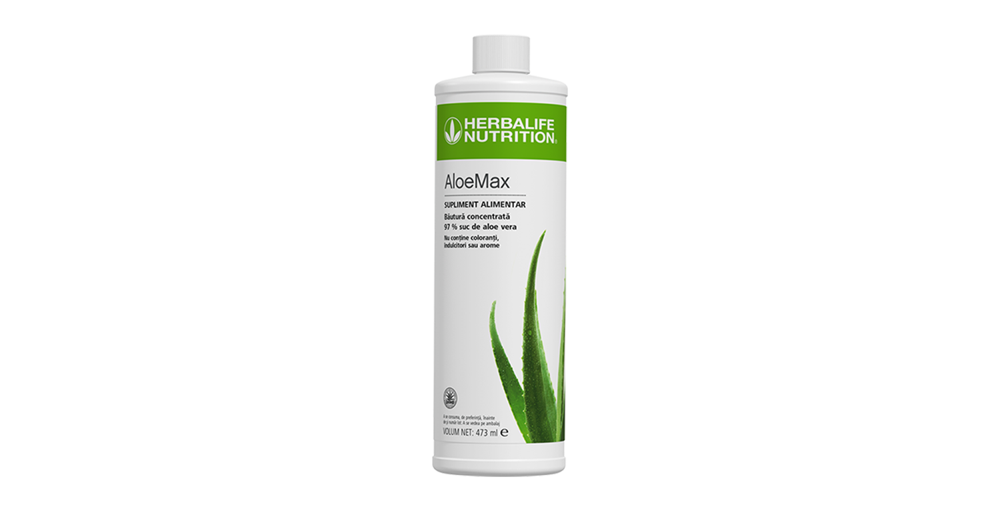
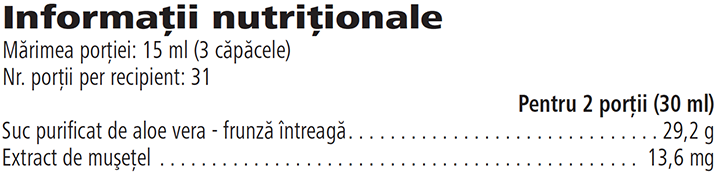

# AloeMax

*Aromă: Original · Mărime: 473 ml · Cod: 1196*

Băutură supliment alimentar, formulată cu 97 % suc de *Aloe vera* de înaltă calitate.

## Prezentare generală

De pe plantațiile noastre direct în paharul tău, AloeMax este preparat din suc de *Aloe Vera* de înaltă calitate, concepută pentru a satisface nevoile tale de hidratare.

AloeMax conține 97 % suc de *Aloe vera* extras prin presare la rece din frunze întregi. Frunzele de Aloe Vera culese manual sunt atent selectate, preparate de către experți și testate temeinic, pentru a oferi un produs care îndeplinește toate standardele de calitate și puritate din industrie, stabilite de IASC (International Aloe Science Council).

Acestă băutură concentrată, supliment alimentar cu *Aloe vera* nu conține coloranți, îndulcitori sau arome. Savurează gustul delicat al AloeMax cu fiecare înghițitură. Adaug-o pur și simplu în apă pentru a obține o băutură răcoritoare din aloe care va deveni garantat un element de bază în rutina zilnică.

## Caracteristici

AloeMax:

- Conține 97 % suc de *Aloe vera* presat la rece, provenit din frunze întregi
- Conținut scăzut de calorii - doar 2 calorii pe porție
- Potrivit pentru vegetarieni și vegani
- Fără coloranți, îndulcitori sau arome
- Certificat de International Aloe Science Council (IASC)
- Conține 31 de porții

## Ce este înăuntru

### Ingrediente

Suc purificat de *Aloe vera* – frunză întreagă (*Aloe Barbadensis*, 97 %), zahăr, corector de aciditate (acid citric), conservanţi (sorbat de potasiu, benzoat de sodiu), extract de muşeţel (*Matricaria chamomilla*).

### Informații nutriționale

## Cum se utilizează

Savurează gustul răcoritor al băuturii AloeMax dimineața sau pe tot parcursul zilei, până la 2 porții pe zi.\* Agită bine înainte de utilizare și adaugă 3 căpăcele de AloeMax (15 ml) în 120 ml de apă. Pentru a-l prepara într-un litru de apă, adaugă 120 ml de AloeMax într-un recipient și completează cu apă. A se păstra la frigider după deschidere.

Savurează acest produs în cadrul unei diete echilibrate şi variate, ca parte a unui stil de viaţă activ şi sănătos.

A se păstra cu capacul închis, într-un loc răcoros şi uscat, dacă nu este deschis. A se păstra la frigider după deschidere și consuma în maxim 30 de zile după deschidere.

*\*A nu se depăși doza recomandată pentru consumul zilnic. Suplimentele alimentare nu înlocuiesc o dietă variată și echilibrată și un stil de viață sănătos. A nu se lăsa la îndemâna și la vederea copiilor mici.*

---

*Alimentele prezentate în imagini și/sau videoclipuri sunt ilustrative și nu reprezintă conținutul produsului.*
