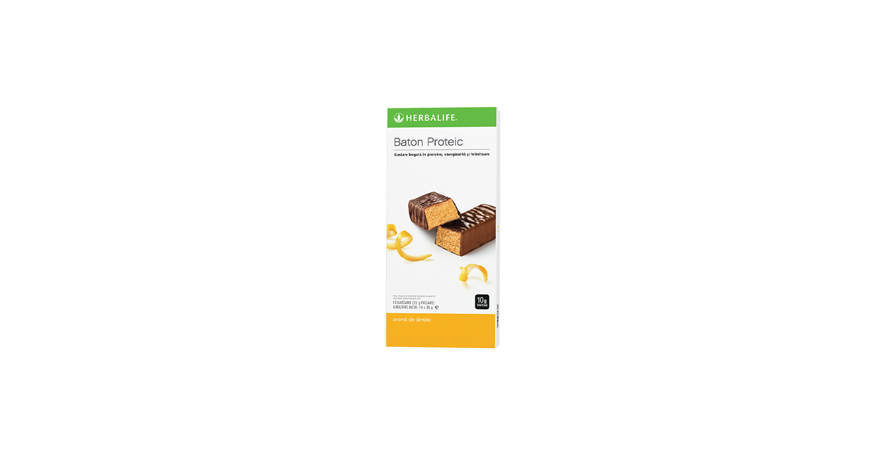
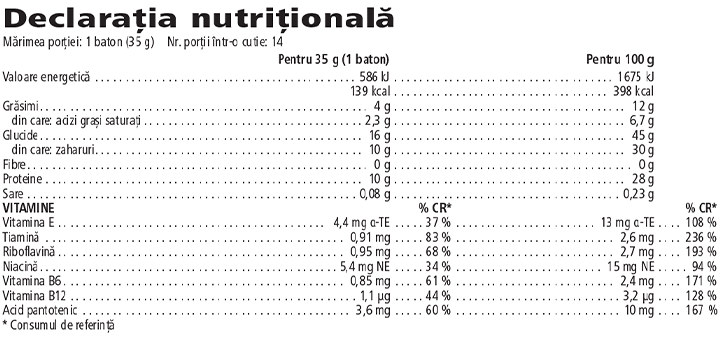

# Baton Proteic

*Aromă: Lămâie · Mărime: 14 batoane · Cod: 3976*

Un baton indulgent conceput pentru a te ajuta să-ți crești aportul de proteine.

## Prezentare generală

Batonul proteic îți oferă o gustare proteică delicioasă și hrănitoare, concepută pentru a te ajuta să-ți crești aportul de proteine.

Formulat cu 10 grame de proteine din lapte și vitamine cheie, acest mic baton este gustarea proteică perfectă. Cu o textură delicioasă, acoperit cu o ciocolată cu lapte bogată și disponibil în 3 arome, Batonul proteic este gustarea de care ai nevoie pentru a reduce poftele de dulce.

Acest baton delicios este conceput pentru o comoditate maximă. Pune un baton proteic în geantă sau în sertarul de la birou pentru o gustare rapidă și convenabilă, care este gata oricând ai nevoie. Când vine vorba de creșterea aportului de proteine, nimic nu se compară cu batonul nostru proteic.

## Caracteristici

Baton Proteic:

- Furnizează 10 g de proteine din lapte
- Are doar 139 de calorii
- Furnizează vitamine cheie, inclusiv vitaminele B6 și B12
- Este acoperit cu ciocolată delicioasă
- Este gustarea proteică perfectă pentru călătorii
- Disponibil într-o cutie cu 14 batoane

## Ce este înăuntru

### Ingrediente

Concentrat proteic din **lapte** (cazeinat de calciu (**lapte**), proteină din zer (**lapte**), cazeinat de sodiu (**lapte**), proteine din **lapte**), sirop de glucoză, înveliș de ciocolată cu **lapte** (17 %, cacao: minimum 30 %) (zahăr, **lapte** praf, unt de cacao, masă de cacao, emulsifiant (lecitine (**soia**)), aromă), sirop de fructoză, ulei de palmier, gelatină, dextroză, arome, corector de aciditate (acid citric), pudră de albumină din **ouă**, vitamina E (DL-alfa-tocoferol), niacină (nicotinamidă), acid pantotenic (D-pantotenat de calciu), tiamină (clorhidrat de tiamină), vitamina B6 (clorhidrat de piridoxină), riboflavină, vitamina B12 (ciancobalamină).

### Informații despre alergeni

CONȚINE SOIA, LAPTE ȘI OUĂ. POATE CONȚINE URME DE ARAHIDE, FRUCTE CU COAJĂ LEMNOASĂ NUCI ȘI GLUTEN.

### Informații nutriționale

## Cum se utilizează

Consumă unul sau două batoane pe zi pentru o gustare nutritivă. Pentru varietate, încearcă și alte gustări delicioase bogate în proteine.

Savurează acest produs în cadrul unei diete echilibrate și variate, ca parte a unui stil de viață sănătos și activ.

Depozitează într-un loc răcoros și uscat.

---

*Alimentele prezentate în imagini și/sau videoclipuri sunt ilustrative și nu reprezintă conținutul produsului.*
