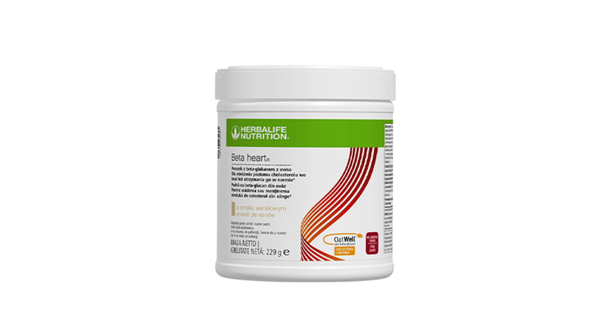
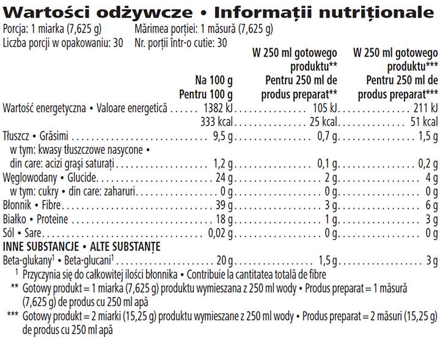

# Beta Heart®

*Aromă: Vanilie · Mărime: 229 g · Cod: 0267*

O băutură bogată în fibre ce conține beta-glucan din ovăz OatWell®.

## Prezentare generală

Îmbunătățește-ți nutriția zilnică cu Beta Heart®, un amestec nutritiv bogat în fibre și sursă de proteine.

Două măsuri din această pudră gustoasă, fără zahăr, cu aromă de vanilie, furnizează 6 grame de fibre, dintre care 3 grame de beta-glucani provenind din ingredientul OatWell®, beta-glucan din ovăz. Beta-glucanul de ovăz este o fibră dietetică solubilă despre care s-a demonstrat că scade\* sau menține\*\* nivelul de colesterol din sânge.

Beta Heart® este o modalitate delicioasă și convenabilă de a adăuga proteine, fibre și beta-glucani din ovăz în dieta ta. Indiferent dacă alegi să o adaugi în apă, shake sau suc de fructe, cu textura sa fină și aroma subtilă de vanilie, această băutură pe bază de pudră cu proprietăți multiple se poate încadra fără efort în rutina zilnică.

*\*Beta-glucanii contribuie la menținerea concentrațiilor normale ale colesterolului din sânge. Efectul benefic este obținut prin consumul unei doze zilnice de 3 g beta-glucani din ovăz, tărâțe de ovăz, orz, tărâțe de orz sau din amestecuri ale acestor beta-glucani.*

\*\*S-a demonstrat ca beta-glucanul din ovăz acționează asupra scăderii/contribuie la menținerea nivelului de colesterol din sânge\*\*. Colesterolul cu valoare ridicată este un factor de risc în dezvoltarea bolilor coronariene. Boala coronariană are multipli factori de risc, iar modificarea unuia dintre acești factori de risc poate avea sau nu un efect benefic. Efectul benefic este obținut prin consumul unei doze zilnice de 3 g de beta-glucani din ovăz.

## Caracteristici

Beta Heart®:

- Conține 1,5 g beta-glucani din ovăz per măsură
- Furnizează 3 g de fibre per măsură
- Conține 25 de calorii per măsură
- Este o sursă de proteine
- Nu conține zahăr
- Potrivit pentru vegetarieni
- Conține 30 porții

## Ce este înăuntru

### Ingrediente

Pudră de tărâțe de **ovăz** (89 %), ulei de floarea-soarelui, maltodextrină, cazeinat de sodiu (**lapte**), aromă.

### Informații despre alergeni

CONȚINE OVĂZ ȘI LAPTE. DE ASEMENEA, POATE CONȚINE ALTE SURSE DE GLUTEN (GRÂU, SECARĂ, ORZ).

### Informații nutriționale

## Cum se utilizează

Agită ușor recipientul înainte de fiecare utilizare. Adaugă 1 sau 2 măsuri de Beta Heart® în apă, suc de fructe sau la shake-ul tău preferat Formula 1 și consumă o dată pe zi.

Savurează acest produs în cadrul unei diete echilibrate şi variate, ca parte a unui stil de viaţă sănătos și activ.

A se păstra cu capacul închis, într-un loc răcoros şi uscat.

---

*Alimentele prezentate în imagini și/sau videoclipuri sunt ilustrative și nu reprezintă conținutul produsului.*
