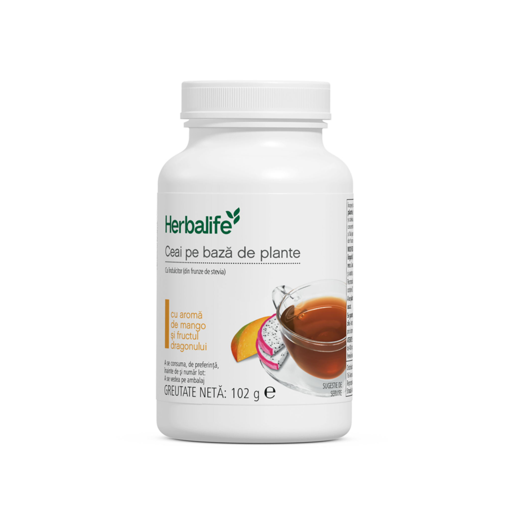
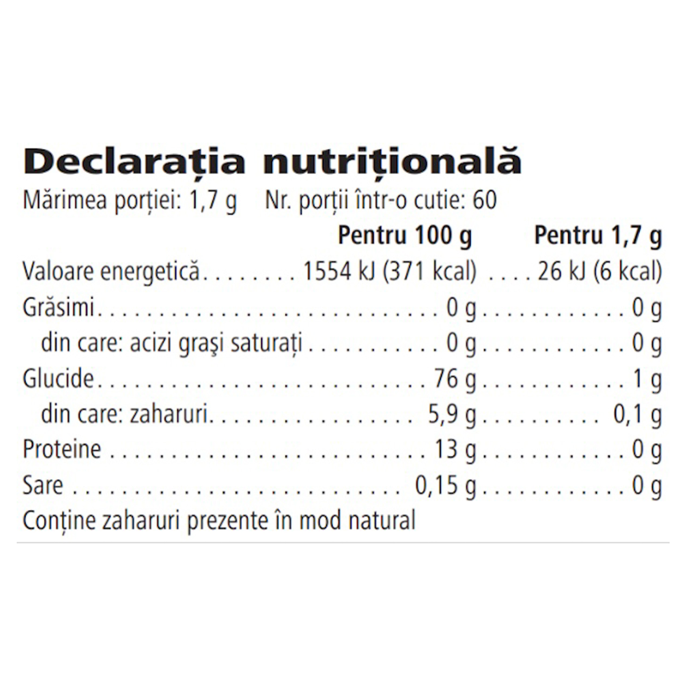

# Ceai pe bază de plante

*Aromă: Mango şi fructul dragonului · Mărime: 102 g · Cod: 331K*

O băutură instant revigorantă, cu un conținut scăzut de calorii, pe care o poți savura pe tot parcursul zilei.

## Prezentare generală

Ceaiul instant pe bază de plante este formulat cu un amestec unic de ceai negru tradițional Orange Pekoe, extract de ceai verde, pulbere de flori de Hibiscus și extract de semințe de cardamom. Ceaiul verde este, de asemenea, extras din apă pentru a-ți oferi același spectru de compuși la care te-ai aștepta de la ceaiurile verzi preparate în mod tradițional.

Această băutură pe bază de plante este perfectă pentru a-ți începe ziua cu energie sau pentru a o savura în timpul după-amiezii pentru un plus de energie. Cu un conținut scăzut de calorii, fiecare porție conține 87,5 mg de cafeină. Bucură-te de gustul revigorant al acestei băuturi pe bază de plante cu fiecare înghițitură. Fiecare ceașcă de Ceai pe bază de plante conține cafeină pentru a spori nivelul de atenție și concentrare\*.

Ceaiul instant pe bază de plante este disponibil într-o varietate de arome și poate fi savurat cald sau rece. Această băutură se prepară în câteva secunde, astfel încât să o poți savura din mers sau în confortul casei tale. Adaugă fructe de pădure sau citricele preferate și descoperă adevărata versatilitate a ceaiului instant pe bază de plante.

*\*Se recomandă să nu se depășească un aport zilnic de 400 mg de cafeină din toate sursele (200 mg pentru femeile însărcinate sau care alăptează). Nu trebuie să depășiți doza unică de 200 mg de cofeină (EFSA Journal 2015;13(5):4102. 2015).*

## Caracteristici

Ceai instant pe bază de plante:

- Furnizează 87,5 mg de cofeină per porție\*
- Are un conținut scăzut de calorii - doar 6 calorii per porție
- Este potrivit pentru vegetarieni și vegani
- Fără gluten
- Nu conține coloranți, îndulcitori sau arome artificiale
- Conține 60 de porții

*\*Se recomandă să nu se depășească un aport zilnic de 400 mg de cafeină din toate sursele (200 mg pentru femeile însărcinate sau care alăptează). Nu trebuie să depășiți doza unică de 200 mg de cofeină (EFSA Journal 2015;13(5):4102. 2015).*

## Ce este înăuntru

### Ingrediente

Maltodextrină, extract de frunze de ceai verde (*Camellia sinensis*L., 17,7 %), arome naturale, extract de frunze de ceai orange pekoe (*Camellia sinensis* L., 4,7 %), pudră de cafeină, îndulcitor (glicozide steviolice din stevia), pudră de flori de hibiscus, extract de semințe de cardamom.

### Informații nutriționale

## Cum se utilizează

Agită ușor recipientul înainte de fiecare utilizare. Se amestecă ½ linguriță (1,7 g) cu 200 - 240 ml de apă caldă sau rece. Savurează acest produs în cadrul unei diete echilibrate şi variate, ca parte a unui stil de viaţă activ şi sănătos. Consumă unul sau două pahare pe zi. O porție conține 87,5 mg de cafeină\*.

A se păstra cu capacul închis într-un loc răcoros și uscat.

Pentru o infuzie revigorantă, fierbe 1 litru de apă și adaugă fructele tale preferate. Adaugă 2,5 lingurițe de ceai instant pe bază de plante. O băutură caldă, reconfortantă, perfectă pentru a fi savurată într-o zi rece.

Pentru un ceai rece răcoritor, lasă 1 litru de apă la infuzat peste noapte cu rodie proaspătă și câteva felii de portocală. Se adaugă gheață și 2,5 lingurițe de ceai pe bază de plante. Cu o aromă revigorantă de citrice este băutura ideală pentru o zi toridă de vară.

*\*Se recomandă să nu se depășească un aport zilnic de 400 mg de cafeină din toate sursele (200 mg pentru femeile însărcinate sau care alăptează). Nu trebuie să depășiți doza unică de 200 mg de cafeină (EFSA Journal 2015;13(5):4102. 2015).*

---

*Alimentele prezentate în imagini și/sau videoclipuri sunt ilustrative și nu reprezintă conținutul produsului.*
