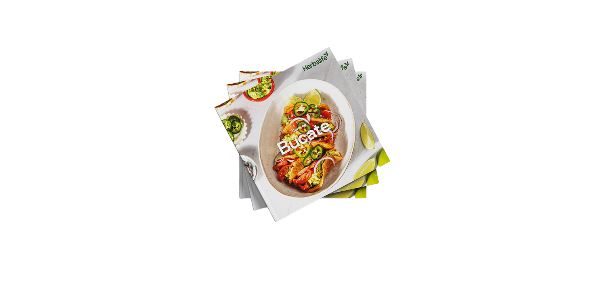

# Carte de bucate Herbalife Volumul 2

*Cod: 3C10*

Descoperă o colecție de 80 de rețete exclusiviste din Europa și Africa.

## Prezentare generală

O colecție de 80 de rețete unice din Europa și Africa care vor îmbunătăți modul în care gătești, mănânci și îți hrănești corpul. Cartea de bucate Herbalife Volumul 2 adună rețete care sunt ușoar de preparat, pline de aromă si care pun în evidență utilitatea variată a produselor noastre, încurajând în același timp o conexiune mai satisfăcătoare cu hrana, care va transforma modul în care pregătești, gătești și te bucuri de mese.

---

*Alimentele prezentate în imagini și/sau videoclipuri sunt ilustrative și nu reprezintă conținutul produsului.*
