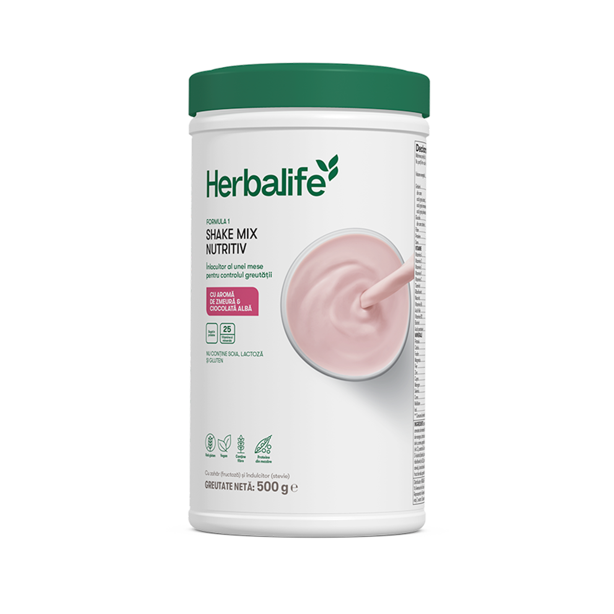
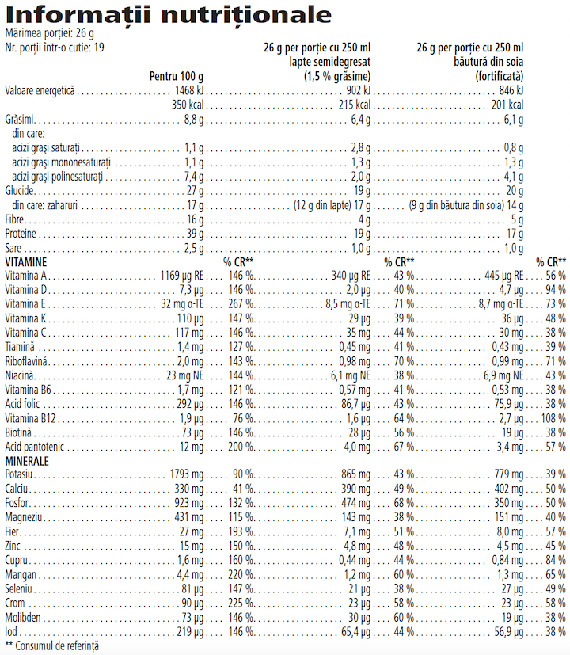

# Formula 1 Shake Mix Nutritiv

*Aromă: Zmeură & ciocolată albă · Mărime: 550 g · Cod: 4469*

Cel mai bine vândut și cel mai delicios shake înlocuitor de masă din gama noastră.

## Prezentare generală

Fie că dorești să îți gestionezi greutatea sau ai nevoie de o opțiune convenabilă pentru o nutriție echilibrată de zi cu zi, Formula 1 Shake Mix Nutritiv este soluția care oferă corpului tău ceea ce are nevoie, fără a face compromisuri în ceea ce privește gustul.\*

Produs din ingrediente 100 % vegane, Formula 1 Shake Mix Nutritiv oferă un amestec echilibrat de nutrienți cheie, inclusiv proteine pe bază de plante, carbohidrați, fibre, vitamine și minerale. Susține-ți obiectivele de control al greutății și îmbunătățește-ți starea de bine cu un shake care oferă nutriție de calitate.

Savurează acest shake ca o alternativă nutritivă la micul dejun, prânz sau cină. Formula 1 este conceput pentru a asigura obținerea echilibrului corect de nutrienți, menținând în același timp un control caloric.\*

Formula 1 Shake Mix Nutritiv se potrivește stilului tău de viață, indiferent de nevoile tale. Este disponibil într-o varietate de arome, pentru a satisface gusturile fiecăruia. Dacă ești în căutarea unei variante delicioase, ușor de preparat, oriunde te-ai afla, pentru controlul greutății sau starea ta de bine de zi cu zi, Formula 1 îți oferă soluția. Formula 1 Shake Mix Nutritiv este, de asemenea, deosebit de versatil. Personalizează-ți shake-ul cu un plus de proteine folosind suplimentele noastre proteice Protein Drink Mix și Formula 3 Pudră Proteică Personalizată, sau adaugă fructele și legumele tale preferate pentru un plus de varietate nutritivă.\*\*

*\*Formula 1 Shake Mix Nutritiv este un înlocuitor de masă pentru o dietă cu un conținut caloric controlat. Furnizează cantitatea necesară de nutrienți în ceea ce privește vitaminele și mineralele, proteinele și fibrele.*

*\*\*Valorile nutriționale sunt aplicabile doar atunci când produsul este preparat conform instrucțiunilor de pe etichetă.*

## Caracteristici

Formula 1 Shake Mix Nutritiv cu aromă de Zmeură & ciocolată albă:

- Formulă cu proteine din mazăre
- Furnizează 19 g de proteine de înaltă calitate per porție (17 g de proteine per porție atunci când se prepară cu băutură din soia fortificată)
- Conține 25 de vitamine și minerale cheie
- Conține ingrediente din surse vegane
- Fără gluten, soia și lactoză\*
- Fără coloranți artificiali
- Conține îndulcitor din sursă naturală
- Conține 19 porții

*\*Acest produs nu conține soia și gluten atunci când este preparat cu lapte de vacă și nu conține lactoză și gluten atunci când este preparat cu băutură din soia. Acest produs nu conține lactoză, gluten, soia și este potrivit pentru vegani atunci când este preparat cu o băutură pe bază de plante. Dar nu va fi un înlocuitor de masă.*

## Ce este înăuntru

### Ingrediente

Izolat proteic din mazăre (45 %), fructoză, inulină, fibre din **ovăz** fără gluten, ulei de șofrănel, fosfat de potasiu, amestec de minerale (citrat de calciu, oxid de magneziu, fumarat feros, selenit de sodiu, oxid de zinc, clorură de crom (III), carbonat de mangan, citrat de cupru, iodură de potasiu, molibdat de sodiu), emulsifiant (lecitină din floarea soarelui), pudră de semințe de in, arome, agenți de îngroșare (gumă de xantan, gumă de guar), colorant (roșu sfeclă), amestec de vitamine (acid L-ascorbic (vit. C), acetat de DL-alfa-tocoferil (vit. E), nicotinamidă (niacină), acetat de retinil (vit. A), D-pantotenat de calciu (acid pantotenic), D-biotină (biotină), colecalciferol (vit. D), acid pteroilmonoglutamic (acid folic), filochinonă (vit. K), clorhidrat de piridoxină (vit. B6), riboflavină (vit. B2), clorhidrat de tiamină (vit. B1), ciancobalamină (vit. B12)), aromă naturală, îndulcitor (glicozide steviolice din stevia), clorură de sodiu, l-metionină, pudră de fruct de papaya, pudră de ierburi de pătrunjel, pudră de fructe de afine, pudră de fruct de rodie, agent antiaglomerant (dioxid de siliciu). Îndulcitor din sursă naturală.

### Informații despre alergeni

CONȚINE OVĂZ.

### Informații nutriționale

## Cum se utilizează

Savurează un Formula 1 Shake Mix Nutritiv în fiecare zi, echivalent cu o masă nutritivă. Agită ușor recipientul înainte de fiecare utilizare, deoarece conținutul se poate sedimenta. Pentru a pregăti un shake delicios, amestecă două măsuri de pulbere (26 g) cu 250 ml de lapte rece, semidegresat (1,5 % grăsime). Pentru un shake vegan și fără lactoză în mod natural, prepară cu 250 ml de băutură din soia fortificată. Îți dorești o masă echilibrată fără să folosești lapte sau băutură din soia? Încearcă Formula 1 cu Protein Drink Mix și apă. Formula 1 Shake mix nutritiv se savurează cel mai bine atunci când este pregătit cu gheață. Adaugă 250 ml de băutură din soia fortificată sau lapte semidegresat într-un blender, 3 – 4 cuburi de gheață și două măsuri de Formula 1 Shake Mix Nutritiv și amestecă până la omogenizare. Savurează acest produs în cadrul unei diete echilibrate şi variate, ca parte a unui stil de viaţă sănătos și activ.

A se păstra cu capacul închis într-un loc răcoros și uscat.

**Pentru controlul greutății:** Substituirea cu înlocuitori de masă a două mese principale zilnice din cadrul unei diete hipocalorice contribuie la pierderea în greutate. Înlocuiește două mese pe zi cu câte un shake delicios Formula 1 și consumă o singură masă echilibrată.

**Pentru o alimentație echilibrată și menținerea greutății:** Substituirea uneia dintre mesele principale zilnice din cadrul unei diete hipocalorice cu un înlocuitor de masă contribuie la menținerea greutății corporale după pierderea în greutate. Înlocuiește o masă pe zi cu un shake delicios Formula 1 și consumă două mese echilibrate.

Acest produs este destinat să fie utilizat numai ca parte a unei diete cu valoare energetică redusă, alături de alte alimente care constituie componente necesare ale unei astfel de diete, în combinație cu o activitate fizică regulată. Este important să se consume zilnic o cantitate corespunzătoare de lichide. Este important să se respecte întocmai aceste instrucțiuni.

---

*Alimentele prezentate în imagini și/sau videoclipuri sunt ilustrative și nu reprezintă conținutul produsului.*
