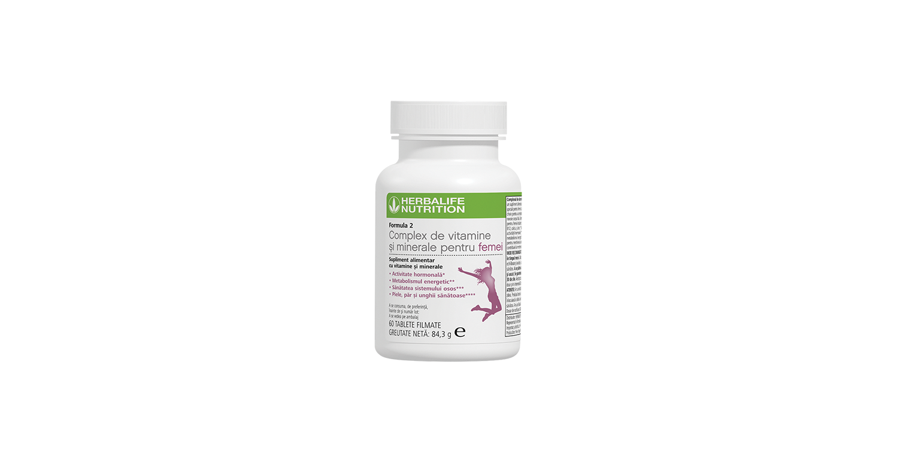
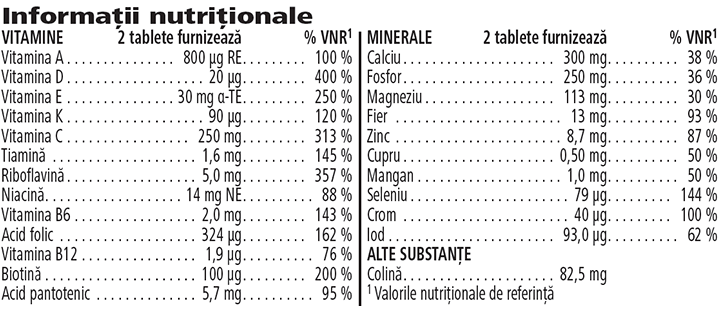

# Formula 2 Complex de Vitamine și Minerale pentru femei

*Mărime: 60 tablete · Cod: 1819*

Supliment alimentar zilnic special conceput pentru femei.

## Prezentare generală

Formula 2 Complex de Vitamine și Minerale pentru femei este un supliment alimentar dezvoltat de experți, adaptat nevoilor nutriționale unice ale femeilor.

Formula 2 Complex de vitamine și minerale pentru femei  este un supliment alimentar complet, dezvoltat de experți și susținut de știință. Formulat special pentru femei, fiecare comprimat este conceput pentru a furniza 24 de micronutrienți cheie pentru a susține nevoile corpului tău. Complexul de vitamine și minerale pentru femei conține un amestec de nutrienți cheie ce contribuie la reglarea activității hormonale (vitamina B6), la metabolismul energetic normal (vitamina B12), la mentinerea sănătății sistemului osos (calciu) și la menținerea sănătății pielii, părului și unghiilor (zinc).

Complexul de vitamine și minerale pentru femei este un supliment alimentar complet, creat pentru a-ți sprijini starea generală de bine și gândit să funcționeze în armonie cu shake-ul tău preferat Formula 1. Include-l cu ușurință în rutina ta zilnică și obține micronutrienții cheie de care are nevoie corpul tău.

## Caracteristici

Formula 2 Complex de Vitamine și Minerale pentru femei:

- Furnizează 24 de vitamine și minerale cheie
- Conține vitamina B6
- Conține vitamina B12
- Conține calciu
- Conține zinc
- Este creat special pentru femei
- Conține 60 de tablete filmate

## Ce este înăuntru

### Ingrediente

Mix de vitamine și minerale (fosfat dicalcic, acid L-ascorbic, fosfați de magneziu, bitartrat de colină, oxid de magneziu, acetat de DL-alfa-tocoferil, carbonat de calciu, fumarat feros, beta-caroten, nicotinamidă, colecalciferol, D-biotină, oxid de zinc, palmitat de retinil, D-pantotenat de calciu, selenit de sodiu, riboflavină, acid pteroilmonoglutamic, clorură de crom (III), sulfat de mangan, filochinonă, clorhidrat de piridoxină, ciancobalamină, mononitrat de tiamină, sulfat de cupru, iodură de potasiu), agent de încărcare (celuloză microcristalină), învelișul tabletei [agent de glazurare (hidroxipropilmetilceluloză), coloranţi (carbonat de calciu, oxid de fier roșu), agent antiaglomerant (acizi grași), agent de încărcare (celuloză microcristalină)], agenți antiaglomeranți (carboximetilceluloză de sodiu reticulată, acizi grași, săruri de magneziu ale acizilor grași, dioxid de siliciu), stabilizator (polietilenglicol).

### Informații nutriționale

## Cum se utilizează

Ia 1-2 tablete zilnic, în timpul mesei\*.

Utilizează acest produs în cadrul unei diete echilibrate şi variate, ca parte a unui stil de viaţă activ şi sănătos.

A se păstra cu capacul închis într-un loc răcoros și uscat.

*\*A nu se depăși doza zilnică recomandată. Suplimentele alimentare sunt destinate să completeze dieta și nu ar trebui folosite pentru a înlocui o dietă variată. A nu se păstra la îndemâna și la vederea copiilor mici.*

---

*Alimentele prezentate în imagini și/sau videoclipuri sunt ilustrative și nu reprezintă conținutul produsului.*
