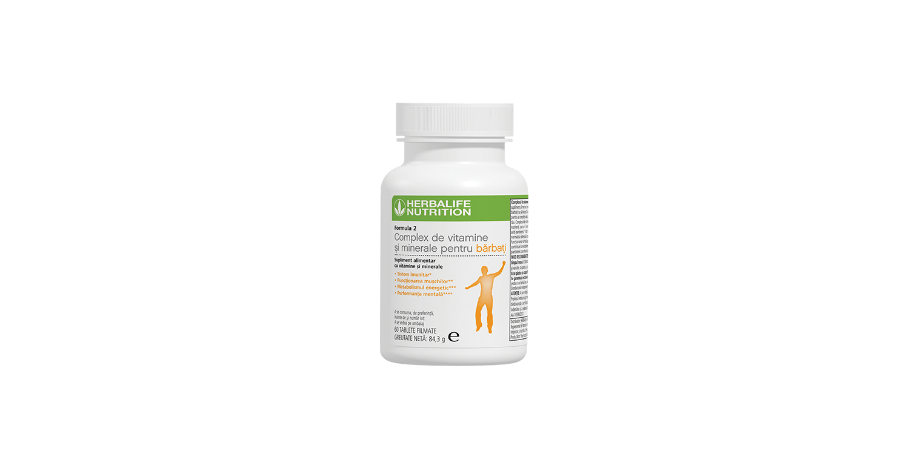
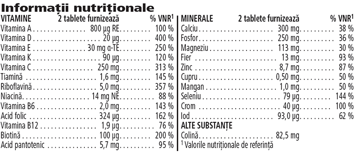

# Formula 2 Complex de Vitamine și Minerale pentru bărbați

*Mărime: 60 tablete · Cod: 1800*

Supliment alimentar zilnic special formulat pentru bărbați.

## Prezentare generală

Complexul de vitamine și minerale Formula 2 pentru bărbați este un supliment alimentar dezvoltat de experți, adaptat nevoilor nutriționale unice ale bărbaților.

Formula 2 Complex de vitamine și minerale pentru bărbați este un supliment alimentar complet, dezvoltat de experți și susținut de știință. Formulat special pentru bărbați, fiecare tabletă este concepută pentru a furniza 24 de micronutrienți cheie pentru a susține nevoile corpului tău. Complexul de vitamine și minerale Formula 2 pentru bărbați conține un amestec de nutrienți cheie ce contribuie la funcționarea normală a sistemului imunitar (vitamina A și vitamina C), la funcționarea normală a sistemului muscular (magneziu), la metabolismul energetic normal (riboflavina) și la performanța mentală normală (acid pantotenic).

Complexul de vitamine și minerale pentru bărbați este un supliment alimentar complet, creat pentru a-ți sprijini starea generală de bine și gândit să funcționeze în armonie cu shake-ul tău preferat Formula 1. Include-l cu ușurință în rutina ta zilnică și obții micronutrienții cheie de care are nevoie corpul tău.

## Caracteristici

Formula 2 Complex de Vitamine și Minerale pentru bărbați:

- Furnizează 24 de vitamine și minerale cheie
- Conține vitaminele A și C
- Conține magneziu
- Conține riboflavină
- Conține acid pantotenic
- Este special creat pentru bărbați
- Conține 60 tablete filmate

## Ce este înăuntru

### Ingrediente

Mix cu vitamine și minerale (fosfat dicalcic, fosfați de magneziu, acid L-ascorbic, bitartrat de colină, acetat de DL-alfa-tocoferil, carbonat de calciu, oxid de magneziu, fumarat feros, beta-caroten, nicotinamidă, palmitat de retinil, colecalciferol, D-biotină, oxid de zinc, D-pantotenat de calciu, selenit de sodiu, riboflavină, clorură de crom (III), sulfat de mangan, clorhidrat de piridoxină, ciancobalamină, mononitrat de tiamină, filochinonă, acid pteroilmonoglutamic, sulfat de cupru, iodură de potasiu), agent de încărcare (celuloză microcristalină), învelișul tabletei [agent de glazurare (hidroxipropilmetilceluloză), coloranţi (carbonat de calciu, oxid de fier galben), agenti antiaglomeranti (acizi grași), agent de încărcare (celuloză microcristalină)], agenți antiaglomeranți (carboximetilceluloză de sodiu reticulată, acizi grași, săruri de magneziu ale acizilor grași, dioxid de siliciu), stabilizator (polietilenglicol).

### Informații nutriționale

## Cum se utilizează

Ia 1 până la 2 comprimate pe zi, în timpul meselor\*.

Utilizează acest produs în cadrul unei diete echilibrate şi variate, ca parte a unui stil de viaţă activ şi sănătos.

A se păstra cu capacul închis într-un loc răcoros și uscat.

*\*A nu se depăși doza zilnică recomandată. Suplimentele alimentare sunt destinate să completeze dieta și nu ar trebui folosite pentru a înlocui o dietă variată. A nu se lăsa la îndemâna și vederea copiilor mici.*

---

*Alimentele prezentate în imagini și/sau videoclipuri sunt ilustrative și nu reprezintă conținutul produsului.*
