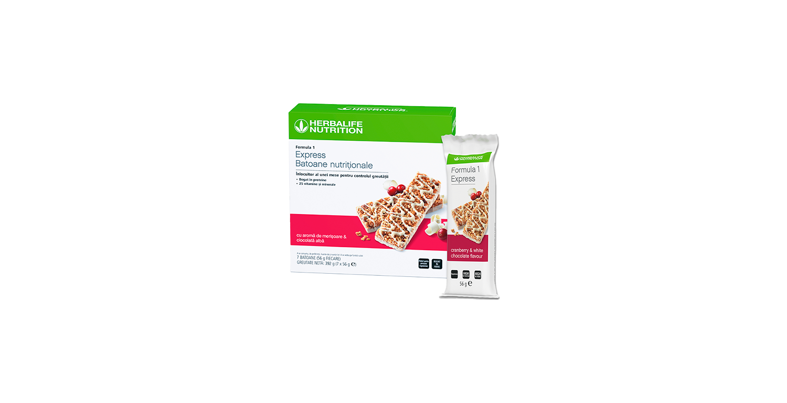
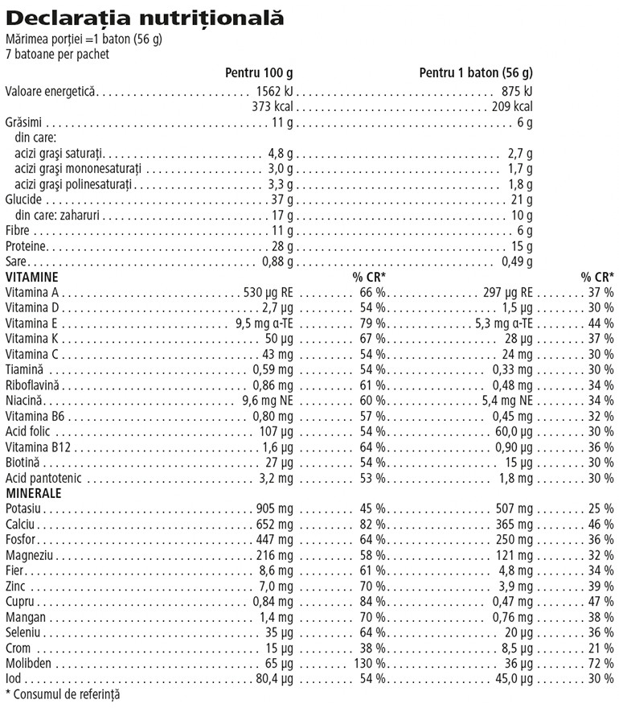

# Formula 1 Express Batoane Nutriționale

*Aromă: Merișoare și ciocolată albă · Mărime: 7 batoane · Cod: 4473*

Baton înlocuitor de masă care te ajută să-ți menții obiectivele nutriționale oriunde te-ai afla.

## Prezentare generală

Chiar dacă ești în deplasare, nu trebuie să faci compromisuri în ceea ce privește nutriția. Batonul Formula 1 Express este o modalitate delicioasă de a te bucura de o masă echilibrată și nutritivă oricând și oriunde\*.

Cu proteine de înaltă calitate și vitamine și minerale cheie, acest baton delicios te ajută mai mult ca niciodată să-ți menții obiectivele nutriționale.

Nu vei mai rata nici o masă. Fie că ești la sală, la birou sau în aer liber, Batonul nutrițional Formula 1 Express este partenerul tău perfect. Bucură-te de o masă nutritivă și echilibrată oriunde te-ai afla\*.

*\*Formula 1 Express Batoane Nutriționale este un înlocuitor de masă pentru o dietă cu un conținut caloric controlat. Oferă cantitatea necesară de nutrienți în ceea ce privește vitaminele și mineralele, proteinele și fibrele.*

## Caracteristici

Batonul nutrițional Formula 1 Express:

- Furnizează 15 g de proteine
- Conține 25 de vitamine și minerale cheie
- Furnizează 6 g de fibre
- Este potrivit pentru vegetarieni
- Nu conține coloranți artificiali
- Disponibil la cutie cu 7 batoane

## Ce este înăuntru

### Ingrediente

**Soia** crocantă (24,4 %) (izolat proteic din **soia**, amidon de tapioca, sare), sirop de glucoză, înveliș de ciocolată albă (12,5 %) (zahăr, unt de cacao, **lapte** praf integral, emulsifiant (lecitine (**soia**)), aromă naturală), granule de **soia** (11,6 %), Promitor® fibre, agent de umezire (glicerol), merișoare confiate (4,1 %) (merișoare (2,2 %), zahăr, ulei de floarea-soarelui), boabe de cacao zdrobite, maltodextrină, fructoză, amestec de minerale (carbonat de calciu, fosfați de potasiu, clorură de potasiu, oxid de magneziu, pirofosfat feric, oxid de zinc, selenit de sodiu, sulfat de mangan, gluconat de cupru, iodură de potasiu), arome naturale, uleiuri vegetale (rafinate complet de floarea-soarelui și/ sau soia), corector de aciditate (acid citric), clorură de sodiu, amestec de vitamine (vitamina C (acid L-ascorbic), vitamina E (acetat de DL-alfa-tocoferil), niacină (nicotinamidă), vitamina A (acetat de retinil), acid pantotenic (D-pantotenat de calciu), biotină (D-biotină), vitamina B12 (ciancobalamină), vitamina D (colecalciferol), vitamina B6 (clorhidrat de piridoxină), tiamina (mononitrat de tiamină), vitamina K (filochinonă), riboflavină, acid folic (acid pteroilmonoglutamic)).

### Informații despre alergeni

CONȚINE SOIA ȘI LAPTE. POATE CONȚINE OUĂ, CEREALE CARE CONȚIN GLUTEN, FRUCTE CU COAJĂ LEMNOASĂ, ARAHIDE, SEMINȚE DE SUSAN.

### Informații nutriționale

## Cum se utilizează

Bucură-te în fiecare zi de o masă nutritivă cu Formula 1 Express Batoane Nutriționale. Savurează acest produs în cadrul unei diete echilibrate şi variate, ca parte a unui stil de viaţă sănătos și activ.

A se păstra într-un loc răcoros şi uscat.

**Pentru controlul greutății:** Substituirea cu înlocuitori de masă a două mese principale zilnice din cadrul unei diete hipocalorice contribuie la pierderea în greutate. Înlocuiește două mese pe zi cu câte un baton delicios Formula 1 Express şi consumă o singură masă echilibrată.

**Pentru o alimentație echilibrată și menținerea greutății:** Substituirea uneia dintre mesele principale zilnice din cadrul unei diete hipocalorice cu un înlocuitor de masă contribuie la menținerea greutății corporale după pierderea în greutate. Înlocuiește o masă pe zi cu un baton delicios Formula 1 Express şi consumă două mese echilibrate.

Acest produs este destinat să fie utilizat numai ca parte a unei diete cu valoare energetică redusă, alături de alte alimente care constituie componente necesare ale unei astfel de diete, în combinaţie cu o activitate fizică regulată. Este important să se consume zilnic o cantitate corespunzătoare de lichide. Este important să se respecte întocmai aceste instrucţiuni.

---

*Alimentele prezentate în imagini și/sau videoclipuri sunt ilustrative și nu reprezintă conținutul produsului.*
