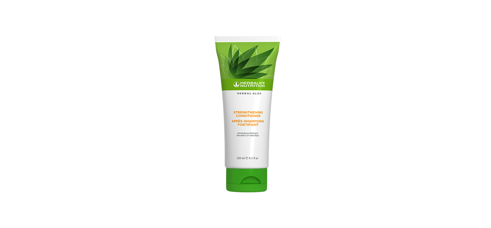

# Herbal Aloe Balsam pentru întărirea părului

*Mărime: 250 ml · Cod: 2565*

Fortifică, hrănește și hidratează-ți părul.

## Prezentare generală

Oferă părului tău îngrijirea pe care o merită cu balsamul Herbal Aloe pentru întărirea părului.

Balsamul Herbal Aloe pentru întărirea părului este creat de experți cu *Aloe vera* și extracte botanice selectate pentru a-ți hrăni și hidrata în profunzime părul. Această formulă care ajută la menținerea culorii este, de asemenea, creată cu proteine hidrolizate din grâu pentru a ajuta la protejarea, repararea și întărirea părului, lăsându-l mai moale și mătăsos doar după o singură utilizare\*.

Indiferent dacă părul tău este drept, creț, ondulat sau buclat, balsamul Herbal Aloe pentru întărirea părului este potrivit pentru toate tipurile de păr. Bucură-te de hidratarea profundă și aromele revigorante ale unui balsam care este creat pentru a oferi părului tău hidratarea de care are nevoie.

*\*Când este utilizat împreună cu șamponul pentru întărirea părului, comparativ cu părul netratat. Rezultate obținute în urma studiului privind întărirea, precum și deteriorarea firelor de păr. Valoare medie obținută în urma testelor la periaj, realizate de un laborator independent, pentru firele de păr deteriorate. Numărul de fibre rupte a fost comparat cu părul care nu a utilizat șamponul și balsamul Herbal Aloe pentru întărirea părului.*

## Caracteristici

Herbal Aloe Balsam pentru întărirea părului:

- Este formulat cu *Aloe vera* și extracte botanice
- Este formulat cu proteine hidrolizate din grâu
- Hrănește și hidratează părul
- Formulă care păstrează culoarea
- Este potrivit pentru bărbați și femei
- Nu are parabeni adăugați
- Este testat dermatologic

## Ce este înăuntru

### Ingrediente

Aqua, Cetyl Alcohol, Distearoylethyl Dimonium Chloride, Cetearyl Alcohol, Stearamidopropyl Dimethylamine, Parfum, Bis-Hydroxy/Methoxy Amodimethicone, *Aloe Barbadensis* Leaf Juice, Hydrolyzed Wheat Protein, Behentrimonium Chloride, *Yucca Schidigera* Leaf/Root/Stem Extract, *Artemisia Tridentata* Extract, *Simmondsia Chinensis* Seed Extract, *Silybum Marianum* Seed Extract, *Salvia Hispanica* Seed Extract, *Agave Americana* Leaf Extract, Glycerin, Guar Hydroxypropyltrimonium Chloride, Citric Acid, Phenoxyethanol, Ethylhexylglycerin, Benzyl Alcohol, Citronellol, Limonene, Hexyl Cinnamal and Linalool.

## Cum se utilizează

Aplică o cantitate generoasă pe părul umed. Masează uniform pe păr sau concentrează-te pe lungime și vârfuri, acolo unde părul tău are cea mai mare nevoie de hidratare. Lasă balsamul să acționeze 2-3 minute, apoi clătește bine și coafează-ți părul ca de obicei.

Pentru cele mai bune rezultate, utilizează împreună cu Herbal Aloe Șampon pentru întărirea părului.

---

*Alimentele prezentate în imagini și/sau videoclipuri sunt ilustrative și nu reprezintă conținutul produsului.*
