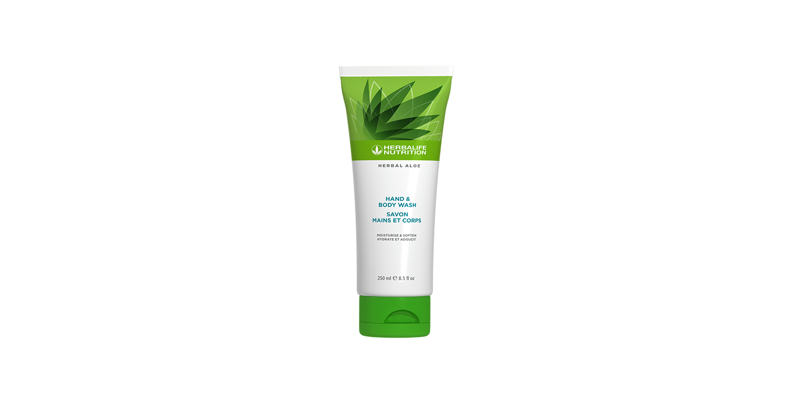

# Herbal Aloe Gel de curăţare pentru mâini şi corp

*Mărime: 250 ml · Cod: 2561*

Curăță, revigorează și reîmprospătează-ți pielea.

## Prezentare generală

Evită să folosești săpunul obișnuit și oferă pielii tale îngrijirea delicată și hidratantă de care are nevoie, cu gelul de curăţare pentru mâini și corp Herbal Aloe.

Indiferent de tipul de piele, acest gel de curățare cu multiple utilizări este conceput pentru a îngriji și curăța pielea din cap până-n picioare. Formulat cu *Aloe vera* și un amestec de extracte botanice din deșert, gelul de duș Herbal Aloe pentru mâini și corp, ajută la ameliorarea senzației de uscăciune și oferă hidratare pe tot parcursul zilei pentru pielea ta. Acest produs de curățare delicat are un parfum subtil și nu are adaos de sulfați, parabeni, coloranți sau materii colorante.

Folosește Herbal Aloe gelul de curățare pentru mâini și corp pe tot parcursul zilei, spumează și oferă pielii tale îngrijirea pe care o merită.

## Caracteristici

Herbal Aloe Gel de curăţare pentru mâini şi corp:

- Este formulat cu *Aloe vera* și un amestec de extracte botanice din deșert
- Oferă hidratare pielii pe tot parcursul zilei
- S-a demonstrat că lasă pielea mai fină și mai catifelată cu până la 100%
- Ajută la ameliorarea senzației de uscăciune și la hidratarea profundă a pielii
- Este potrivit pentru utilizarea zilnică
- Este potrivit pentru bărbați și femei
- Nu conține parabeni sau sulfați
- Este testat dermatologic

## Ce este înăuntru

### Ingrediente

Aqua, Sodium Cocoyl Isethionate, Cocamidopropyl Betaine, Glycerin, *Aloe Barbadensis* Leaf Juice, Parfum, Sodium Cocoyl Apple Amino Acids, Olive Oil Peg-7 Esters, Leuconostoc/Radish Root Ferment Filtrate, *Chamomilla Recutita* Flower Extract, *Yucca Schidigera* leaf/root/stem extract, *Artemisia Tridentata* Extract, *Simmondsia Chinensis* Seed Extract, *Silybum Marianum* Seed Extract, *Salvia Hispanica* Seed Extract, *Agave Americana* Leaf Extract, Glycol Distearate, Disteareth-75 IPDI, Laureth-4, Phenoxyethanol, Ethylhexylglycerin, Benzyl Alcohol, Citronellol, Limonene, Hexyl Cinnamal and Linalool.

## Cum se utilizează

Distribuie o cantitate mică de Herbal Aloe Gel de curăţare pentru pe pielea umedă și spumează ușor. Clătește bine.

Folosește zilnic în timpul băii. Pentru spălarea mâinilor, utilizează pe tot parcursul zilei. Pentru cele mai bune rezultate, folosește împreună cu Herbal Aloe Loțiune pentru mâini și corp.

---

*Alimentele prezentate în imagini și/sau videoclipuri sunt ilustrative și nu reprezintă conținutul produsului.*
