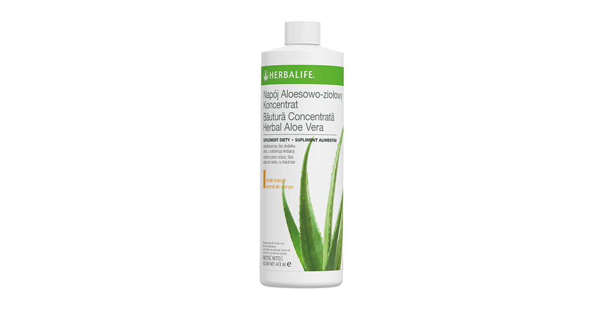
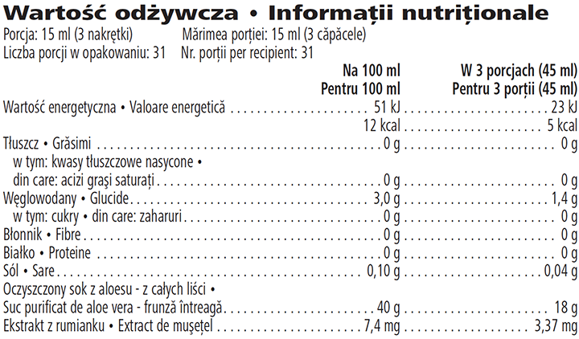

# Băutură Concentrată Herbal Aloe Vera

*Aromă: Mango · Mărime: 473 ml · Cod: 1065*

​​Un supliment răcoritor cu un conținut scăzut de calorii, formulat cu suc de Aloe vera de înaltă calitate.​

## Prezentare generală

Oferă apei tale o aromă delicioasă cu Băutura Concentrată Herbal Aloe Vera. Această băutură concentrată cu aromă subtilă, are un conținut scăzut de calorii, conține suc de *Aloe vera* de înaltă calitate și este concepută pentru a te ajuta să-ți satisfaci necesarul de hidratare.

Băutura Concentrată Herbal Aloe Vera conține 40 % suc de Aloe vera presat la rece care este derivat din întreaga frunză de aloe. Frunzele de Aloe vera sunt culese manual și pregătite pentru a-ți oferi un produs de înaltă calitate.

Bucură-te de gustul delicat al Băuturii Concentrate Herbal Aloe Vera. Pur și simplu adaugă în apă pentru a obține o băutură răcoritoare cu aloe care este garantată să devină un element de bază în rutina zilnică.

## Caracteristici

Băutură Concentrată Herbal Aloe Vera:

- Conține 40 % suc de *Aloe vera* presat la rece, derivat din frunze întregi
- Conținut scăzut în calorii – doar 2 calorii pe porție
- Este potrivită pentru vegetarieni și vegani
- Nu are coloranți artificiali
- Fără zahăr
- Conține 31 porții

## Ce este înăuntru

### Ingrediente

Apă, suc purificat de *Aloe vera* – frunză întreagă (*Aloe barbadensis*, 40 %), corector de aciditate (acid citric), aromă, conservanți (sorbat de potasiu, benzoat de sodiu), îndulcitor (sucraloză), extract de muşeţel (*Matricaria chamomilla*).

### Informații nutriționale

## Cum se utilizează

Bucură-te de gustul răcoritor al băuturii concentrate Herbal Aloe Vera, dimineața sau pe tot parcursul zilei, consumând până la 3 porții pe zi.\* Agită bine înainte de utilizare și adaugă 3 căpăcele de băutură concentrată Herbal Aloe Vera (15 ml) în 120 ml de apă. Pentru a prepara 1 litru de băutură concentrată Herbal Aloe Vera gata de consum, pune 8 linguri (120 ml) de concentrat într-un recipient de un litru și umple cu apă. Refrigerează orice porție neutilizată. Bucură-te de acest produs într-o dietă echilibrată și variată, ca parte a unui stil de viață activ și sănătos.

Dacă recipientul nu este deschis, păstrează-l într-un loc răcoros și uscat. Pune la frigider orice produs neutilizat după ce flaconul a fost deschis și consumă-l în termen de 30 de zile.

*\*Nu depăşi doza zilnică recomandată. Suplimentele alimentare sunt destinate să completeze dieta și nu trebuie utilizate ca înlocuitor pentru o dietă variată. A nu se lăsa la îndemâna şi vederea copiilor mici.*

---

*Alimentele prezentate în imagini și/sau videoclipuri sunt ilustrative și nu reprezintă conținutul produsului.*
