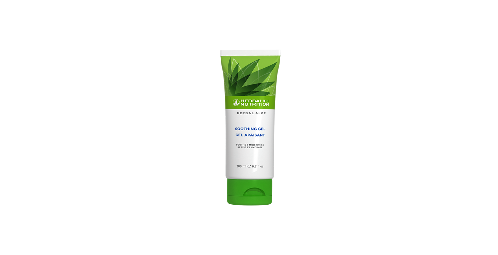

# Herbal Aloe Gel calmant

*Mărime: 200 ml · Cod: 2562*

Catifelează, hidratează și calmează pielea.

## Prezentare generală

Hrănește-ți pielea din exterior spre interior și simte beneficiile calmante ale *Aloe vera*.

Herbal Aloe Gel calmant este formulat cu *Aloe vera* de înaltă calitate pentru a calma și a hidrata delicat pielea ta. Fără adaos de substanțe chimice dure, parabeni sau parfumuri artificiale, acest gel delicat este infuzat cu un amestec de plante care ajută la hidratarea și hrănirea pielii.

Menține-ți sănătatea pielii cu Herbal Aloe Gel calmant, o formulă versatilă, fără parfum și cu absorbție rapidă, perfectă pentru utilizarea zilnică.

## Caracteristici

Herbal Aloe Gel calmant:

- Este formulat cu *Aloe vera* și extracte botanice
- Asigură hidratarea pielii pe toată durata zilei
- S-a demonstrat că lasă pielea mai netedă și mai catifelată până la 100%
- Nu conține parfum
- Este potrivit pentru utilizarea zilnică
- Este potrivit pentru bărbați și femei
- Nu conține parabeni adăugați
- Este testat dermatologic

## Ce este înăuntru

### Ingrediente

Aqua, *Aloe Barbadensis* Leaf Juice, Glycerin, *Chamomilla Recutita* Flower Extract, *Yucca Schidigera* leaf/root/stem extract, *Artemisia Tridentata* Extract, *Simmondsia Chinensis* Seed Extract, *Silybum Marianum* Seed Extract, *Salvia Hispanica* Seed Extract, *Agave Americana* Leaf Extract, Carbomer, Triethanolamine, Phenoxyethanol and Ethylhexylglycerin.

## Cum se utilizează

Aplică o cantitate generoasă de Herbal Aloe Gel calmant pe pielea curată și uscată. Masează ușor până se absoarbe.

Potrivit pentru utilizare zilnică - aplică atunci când este nevoie.

---

*Alimentele prezentate în imagini și/sau videoclipuri sunt ilustrative și nu reprezintă conținutul produsului.*
