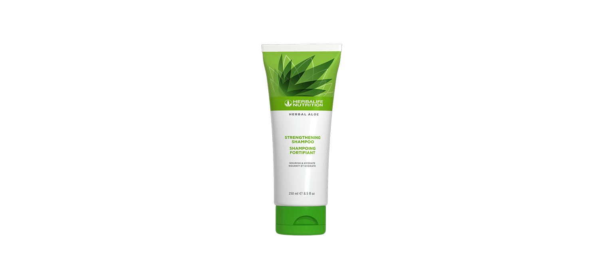

# Herbal Aloe Șampon pentru întărirea părului

*Mărime: 250 ml · Cod: 2564*

Întărește, repară și protejează-ți părul.

## Prezentare generală

Oferă-i părului tău îngrijirea pe care o merită cu șamponul Herbal Aloe.

Șamponul pentru întărirea părului Herbal Aloe, reduce numărul de fire rupte cu 90%, lăsând părul de 10 ori mai puternic după o singură utilizare\*.

Formulat de experți cu *Aloe vera* și extracte botanice selectate, acest șampon curăță delicat, dar eficient. Îndepărtează murdăria, excesul de ulei și reziduurile de produs fără a face părul să se simtă uscat sau fragil. Această formulă care ajută la menținerea culorii este, de asemenea, realizată folosind proteină de grâu hidrolizată pentru a ajuta la protejarea, repararea și întărirea firului de păr.

De la părul subțire până la părul gros, de la părul drept până la părul ondulat, șamponul Herbal Aloe pentru întărirea părului este potrivit pentru toate tipurile de păr.

*\*Când este utilizat în combinație cu balsamul pentru întărirea părului, comparativ cu părul netratat. Rezultate obținute în urma Studiului privind întărirea, precum și deteriorarea firelor de păr. Valoare medie obținută în urma testelor la periaj, realizate de un laborator independent, pentru firele de păr deteriorate. Numărul de fibre rupte a fost comparat pe părul netratat cu șamponul și balsamul pentru întărirea părului Herbal Aloe.*

## Caracteristici

Herbal Aloe Șampon pentru întărirea părului:

- Este formulat cu *Aloe vera* și extracte botanice
- Este formulat cu proteine hidrolizate din grâu
- Reduce numărul de fire rupte cu 90%
- Hrănește și hidratează părul
- Formulă care protejează culoarea
- Este potrivit pentru bărbați și femei
- Nu are parabeni sau sulfați adăugați
- Este testat dermatologic

## Ce este înăuntru

### Ingrediente

Aqua, Sodium Cocoyl Isethionate, Cocamidopropyl Betaine, Parfum, *Aloe Barbadensis* Leaf Juice, Hydrolyzed Wheat Protein, *Yucca Schidigera* Leaf/Root/Stem Extract, *Artemisia Tridentata* Extract, *Simmondsia Chinensis* Seed Extract, *Silybum Marianum* Seed Extract, *Salvia Hispanica* Seed Extract, *Agave Americana* Leaf Extract, Glycerin, Guar Hydroxypropyltrimonium Chloride, Silicone Quaternium-16, Undeceth-11, Butyloctanol, Undeceth-5, Glycol Distearate, Laureth-4, PEG-150 Distearate, Citric Acid, Triethanolamine, Phenoxyethanol, Ethylhexylglycerin, Benzyl Alcohol, Citronellol, Limonene, Hexyl Cinnamal and Linalool.

## Cum se utilizează

Udă-ți părul complet. Aplică o cantitate generoasă pe scalp și păr și masează ușor pentru a obține o spumă bogată. Clătește bine cu apă caldă.

Pentru cele mai bune rezultate, utilizează împreună cu Herbal Aloe Balsam pentru întărirea părului.

---

*Alimentele prezentate în imagini și/sau videoclipuri sunt ilustrative și nu reprezintă conținutul produsului.*
