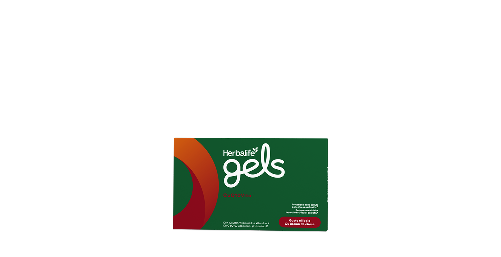
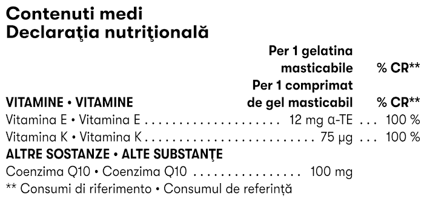

# Herbalife Gels CoQ10Vita

*Aromă: Cireșe · Mărime: 30 de comprimate de gel masticabile · Cod: 378K*

Un supliment delicios, sub formă de comprimate de gel masticabile, bogat în CoQ10, vitamina E și vitamina K.

## Prezentare generală

Susține sănătatea inimii cu Herbalife Gels CoQ10Vita.

CoQ10Vita este un supliment delicios sub formă de comprimate de gel masticabile, îmbogățit cu CoQ10 și vitamine esențiale. Acest supliment fără zahăr combină beneficiile CoQ10, vitaminei E și vitaminei K pentru a susține protecția celulelor împotriva stresului oxidativ1, coagularea normală a sângelui2 și menținerea sănătății sistemului osos.2 CoQ10 este esențială pentru producția de energie, în special în inimă, motiv pentru care CoQ10Vita este o alegere excelentă pentru menținerea sănătății tale. Herbalife Gels CoQ10Vita sunt comprimate de gel masticabile, delicioase și fără zahăr, cu arome și coloranți proveniți din surse naturale.

*1Vitamina E contribuie la protecția celulelor împotriva stresului oxidativ*

*2Vitamina K contribuie la coagularea normală a sângelui și la menținerea sănătății sistemului osos*

## Caracteristici

Herbalife Gels CoQ10Vita:

- Conține CoQ10, care susține producția de energie, în special la nivelul inimii
- Este bogat în vitamina E, care contribuie la protejarea celulelor împotriva stresului oxidativ
- Este bogat în vitamina K, care susține coagularea normală a sângelui și menține sănătatea sistemului osos
- Are o aromă delicioasă de cireșe
- Nu conține zahăr
- Fără gluten
- Conține arome și coloranți proveniți din sursă naturală
- O cutie conține 30 de comprimate de gel masticabile

## Ce este înăuntru

### Ingrediente

Ulei de floarea-soarelui, îndulcitor (xilitol), apă, îndulcitor (sorbitol), coenzima Q10 (ubiquinona), gelatină, corector de aciditate (citrat trisodic), vitamina E (D-alfa-tocoferol), aromă naturală, corector de aciditate (acid malic), vitamina K2 (menachinonă), colorant (extract de ardei roșu), îndulcitor (glicozide steviolice din stevia).

### Informații nutriționale

## Cum se utilizează

Ia 1 comprimat de gel masticabil pe zi.

Utilizează acest produs în cadrul unei alimentații echilibrate și variate, ca parte a unui stil de viață activ și sănătos.

---

*Alimentele prezentate în imagini și/sau videoclipuri sunt ilustrative și nu reprezintă conținutul produsului.*
