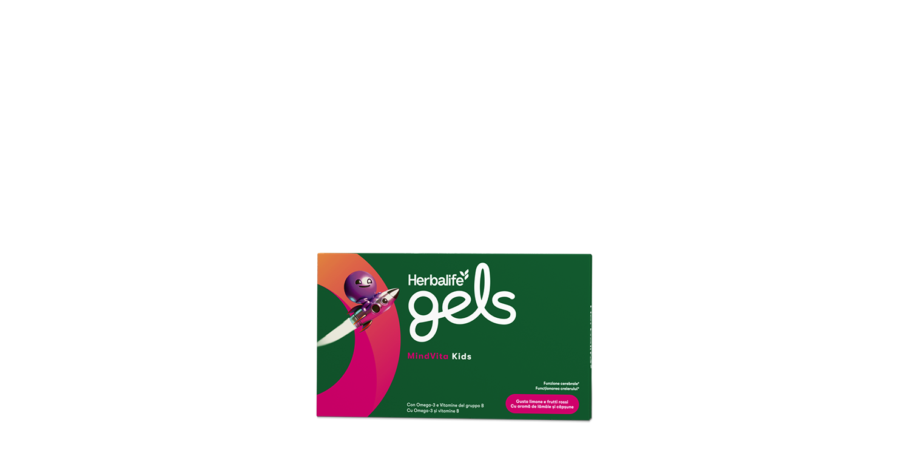
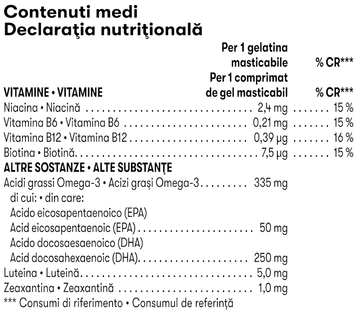

# Herbalife Gels MindVita Kids

*Aromă: Lămâie și căpșune · Mărime: 30 de comprimate de gel masticabile · Cod: 379K*

Un supliment delicios, sub formă de comprimate de gel masticabile pentru copii, îmbogățit cu acizi grași omega-3 și vitamine esențiale din complexul B.

## Prezentare generală

Susține creierul și corpul în dezvoltare1 al copiilor tăi cu Herbalife Gels MindVita Kids.

MindVita Kids este un supliment delicios, sub formă de comprimate de gel masticabile, îmbogățit cu acizi grași omega-3 (EPA și DHA) și vitamine B esențiale. Acest supliment fără zahăr combină beneficiile acizilor grași omega-3 și ale vitaminelor B pentru a susține funcția normală a creierului1, vederea1, metabolismul energetic normal2, funcționarea sistemului nervos2 și funcția psihologică.2

Savurează aroma delicioasă de lămâie și căpșune a produsului Herbalife MindVita Kids.

*1DHA contribuie la menținerea funcției normale a creierului și a vederii. Efectele benefice se obțin printr-un aport zilnic de 250 mg DHA.*

*2Vitaminele B (B6, B12, biotină și niacină) contribuie la metabolismul energetic normal, funcționarea sistemului nervos și funcția psihologică.*

## Caracteristici

Herbalife Gels MindVita Kids:

- Bogat în acizi grași omega-3 (EPA și DHA), care susțin funcția normală a creierului și vederea normală1
- Conține vitaminele B atent selecționate (B6, B12, biotină și niacină), care contribuie la metabolismul energetic normal, funcționarea sistemului nervos și menținere funcției psihologice
- Aromă delicioasă de lămâie și căpșune
- Fără zahăr
- Fără gluten
- Conține arome naturale
- O cutie conține 30 de comprimate de gel masticabile

*1DHA contribuie la menținerea funcției normale a creierului și a vederii normale. Efectele benefice se obțin printr-un aport zilnic de 250 mg DHA.*

## Ce este înăuntru

### Ingrediente

Concentrat de ulei de **pește**, îndulcitor (xilitol), apă, îndulcitor (sorbitol), gelatină, arome naturale, corector de aciditate (citrat trisodic), mixtură de luteină si zeaxantină, corector de aciditate (acid citric), antioxidant (acid ascorbic), niacină (nicotinamidă), îndulcitor (glicozide steviolice din stevia), vitamina B6 (clorhidrat de piridoxină), vitamina B12 (ciancobalamină), biotină (D-biotină).

### Informații despre alergeni

CONȚINE PEȘTE.

### Informații nutriționale

## Cum se utilizează

1 comprimat de gel masticabil/zi pentru copii cu vârsta între 4 și 17 ani.

A se consuma conform indicațiilor. Acest produs trebuie mestecat foarte bine înainte de a fi înghițit. Copiii trebuie supravegheați de un adult.

Utilizați produsul în cadrul unei diete echilibrate și variate, ca parte a unui stil de viață activ și sănătos.

---

*Alimentele prezentate în imagini și/sau videoclipuri sunt ilustrative și nu reprezintă conținutul produsului.*
