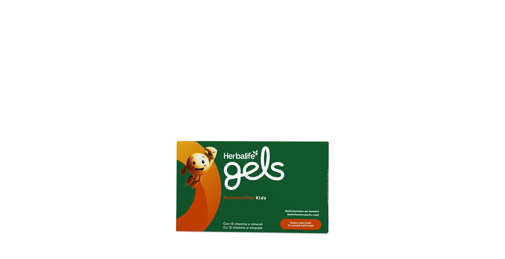
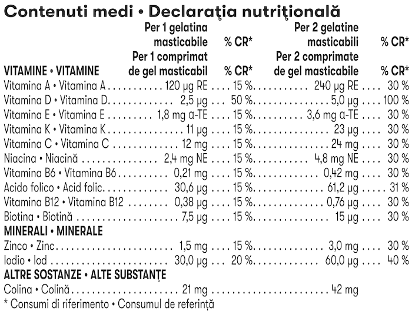

# Herbalife Gels NutrientVita Kids

*Aromă: Tutti frutti · Mărime: 30 de comprimate de gel masticabile · Cod: 369K*

Un supliment delicios, sub formă decomprimate de gel masticabile pentru copii, formulat cu 12 vitamine și minerale esențiale.

## Prezentare generală

Susține creșterea și dezvoltarea copiilor tăi\* cu Herbalife Gels NutrientVita Kids!

NutrientVita Kids este un supliment delicios, sub formă de comprimate de gel masticabile cu aromă fructată, special formulat pentru a susține nevoile nutriționale ale copiilor aflați în plină creștere și dezvoltare.\* Fiecare comprimat de gel masticabil conține 12 vitamine și minerale, fiind o modalitate convenabilă și delicioasă de a susține sănătatea copilului tău.

NutrientVita Kids include iod pentru susținerea creșterii normale a copiilor, vitamina D pentru creșterea și dezvoltarea normală a oaselor și vitamina C, care contribuie la funcționarea normală a sistemului imunitar. Acești nutrienți cheie ajută copilul să rămână sănătos și activ.

Cu ingrediente atent selecționate, precum arome și coloranți din surse naturale, NutrientVita Kids este alegerea sigură pentru cei mici. Gustul plăcut de fructe îl face atractiv pentru copii, iar consistența gelului masticabil îl face ușor de integrat în rutina zilnică.

Asigură-le copiilor tăi aportul nutrițional necesar pentru creșterea și dezvoltarea sănătoasă\* cu Herbalife Gels NutrientVita Kids.

*\*Bogat în vitamina D pentru creșterea și dezvoltarea normală a oaselor și pentru funcționarea normală a sistemului imunitar al copiilor. Conține iod pentru susținerea creșterii normale a copiilor.*

## Caracteristici

Herbalife Gels NutrientVita Kids:

- Conține iod, pentru susținerea creșterii normale a copiilor
- Bogat în vitamina D, pentru creșterea și dezvoltarea oaselor și funcționarea normală a sistemului imunitar al copiilor
- Conține vitamina C, care contribuie la funcționarea normală a sistemului imunitar
- Aromă delicioasă de Tutti Frutti
- Fără zahăr
- Fără gluten
- Conține coloranți și arome naturale
- O cutie conține 30 de comprimate de gel masticabile

## Ce este înăuntru

### Ingrediente

Ulei de floarea-soarelui, îndulcitor (xilitol), apă, îndulcitor (sorbitol), gelatină, bitartrat de colină, corector de aciditate (citrat trisodic), vitamina C (acid L-ascorbic), bisglicinat de zinc, vitamina E (D-alfa-tocoferol), aromă naturală, niacină (nicotinamidă), vitamina K2 (menachinonă), emulsifiant (lecitină), colorant (extract de ardei roșu), îndulcitor (glicozide steviolice din stevia), vitamina B6 (clorhidrat de piridoxină), vitamina A (palmitat de retinil), acid folic (acid (6S)-5-metiltetrahidrofolic, sarea de glucozamină), vitamina B12 (ciancobalamină), iodură de potasiu, vitamina D (colecalciferol), biotină (D-biotină).

### Informații nutriționale

## Cum se utilizează

Se recomandă 1 comprimat de gel masticabil pe zi pentru copiii cu vârsta între 4 și 10 ani și 2 comprimate de gel masticabile pe zi pentru copiii cu vârsta între 11 și 17 ani.

A se consuma conform indicațiilor. Acest produs trebuie mestecat foarte bine înainte de a fi înghițit. Copiii trebuie să fie supravegheați de un adult.

Utilizează produsul în cadrul unei diete echilibrate și variate, ca parte a unui stil de viață activ și sănătos.

---

*Alimentele prezentate în imagini și/sau videoclipuri sunt ilustrative și nu reprezintă conținutul produsului.*
