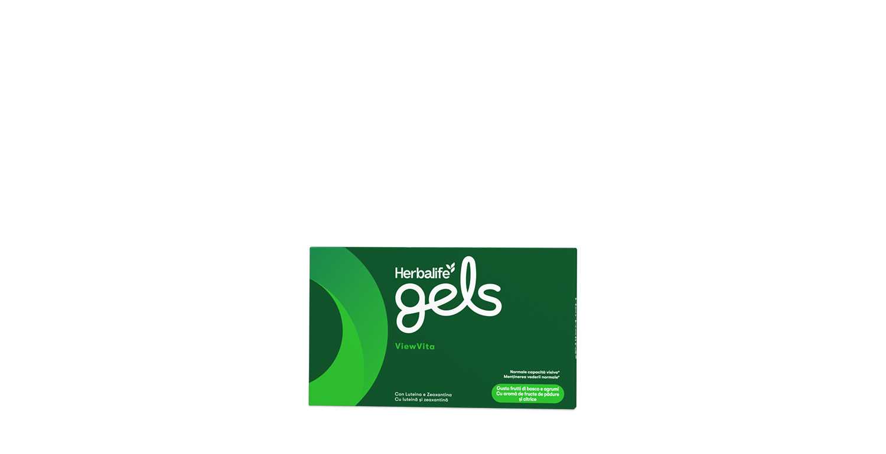
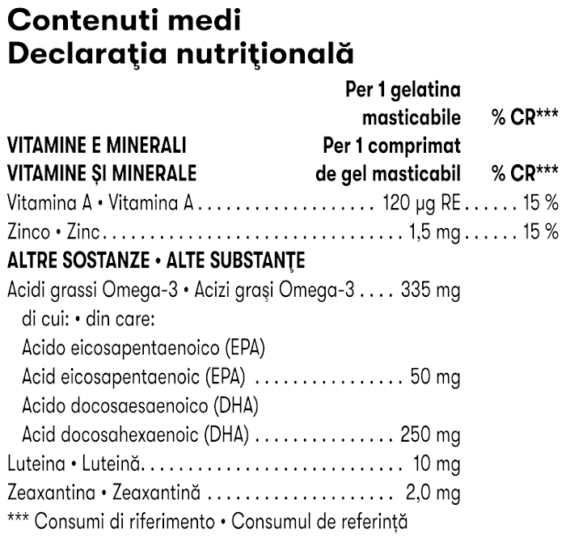

# Herbalife Gels ViewVita

*Aromă: Fructe de pădure și citrice · Mărime: 30 de comprimate de gel masticabile · Cod: 376K*

Un supliment delicios, special formulat pentru protecția și susținerea vederii.

## Prezentare generală

Susține-ți vederea fără efort cu Herbalife Gels ViewVita!

ViewVita este un supliment delicios, sub formă de comprimate de gel masticabile, îmbogățit cu luteină și zeaxantină, ingrediente care contribuie la creșterea densității pigmentului macular (MPOD)1 din retină; acesta poate ajuta la protejarea ochilor împotriva luminii albastre potențial dăunătoare2, susținând sănătatea oculară pe măsură ce înaintăm în vârstă și oferind suport nutrițional pentru ochi3. S-au observat și beneficii cognitive, precum îmbunătățirea vitezei de procesare vizuală, a memoriei spațiale4, a atenției complexe și a flexibilității cognitive.5

ViewVita conține și vitamina A, zinc și DHA, care contribuie la menținerea vederii normale.6

Herbalife Gels ViewVita este un supliment cu ingrediente atent selecționate, cu arome și coloranți din surse naturale, ușor de integrat în rutina ta zilnică datorită gustului plăcut și formatului masticabil.

*1Beneficiul poate să nu fie observat la persoanele care au deja un nivel adecvat de MPOD, cu un scor egal sau mai mare de 0,5 (Hammond B. R, et al. Invest Ophthalmol Vis Sci. 2014; 55(12): 8583-8589; Renzi-Hammond L. M, et al. Nutrients. 2017; 9(11): 1246; Stringham J. M, & Hammond B. R, Optom Vis Sci. 2008; 85(2): 82-88; Wilson L. M, et al. Adv Nutr. 2021; 12(6): 2244-2254.).*

2Soarele este o sursă naturală de lumină albastră, în timp ce becurile tradiționale, fluorescente și LED-urile sunt considerate surse artificiale (Kijlstra A, et al. Prog Retin Eye Res. 2012; 31(4): 303-15; Junghans A, et al. Arch Biochem Biophys. 2001; 391(2): 160-164; Barker F. M, 2nd, et al. Invest Ophthalmol Vis Sci. 2001; 52(7): 3934-3942.).

3Sănătatea oculară în timpul îmbătrânirii / suportul nutrițional: (Delcourt, C, et al. Invest Ophthalmol & Vis Sci. 2006; 47(6): 2329-2335; Manayi A, et al. Crit Rev Biotechnol. 2016; 36(5): 829-839; Nolan J. M, et al. Exp Eye Res. 2007; 84(1): 61-74; van Leeuwen R, et al. JAMA. 2005; 294(24): 3101-3107.).

4Rezultatele sunt observate în general la populația tânără (18–30 ani) după 12 luni de administrare zilnică a 10 mg luteină și 2 mg zeaxantină, conform rezultatelor unui studiu clinic (Renzi-Hammond L. M, et al. Nutrients. 2017; 9(11): 1246.).

5Rezultatele sunt observate în general la POPULAȚIA MAI ÎN VÂRSTĂ (30+ ANI) ȘI la populația tânără (18–30 ani) după 12 luni de administrare zilnică a 10 mg luteină și 2 mg zeaxantină, conform rezultatelor unor studii clinice ((30+) Hammond B. R, et al. Front Aging Neurosci. 2017; 3(9): 254; (18–30) Renzi-Hammond L. M, et al. Nutrients. 2017; 9(11): 1246.).

6Efectul benefic se obține în urma unui consum zilnic de 250 mg de DHA.

## Caracteristici

Herbalife Gels ViewVita:

- Conține luteină și zeaxantină
- Conține vitamina A, care contribuie la menținerea vederii normale
- Conține DHA, care contribuie la menținerea vederii normale și a funcției normale a creierului
- Conține zinc, care contribuie la menținerea vederii normale, la protejarea celulelor împotriva stresului oxidativ și la metabolismul normal al vitaminei A
- Are o aromă delicioasă de fructe de pădure și citrice
- Nu conține zahăr
- Fără gluten
- Conține arome și coloranți din surse naturale
- O cutie conține 30 de comprimate de gel masticabile

## Ce este înăuntru

### Ingrediente

Concentrat de ulei de **pește**, îndulcitor (xilitol), apă, îndulcitor (sorbitol), gelatină, mixtură de luteină și zeaxantină, corector de aciditate (citrat trisodic), arome naturale, corector de aciditate (acid citric), bisglicinat de zinc, antioxidant (acid ascorbic), vitamina A (palmitat de retinil), colorant (beta-caroten).

### Informații despre alergeni

CONȚINE PEȘTE.

### Informații nutriționale

## Cum se utilizează

Consumă 1 comprimat de gel masticabil pe zi.

Utilizează acest produs în cadrul unei alimentații echilibrate și variate, ca parte a unui stil de viață activ și sănătos.

---

*Alimentele prezentate în imagini și/sau videoclipuri sunt ilustrative și nu reprezintă conținutul produsului.*
