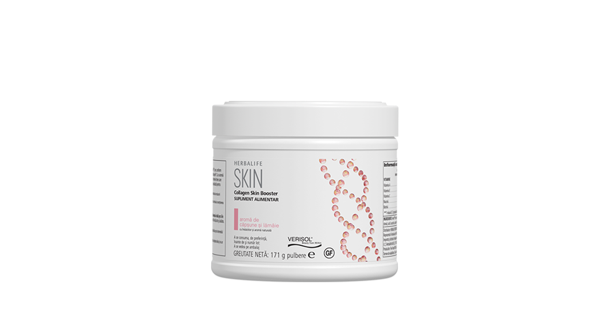
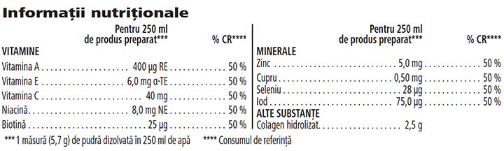

# Herbalife SKIN Collagen Skin Booster

*Aromă: Căpșune și lămâie · Mărime: 171 g · Cod: 076K*

Supliment alimentar creat de experți pentru o piele cu aspect sănătos.

## Prezentare generală

Experimentați frumusețea pornind din interior către exterior.

Collagen Skin Booster este un supliment alimentar susținut de știință și aromat, formulat de experți folosind peptide de colagen de înaltă calitate\* numite VERISOL® P\*, dovedite științific că reduc ridurile din jurul ochilor și îmbunătățesc elasticitatea pielii după patru săptămâni de consu\*\*.

Verisol® P reduce de asemenea semnele vizibile de celulită. Primele rezultate pot fi observate după trei luni de consum regulat.

Acest produs este bogat în vitamine și minerale cheie care sprijină sănătatea pielii, a părului și a unghiilor\*\*.

Collagen Skin Booster nu este doar o soluție rapidă, ci o nutriție de specialitate pentru pielea ta, susținută de știință. Cu o aromă răcoritoare de căpșune și lămâie, Collagen Skin Booster este un supliment alimentar sub formă de pudră cu un conținut ridicat de vitamine și minerale esențiale, precum biotină, iod, vitamina A, niacină și zinc, care contribuie la menținerea sănătății pielii. Collagen Skin Booster conține, de asemenea, seleniu și zinc, care contribuie la menținerea sănătății părului și a unghiilor.

Collagen Skin Booster este conceput ca o completare a ritualului tău de frumusețe, astfel încât să îl poți folosi alături de rutina existentă de îngrijire a pielii. Încearcă-l astăzi și transformă această băutură delicioasă pentru înfrumusețare, în noul tău secret de frumusețe preferat.

*\*VERISOL® și Bioactive Collagen Peptides® sunt mărci comerciale ale Gelita AG.*

*\*\*1. Proksch E et al. Skin Pharmacol Physiol. 2014,27(3):113-9.*

*2. Proksch E et al. Skin Pharmacol Physiol. 2014,27(1):47-55.*

## Caracteristici

Herbalife SKIN Collagen Skin Booster:

- Furnizează Vitamina C care contribuie la formarea normală a colagenului pentru funcționarea normală a pielii
- Furnizează Vitamina E care contribuie la protejarea celulelor împotriva stresului oxidativ
- Este formulat cu peptide de colagen de înaltă calitate\* numite VERISOL® P
- Conține îndulcitor din sursă naturală și aromă naturală
- Nu conține gluten
- Conține 30 de porții

*\*VERISOL® și Bioactive Collagen Peptides® sunt mărci comerciale ale Gelita AG.*

## Ce este înăuntru

### Ingrediente

Verisol® P colagen hidrolizat (porcin), maltodextrină, aromă naturală, corector de aciditate (acid citric), îndulcitor (glicozide steviolice din *Stevia*), acid L-ascorbic, acetat de DL-alfa-tocoferil, beta-caroten, citrat de zinc, nicotinamidă, citrat de cupru, iodură de potasiu, selenit de sodiu, D-biotină.

### Informații nutriționale

## Cum se utilizează

Savurează Collagen Skin Booster în fiecare zi. Agită ușor recipientul înainte de fiecare utilizare. Adaugă 1 măsură (5,7 g) de pulbere la 250 ml de apă și amestecă până la dizolvare. Consumă un pahar pe zi, în timpul unei mese.

Utilizează acest produs în cadrul unei diete echilibrate și variate, ca parte a unui stil de viață sănătos și activ\*.

Se păstrează cu capacul închis, la temperatura camerei, într-un loc uscat.

*\*Nu depăși doza zilnică recomandată. Suplimentele alimentare sunt destinate să completeze dieta și nu trebuie folosite ca substitut al unei diete variate. A nu se păstra la îndemâna și la vederea copiilor mici.*

---

*Alimentele prezentate în imagini și/sau videoclipuri sunt ilustrative și nu reprezintă conținutul produsului.*
