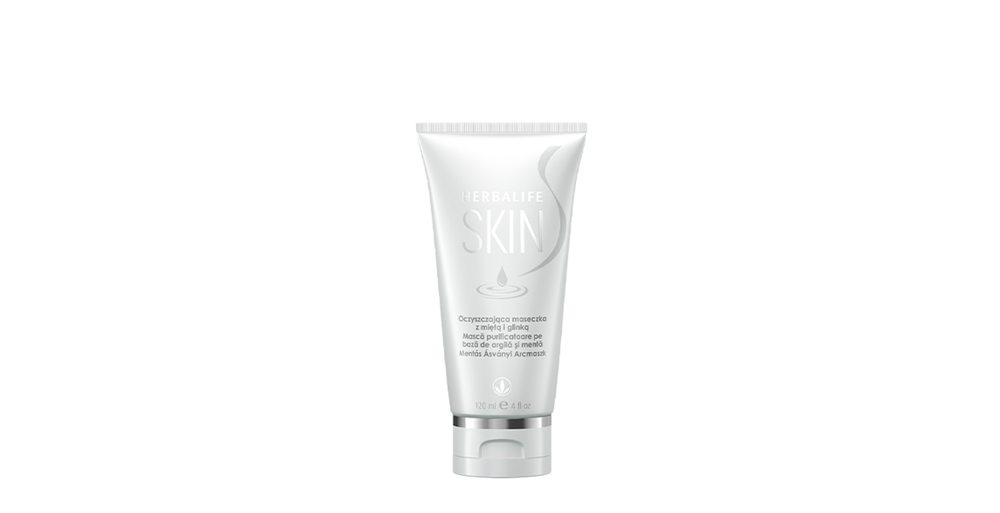

# Herbalife SKIN Mască purificatoare pe bază de argilă și mentă

*Mărime: 120 ml · Cod: 0773*

​​O mască de argilă bentonită pentru o textură îmbunătățită a pielii.​

## Prezentare generală

Îmbunătățește-ți rutina de îngrijire a pielii cu Masca purificatoare pe bază de argilă și mentă.

Această mască luxuriantă, cu textură bogată și cremoasă din argilă bentonită curăță și purifică pielea, eliminând impuritățile și absorbind excesul de sebum. Infuzată cu mentă și rozmarin, Masca purificatoare pe bază de argilă și mentă este concepută pentru a avea ca rezultat o piele mai moale și mai fină.

Folosește o dată până la de trei ori pe săptămână și experimentează o textură îmbunătățită a pielii și senzația imediată de prospețime provenită de la mentă. Experimentează un ritual suprem de îngrijire și adu un tratament ca la spa, în confortul casei tale, folosind Masca purificatoare pe bază de argilă și mentă.

## Caracteristici

Herbalife SKIN Mască purificatoare pe bază de argilă și mentă:

- Conține argilă din bentonit
- Arome revigorante de mentă şi rozmarin
- Potrivită pentru toate tipurile de ten
- Potrivită pentru bărbați și femei
- Fără parabeni adăugați
- Testată dermatologic
- Îmbunătățește aspectul porilor după o singură utilizare\*

*\*Testat pe 31 de femei cu vârsta cuprinsă între 20 și 44 de ani. Rezultatele vizuale au fost evaluate de experți.*

## Ce este înăuntru

### Ingrediente

Aqua, Bentonite, Titanium Dioxide, Butylene Glycol, *Aloe Barbadensis* Leaf Juice, Magnesium Aluminum Silicate, Illite, Niacinamide, Xanthan Gum, Ascorbyl Glucoside, Tocopheryl Acetate, *Chamomilla Recutita* Flower Extract, *Rosmarinus Officinalis* Leaf Oil, *Mentha Viridis* Leaf Oil, Lactic Acid, Glycolic Acid, Glycerin, Sodium Citrate, Citric Acid, Ethylhexylglycerin, Hexylene Glycol, Caprylyl Glycol, Phenoxyethanol, Cl 77288, Limonene and Linalool.

## Cum se utilizează

Aplică pe piele după utilizarea produsului de curățare. Lasă masca să se usuce. Clătește cu apă caldă și usucă prin tamponare. Aplică apoi serumul și crema hidratantă.

Pentru cele mai bune rezultate, folosește o dată până la de trei ori pe săptămână.

---

*Alimentele prezentate în imagini și/sau videoclipuri sunt ilustrative și nu reprezintă conținutul produsului.*
