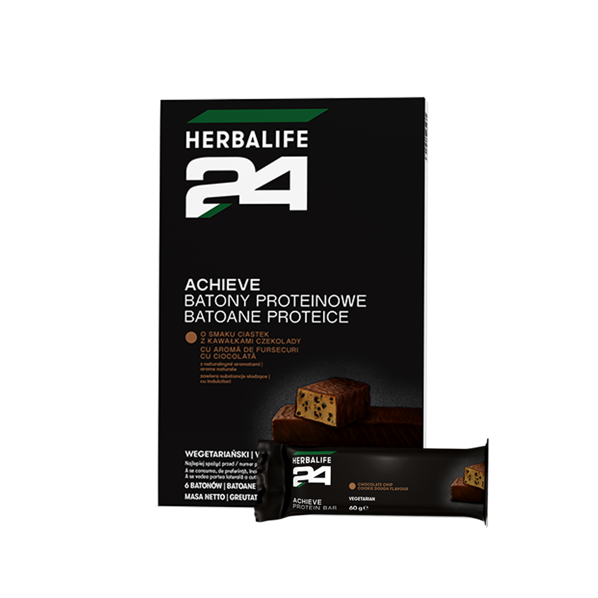
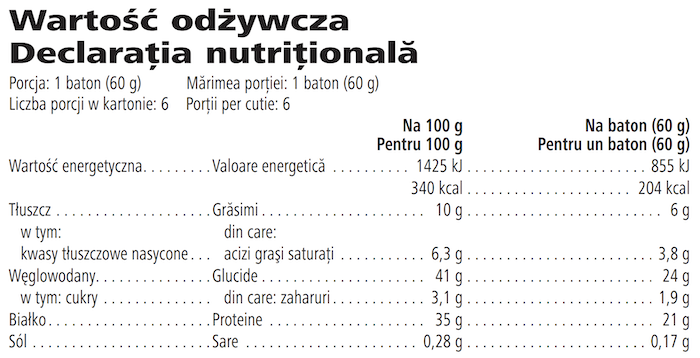

# Herbalife24® Achieve Batoane Proteice

*Aromă: Fursecuri cu ciocolată · Mărime: 6 batoane · Cod: 149K*

Batonul tău proteic după antrenament.

## Prezentare generală

Susține-ți călătoria de fitness și profită la maximum de momentele de după antrenament cu un baton proteic pe măsură.

Acest baton delicios, bogat în proteine este creat special pentru a-ți oferi 21 de grame de proteine de calitate. Cu un conținut scăzut de zahăr și potrivit pentru vegetarieni, Batonul Proteic Achieve nu conține arome sau coloranți artificiali.

Batonul Proteic Achieve este certificat Informed Sport\* și este conceput pentru confortul tău maxim. Indiferent dacă tocmai ai terminat antrenamentul de forță sau o sesiune cardio, acest baton este ceea ce ai nevoie. Reîncarcă-te după antrenament cu Batonul Proteic Achieve. Disponibil în două arome delicioase, acest baton este o gustare bogată în proteine, ideală pentru după antrenament.

*\*Testat pentru substanțe interzise. Programul de asigurare a calității Informed-Sport certifică faptul că o mostră din lotul din care a fost creat acest produs a fost testată de laboratorul antidoping sportiv de clasă mondială al LGC și s-a constatat că nu conține substanțe interzise în testul antidoping.*

## Caracteristici

Herbalife24® Achieve Batoane Proteice:

- Oferă 21 g de proteine
- Are 204 kcal
- Are un conținut scăzut de zahăr
- Este potrivit pentru vegetarieni
- Nu are coloranți artificiali
- Nu are arome artificiale
- Este certificat Informed Sport\*
- Disponibil într-o cutie de 6 batoane

*\*Testat pentru substanțe interzise. Programul de asigurare a calității Informed-Sport certifică faptul că o mostră din lotul din care a fost creat acest produs a fost testată de laboratorul antidoping sportiv de clasă mondială al LGC și s-a constatat că nu conține substanțe interzise în testul antidoping.*

## Ce este înăuntru

### Ingrediente

Proteine din **lapte** (izolat proteic din **lapte**, cazeinat de calciu (**lapte**), concentrat proteic din zer (**lapte**)), îndulcitor (sirop de maltitol), înveliş de ciocolată cu **lapte** cu îndulcitor (17 %, cacao: minimum 35 %) (îndulcitor (maltitol), unt de cacao, **lapte** praf integral, masă de cacao, emulsifiant (lecitine (**soia**)), extract de vanilie), agent de umezire (glicerol), unt de cacao, **soia** crocantă cu cacao (izolat proteic din **soia**, praf de cacao, amidon de tapioca), boabe de cacao prăjite, arome naturale, colorant (caramel simplu), îndulcitor (glicozide steviolice din stevia).

### Informații despre alergeni

CONȚINE SOIA ȘI LAPTE. POATE CONȚINE GLUTEN, NUCI, OUĂ ȘI ALUNE.

### Informații nutriționale

## Cum se utilizează

Savurează-l ca gustare, o dată pe zi, între mese sau după antrenament.

Savurează acest produs în cadrul unei diete echilibrate și variate, ca parte a unui stil de viață sănătos și activ.

Depozitează într-un loc răcoros și uscat.

Consumul excesiv poate produce efecte laxative.

---

*Alimentele prezentate în imagini și/sau videoclipuri sunt ilustrative și nu reprezintă conținutul produsului.*
