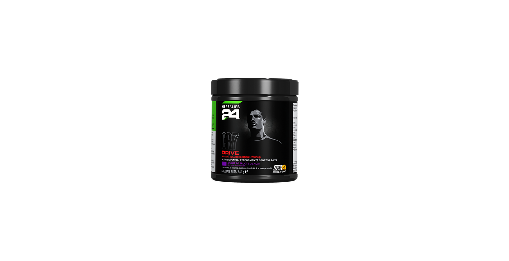
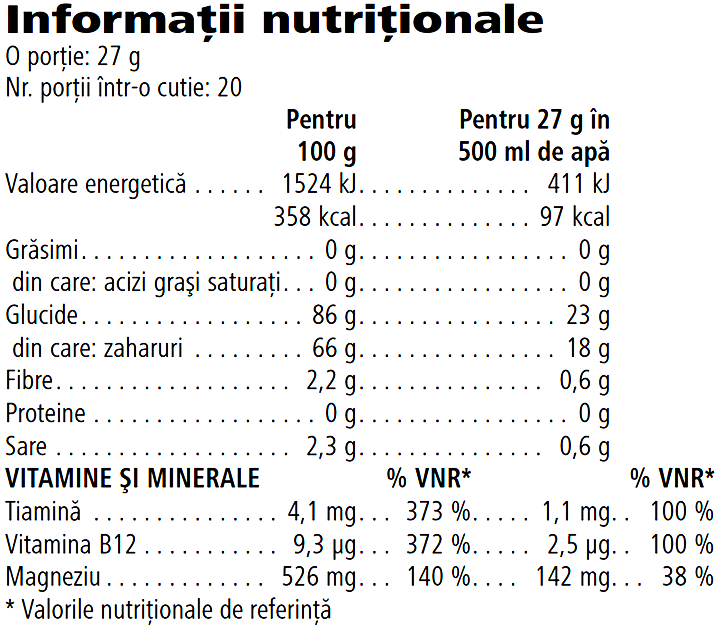

# Herbalife24® CR7 Drive

*Aromă: Fructe de Acai · Mărime: 540 g · Cod: 1466*

O băutură pentru sportivi dezvoltată exclusiv în parteneriat cu Cristiano Ronaldo.

## Prezentare generală

Asigură-ți o hidratare optimă în timpul antrenamentului cu CR7 Drive.

CR7 Drive este dezvoltat de experți în nutriție sportivă, în parteneriat cu Cristiano Ronaldo. Această formulă exclusivă de carbohidrați-electroliți crește absorbția de apă\* și contribuie la menținerea rezistenței la efort în timpul exercițiilor fizice prelungite\*\*.

De la alergare la ridicarea greutăților, CR7 Drive este băutura ta sportivă pentru orice tip de antrenament. Formulat cu electroliți cheie, CR7 Drive furnizează 249 mg de sodiu și 142 mg de magneziu per porție.

Cu o aromă răcoritoare de fructe de Acai, bogată în vitamine cheie B1 și B12, această băutură pentru sportivi este concepută pentru a oferi hidratare avansată și rezistență în timpul activității fizice.

*\*Soluțiile de carbohidrați-electroliți cresc absorbția de apă în timpul exercițiilor fizice.*

\*\*Soluțiile de carbohidrați-electroliți contribuie la menținerea rezistenței la efort în timpul exercițiilor fizice prelungite.

## Caracteristici

Herbalife24® CR7 Drive:

- Conține electroliți esențiali precum sodiu și magneziu
- Conține vitaminele B1 și B12, care contribuie la metabolismul energetic normal
- Fără îndulcitori artificiali
- Certificat Informed Sport\*
- Conține 20 de porții

*\*Testat pentru substanțe interzise. Programul de asigurare a calității Informed-Sport certifică faptul că un eșantion din lotul din care a fost creat acest produs a fost testat de laboratorul de antidoping de clasă mondială de la LGC și s-a constatat că nu conține substanțe interzise.*

## Ce este înăuntru

### Ingrediente

Dextroză, zahăr, maltodextrină, citrat trisodic, izomaltuloză\*, corector de aciditate (acid citric), săruri de magneziu ale acidului citric, citrat de potasiu, arome, coloranți (antocianine), ciancobalamină, mononitrat de tiamină.

*\*Izomaltuloza este o sursă de glucoză și fructoză.*

### Informații nutriționale

## Cum se utilizează

Agită ușor recipientul înainte de fiecare utilizare, deoarece conținutul se poate sedimenta. Amestecă 2 măsuri (27 g) de pudră cu 500 ml de apă, amestecă bine. A se consuma în timpul exercițiilor fizice.

Savurează acest produs în cadrul unei diete echilibrate şi variate, ca parte a unui stil de viaţă sănătos și activ.

A se păstra cu capacul închis, într-un loc răcoros şi uscat.

---

*Alimentele prezentate în imagini și/sau videoclipuri sunt ilustrative și nu reprezintă conținutul produsului.*
