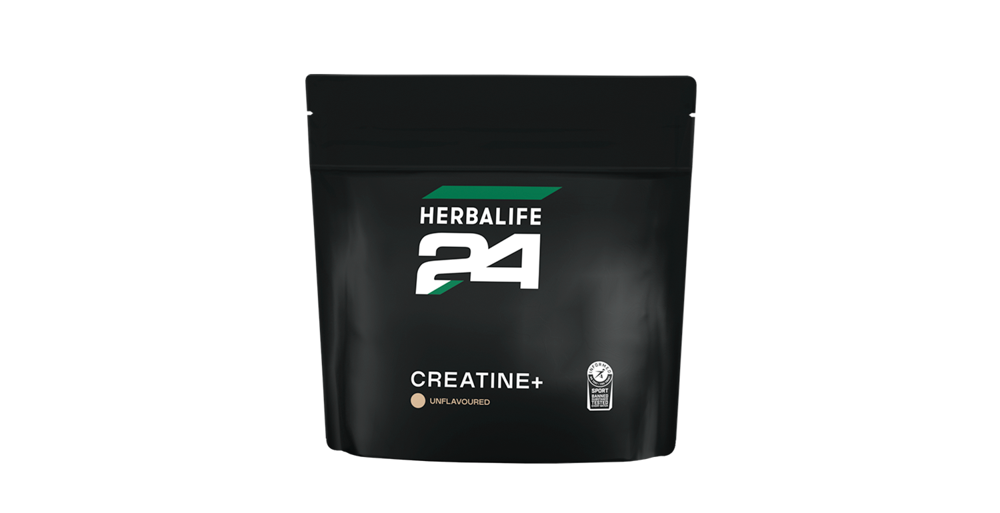
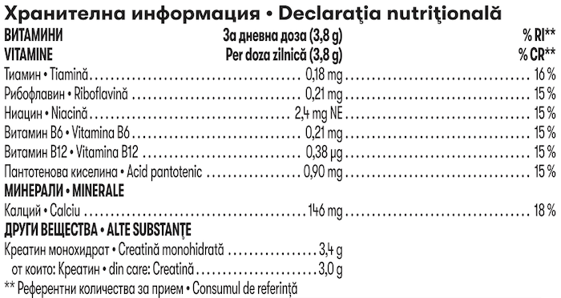

# Herbalife24 Creatine+

*Aromă: Unflavoured · Mărime: 228 g · Cod: 488K*

Susține-ți performanța, sănătatea și starea generală de bine.

## Prezentare generală

**Herbalife24 Creatine+, un supliment pentru fiecare stil de viață.**

Îmbunătățește-ți performanța fizică cu Herbalife24 Creatine+, suplimentul tău de încredere. Dezvoltat de specialiști în nutriția sportivă, Herbalife24 Creatine+ susține performanța fizică, optimizează producerea de energie în timpul exercițiilor intense\* și contribuie la dezvoltarea forței musculare1‑3 atunci când este integrată în antrenamentele de forță\*, fiind potrivită pentru fiecare stil de viață, inlcusiv pentru femei și adulți cu vârsta de peste 50 de ani4‑6.

Formula sa unică include vitamine din complexul B (vitaminele B6 și B12, niacină, riboflavină, tiamină și acid pantotenic) și calciu, ingrediente esențiale care contribuie la un metabolism energetic normal. Calciul joacă, de asemenea, un rol important în susținerea funcției musculare normale, iar vitaminele B sprijină sistemul imunitar pentru un organism puternic și echilibrat. Nu trebuie să te antrenezi regulat la sală pentru a te bucura de beneficiile H24 Creatine+. Acest supliment vegan cu creatină este ideal pentru rutina ta zilnică, sprijinindu-ți performanța generală\* în călătoria ta către un stil de viață activ și sănătos.

Fie că faci o sesiune scurtă de exerciții intense de 20 de minute sau te afli în mijlocul unui antrenament solicitant de forță, acest supliment cu creatină te ajută să-ți atingi performanța maximă\* fără să-ți afecteze rutina zilnică. Tot mai multe studii științifice explorează influența creatinei asupra funcțiilor cognitive și a sănătății mentale, însă pentru a formula concluzii solide și recomandări aplicabile este nevoie de investigații suplimentare riguroase.

Descoperă Herbalife24 Creatine+ și susține-ți performanța, sănătatea și starea generală de bine. Lingurița este disponibilă separat la vânzare. Contactează-ne dacă dorești mai multe informații despre acest supliment sau despre lingurița Herbalife.

**Întrebări și răspunsuri**

1.Când ar trebui să iau Herbalife24 Creatine+ – înainte sau după antrenament?

Poți să consumi creatina oricând în timpul zilei — înainte, în timpul sau după antrenament, o singură dată pe zi.

**2.Este indicat să iau Herbalife24 Creatine+ și în zilele fără antrenament?**

Da, pentru a te bucura de beneficiile sale, se recomandă un consum zilnic de aproximativ 3-5 g din acest supliment cu creatină8.

**3. Există efecte secundare la utilizarea Herbalife24 Creatine+?**

Nu sunt cunoscute efecte adverse semnificative, însă organismul poate avea nevoie de o perioadă de adaptare8–11.

**4. Pot lua Herbalife24 Creatine+ împreună cu alte suplimente?**

Da, fără îndoială. Asocierea cu carbohidrați sau proteine poate îmbunătăți absorbția – o poți combina cu Herbalife24 CR7 Drive, Herbalife24 Rebuild Strength sau cu shake-ul Formula 1 pentru a te bucura de beneficii12–14.

*\*Creatina crește performanța fizică în timpul eforturilor succesive, scurte și de intensitate ridicată. Efectul benefic se obține printr-un consum zilnic de 3g de creatină.*

†Efectul benefic se obține printr-un consum zilnic de 3g de creatină. Calciul contribuie la funcționarea normală a sistemului muscular.

*Referințe:*

1. Vilar Neto JdO, et al.

2. Herda TJ, et al. J. Strength Cond. Res. 2009;23(3):818-26.

3. Kaviani M, et al. J Sports Med Phys Fitness. 2019;59(4):608-12.

4. EFSA. EFSA Journal. 2011;9(7).

5. Kerksick, et al. J Int Soc Sports Nutr. 2018;15(1):38.

6. Burke DG, et al. Med Sci Sports Exerc. 2003;35(11):1946-55.

7. Blancquaert L, et al. Br J Nutr. 2018;119(7):759-70.

8. Kreider RB, et al. JISSN. 2017;14(1):18.

9. Kerksick C.M. et al. J Int Soc Sports Nutr. 2018;15(1):38.

10. Shao A, et al. Regulatory Toxicology and Pharmacology. 2006;45(3):242-51.

11. Kreider RB, et al. Nutrients. 2022;14(5).

12. Hultman E, et al. J Appl Physiol. 1996;81(1):232-7.

13. Steenge GR, et al. J Appl Physiol. 2000;89(3):1165-71.

14. Green AL, et al. Am J Physiol. 1996;271(5 Pt 1):E821-6.

## Caracteristici

Herbalife24 Creatine+:

- Crește forța musculară1-3\*
- Îmbunătățește performanța fizică4-5
- Conține calciu și vitamine din complexul B (vitaminele B6 și B12, niacină, riboflavină, tiamină și acid pantotenic)
- Sprijină dietele vegane și vegetariene6-7
- Este sigură pentru consum îndelungat
- Certificat Informed Sport
- Lingurița nu este inclusă; se achiziționează separat - SKU 9B48 (2 x măsura 3 cc per porție)

*\*Creatina crește performanța fizică în eforturi succesive de scurtă durată și intensitate ridicată. Efectul benefic se obține printr-un aport zilnic de 3g de creatină. Consumul zilnic de creatină poate amplifica efectele antrenamentelor de rezistență asupra forței musculare la adulții cu vârsta peste 50 de ani.*

1. Vilar Neto JdO, et al.

2. Herda TJ, et al. J. Strength Cond. Res. 2009;23(3):818-26.

3. Kaviani M, et al. J Sports Med Phys Fitness. 2019;59(4):608-12.

4. EFSA. EFSA Journal. 2011;9(7).

5. Kerksick, et al. J Int Soc Sports Nutr. 2018;15(1):38.

6. Burke DG, et al. Med Sci Sports Exerc. 2003;35(11):1946-55.

7. Blancquaert L, et al. Br J Nutr. 2018;119(7):759-70.

## Ce este înăuntru

### Ingrediente

Creatină monohidratã, carbonat de calciu, niacină (nicotinamidã), acid pantotenic (D-pantotenat de calciu), vitamina B12 (ciancobalamină), tiamină (clorhidrat de tiamină), vitamina B6 (clorhidrat de piridoxină), riboflavină.

### Informații despre alergeni

POATE CONȚINE SOIA, LAPTE ȘI OUǍ.

### Informații nutriționale

## Cum se utilizează

Doza zilnică recomandată: adaugă zilnic aproximativ 3,8 g de pudră (2 măsuri de 3 cc) la 200 ml de apă și agită bine. O poți adăuga în shake-ul tău preferat Formula 1.

Consumă o dată pe zi în orice moment al zilei. Utilizează acest produs în cadrul unei diete echilibrate și variate, ca parte a unui stil de viață activ și sănătos.

La prima utilizare a produsului: pentru a obține eficiența dorită, se recomandă consumul zilnic a aproximativ 3,8 g de Herbalife24 Creatine+, timp de cel puțin 28 de zile.

Pentru opțiuni alternative de utilizare, te rugăm să iei legătura cu Distribuitorul Independent Herbalife. Lingura de măsurare se comercializează separat - SKU 9B48 (2 x măsura 3 cc).

---

*Alimentele prezentate în imagini și/sau videoclipuri sunt ilustrative și nu reprezintă conținutul produsului.*
