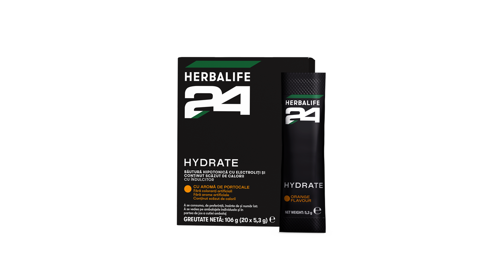
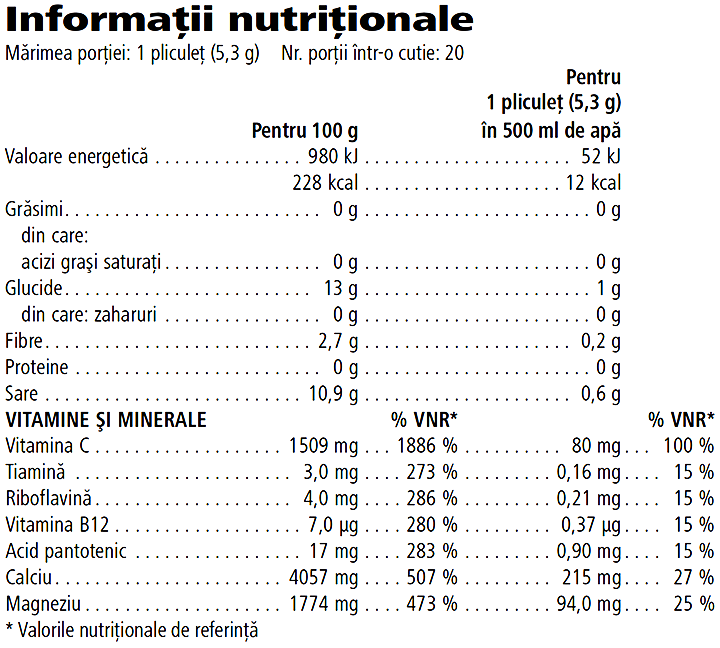

# Herbalife24® Hydrate

*Aromă: Portocale · Mărime: 20 pliculețe · Cod: 1433*

O băutură pentru sportivi, cu electroliți, săracă în calorii, ce conține vitamina C.

## Prezentare generală

Hidratează-te eficient în timpul antrenamentului cu Hydrate.

Dezvoltat de experți în nutriție sportivă, Hydrate este formulat exclusiv cu un amestec de vitamine și minerale cheie, inclusiv vitaminele B (B1, B2, acid pantotenic și B12), precum și calciu și magneziu care contribuie la metabolismul energetic normal. Hydrate este, de asemenea, bogat în vitamina C, care contribuie la reducerea oboselii și extenuării.

Hydrate este certificat Informed Sport\* și nu conține coloranți sau arome artificiale. Cu o aromă răcoritoare de portocale, disponibil în plicuri individuale pentru confort maxim, această băutură cu electroliți, pentru sportivi, săracă în calorii, este concepută pentru a te ajuta să-ți atingi obiectivele de hidratare.

*\*Testat pentru substanțe interzise. Programul de asigurare a calității Informed-Sport certifică faptul că un eșantion din lotul din care a fost creat acest produs a fost testat de laboratorul de antidoping de clasă mondială de la LGC și s-a constatat că nu conține substanțe interzise.*

## Caracteristici

Herbalife24® Hydrate:

- Conţinut scăzut de calorii
- Furnizează vitamina C
- Conține vitamine din grupul B (B1, B2, acid pantotenic și B12)
- Conține calciu și magneziu
- Fără coloranți sau arome artificiale
- Certificat Informed Sport\*
- Prezentare: cutie cu 20 plicuri individuale

*\*Testat pentru substanțe interzise. Programul de asigurare a calității Informed-Sport certifică faptul că un eșantion din lotul din care a fost creat acest produs a fost testat de laboratorul de antidoping de clasă mondială de la LGC și s-a constatat că nu conține substanțe interzise.*

## Ce este înăuntru

### Ingrediente

Corectori de aciditate (acid citric, fosfat dipotasic), aromă naturală de portocale, carbonat de calciu, citrat trisodic, clorhidrat de sodiu, hidroxid de magneziu, L-ascorbat de sodiu, potențiator de aromă (clorură de potasiu), îndulcitor (sucraloză), D-pantotenat de calciu, clorhidrat de tiamină, riboflavină, cianocobalamină.

### Informații nutriționale

## Cum se utilizează

Amestecă 1 plic cu 500 ml de apă și agită puternic.

Savurează acest produs în cadrul unei diete echilibrate şi variate, ca parte a unui stil de viaţă sănătos și activ.

A se păstra într-un loc răcoros și uscat.

---

*Alimentele prezentate în imagini și/sau videoclipuri sunt ilustrative și nu reprezintă conținutul produsului.*
