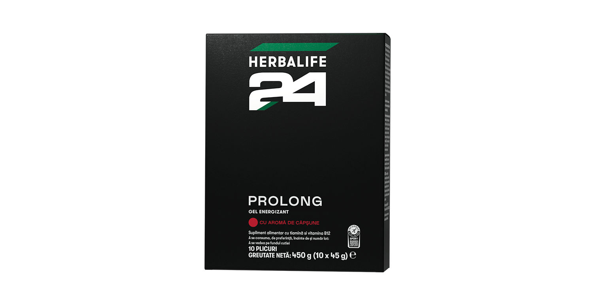
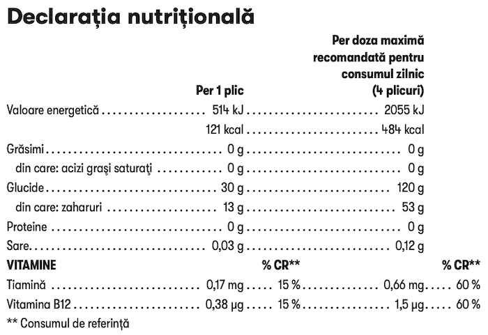

# Herbalife24® Prolong Gel Energizant

*Aromă: Căpșune · Mărime: 10 pliculețe · Cod: 402K*

Un gel energizant bogat în carbohidrați, îmbogățit cu un amestec de vitamine B.

## Prezentare generală

Dezlănțuie-ți potențialul și optimizează-ți antrenamentele cu gelul energizant Herbalife24® Prolong.

Formulă dezvoltată de experți și cercetători de renume mondial în domeniul sportului și nutriției, Herbalife24® Prolong oferă un raport ideal de 1:0,8 între glucoză și fructoză, asigurând 30g de carbohidrați ușor de absorbit pentru o energie rapidă și eficientă.

Herbalife24®Prolong are un gust revigorant de căpșune și conține un complex de vitamine B\*, care susține metabolismul energetic normal. Vitamina B12 ajută la reducerea oboselii și a extenuării.

Optimizează-ți antrenamentele și atinge noi performanțe cu Herbalife24® Prolong Gel energizant!

*\*Conține vitaminele B12 și Tiamină*

## Caracteristici

Herbalife24® Prolong pliculețe de gel energizant:

- Formulate pe baza raportului ideal de 1:0,8 între glucoză și fructoză
- Conțin 30g de carbohidrați per porție
- Certificate Informed Sports
- Conțin Vitamina B12 și Tiamină
- Arome naturale
- Fără coloranți sau îndulcitori
- Potrivite pentru vegani
- Fără gluten
- Disponibile într-o cutie cu 10 pliculețe de gel energizant

## Ce este înăuntru

### Ingrediente

Maltodextrină, apă, fructoză, corector de aciditate (acid citric), aromă naturală, conservanți (sorbat de potasiu, benzoat de sodiu), clorură de sodiu, Vitamina B12 (ciancobalamină), Tiamină (clorhidrat de tiamină).

### Informații nutriționale

## Cum se utilizează

Pentru exerciții intense care durează mai puțin de 1,5 ore, consumă 1 plic de gel energizant pe oră.

Pentru exerciții intense care durează între 1,5 până la 2 ore, consumă 2 pliculețe de gel energizant pe oră.

Numărul maxim de plicuri recomandate pe zi este de 4.

Utilizează acest produs în cadrul unei diete echilibrate şi variate, ca parte a unui stil de viaţă activ şi sănătos. Este important să se consume o cantitate corespunzătoare de lichide.

---

*Alimentele prezentate în imagini și/sau videoclipuri sunt ilustrative și nu reprezintă conținutul produsului.*
