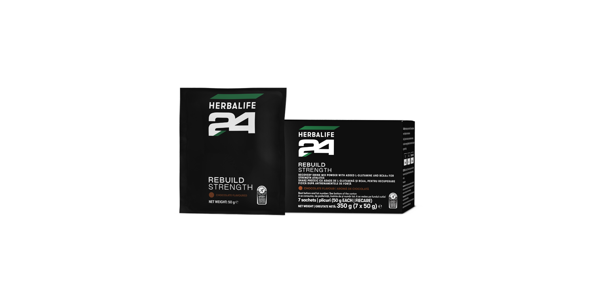
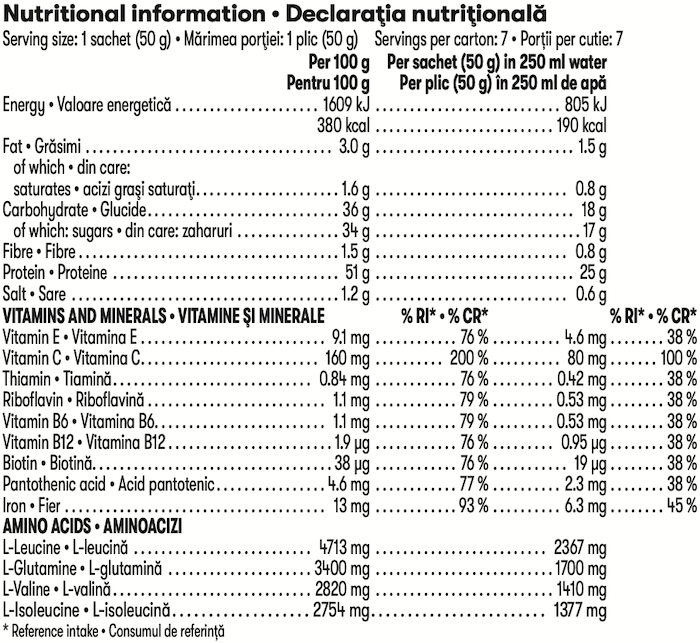

# Herbalife24 Rebuild Strength

*Aromă: Ciocolată · Mărime: 7 pliculețe · Cod: 486K*

O băutură pentru recuperare pe bază de carbohidrați și proteine pentru utilizare după un antrenament de tip anaerob.

## Prezentare generală

Beneficiază de nutriția necesară post-antrenament\* cu Rebuild Strength.

Rebuild Strength este o băutură pentru recuperare post-antrenament pe bază de proteine și carbohidrați, care se consumă după un antrenament de forţă. Cu un adaos de L-glutamină și aminoacizi cu lanț ramificat (BCAA), această băutură unică pentru sportivi conține carbohidrați care susțin recuperarea\* după antrenamentul fizic aerobic.

Rebuild Strength este formulat cu proteine din zer de înaltă calitate și furnizează 25 grame de proteine per porție, contribuind astfel la creșterea și menținerea masei musculare. Rebuild Strength este, de asemenea, formulat cu un amestec de micronutrienți cheie, inclusiv vitamina C și fier. Fierul contribuie la metabolismul energetic normal, la formarea normală a globulelor roșii și a hemoglobinei și la transportul normal al oxigenului în corp.

Beneficiază la maximum de intervalul post-antrenament cu Rebuild Strength.

*\*Glucidele contribuie la recuperarea funcționării normale a mușchilor (contracție) după un exercițiu fizic foarte intens și/sau de lungă durată, care conduce la oboseală musculară și la epuizarea depozitelor de glicogen din mușchiul scheletic. Efectul benefic se obține în condițiile consumului de glucide, din toate sursele, la o doză totală de 4 g per kg de greutate corporală, în doze administrate în primele patru ore și nu mai târziu de șase ore, în urma unui exercițiu fizic foarte intens și/sau de lungă durată, care conduce la oboseală musculară și la epuizarea depozitelor de glicogen din mușchiul scheletic.*

## Caracteristici

Herbalife24 Rebuild Strength:

- Furnizează 25 g de proteine per porție
- Conține proteine din zer de înaltă calitate
- Furnizează 6,3 mg de fier per porție
- Bogat în vitamina C
- Formulat cu L-glutamină și aminoacizi cu lanț ramificat (BCAA)
- Certificat Informed Sport\*
- Disponibil într-o cutie cu 7 pliculețe individuale

*\*Testat pentru substanțe interzise. Programul de asigurare a calității Informed-Sport certifică faptul că un eșantion din lotul din care a fost creat acest produs a fost testat de laboratorul de antidoping de clasă mondială de la LGC și s-a constatat că nu conține substanțe interzise.*

## Ce este înăuntru

### Ingrediente

Concentrat de proteină din **lapte**, concentrat de proteină din zer (din **lapte**), fructoză, sucroză, pudră de cacao cu conţinut redus de grăsimi, L-glutamină, izolat de proteine din zer (din **lapte**), maltodextrină, arome naturale, clorură de sodiu, corector de aciditate (citrat de potasiu), caseină de calciu, trigliceride cu lanţ mediu, L-leucină, L-isoleucină, L-valină, L-ascorbat de sodiu, agent de îngroşare (gumă guar), feric (III) pirofosfat, DL-alfa-tocoferol, D-pantotenat de calciu, clorhidrat de piridoxină, clorhidrat de tiamină, riboflavină, D-biotină, cianocobalamină.

### Informații despre alergeni

CONȚINE LAPTE. POATE CONŢINE OU ŞI SOIA.

### Informații nutriționale

## Cum se utilizează

Adaugă 1 plic (50 g) în 250 ml de apă şi agită puternic. A se consuma în următoarele 30 de minute după efectuarea activității fizice de tip anaerob. Savurează acest produs în cadrul unei diete echilibrate şi variate, ca parte a unui stil de viață activ şi sănătos.

A se păstra într-un loc răcoros şi uscat.

---

*Alimentele prezentate în imagini și/sau videoclipuri sunt ilustrative și nu reprezintă conținutul produsului.*
