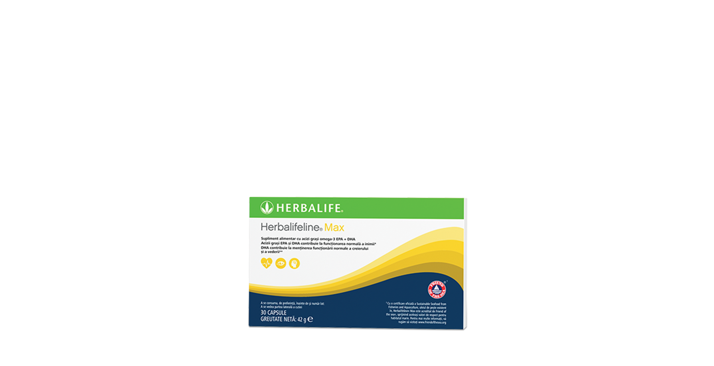
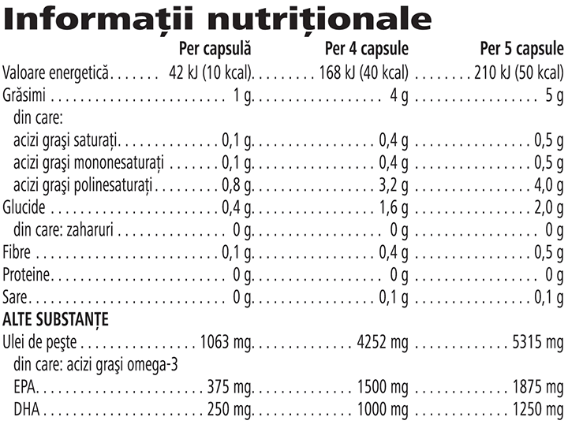

# Herbalifeline® Max

*Mărime: 30 capsule · Cod: 0043*

​​Formulat exclusiv cu uleiuri de pește din surse sustenabile care conțin acizi grași omega-3.​

## Prezentare generală

Descoperă beneficiile acizilor grași omega-3 cu Herbalifeline® Max, formulat exclusiv cu uleiuri de pește provenite din surse sustenabile\*.

Acest supliment alimentar zilnic este disponibil în capsule de gel (potrivite pentru vegetarieni), atent formulate cu uleiuri esențiale de cimbru și mentă pentru a oferi o senzație de prospețime după administrare.

Fiecare capsulă de Herbalifeline® Max furnizează 375 de miligrame de EPA și 250 de miligrame de DHA. Acești acizi grași esențiali contribuie la funcționarea normală a inimii, menținerea tensiunii arteriale normale și menținerea nivelului normal de trigliceride din sânge. De asemenea, acidul gras esențial DHA contribuie la menținerea funcției normale a creierului și la menținerea vederii normale\*\*.

Optimizează-ți nutriția cu Herbalifeline® Max Omega-3. Ia până la 5 capsule pe zi, atinge-ți necesarul zilnic de omega-3 și începe să te bucuri de numeroasele beneficii ale acestor grăsimi sănătoase.

*\*Uleiul de pește existent în Herbalifeline® Max este acreditat de Friend of the Sea™ Certification for Sustainable Fisheries, sprijinind aceleași valori de respect pentru habitatul marin.*

*\*\*Toate beneficiile enumerate depind de numărul de capsule administrate, conform instrucțiunilor.*

## Caracteristici

Herbalifeline® Max Omega-3:

- Este formulat cu ulei de pește din surse sustenabile, acreditat de Friend of the Sea™\*
- Este formulat cu acizi grași esențiali omega-3 EPA și DHA
- Disponibile în capsule de gel (potrivite pentru vegetarieni) care conțin uleiuri esențiale de cimbru și mentă
- Disponibil într-o cutie cu 30 de capsule

*\*Uleiul de pește existent în Herbalifeline® Max este acreditat de Friend of the Sea™ Certification for Sustainable Fisheries, sprijinind aceleași valori de respect pentru habitatul marin.*

## Ce este înăuntru

### Ingrediente

Ulei de **peşte**, invelișul capsulei [stabilizator (amidon hidroxipropilic), agent de intârire (glicerol), agent gelatinizant (caragenan), corector de aciditate (fosfați de sodiu)], antioxidant (alfa-tocoferol), arome naturale (ulei de cimbru (*Thymus vulgaris* L. 0,14 %), ulei de mentă (*Mentha piperita* L. 0,07 %)].

### Informații despre alergeni

CONȚINE PEȘTE.

### Informații nutriționale

## Cum se utilizează

Ia 1, 4 sau 5 capsule pe zi (în funcție de beneficiile pe care dorești să le obții) în combinație cu apă, de preferință la o distanță între mese, pe parcursul zilei\*.

DHA contribuie la menținerea funcției normale a creierului și la menținerea vederii normale. Efectul benefic se obține în condițiile unui consum zilnic de 250 mg de DHA.

DHA și EPA contribuie la funcționarea normală a inimii. Efectul benefic se obține în condițiile unui consum zilnic de 250 mg de EPA și DHA.

DHA și EPA contribuie la menținerea concentrațiilor normale de trigliceride din sânge. Efectul benefic se obține în condițiile unui consum zilnic de 2g de EPA și DHA.

DHA și EPA contribuie la menținerea tensiunii arteriale normale. Efectul benefic se obține în condițiile unui consum zilnic de 3g de EPA și DHA.

Un consum zilnic suplimentar de 5g de EPA și DHA combinat, nu trebuie depășit.

Utilizează acest produs în cadrul unei diete echilibrate şi variate, ca parte a unui stil de viaţă activ şi sănătos.

A se păstra într-un loc răcoros și uscat.

*\*A nu se depăși doza zilnică de consum recomandată. Suplimentele alimentare sunt destinate să completeze dieta și nu ar trebui folosite pentru a înlocui o dietă variată. A nu se lăsa la îndemâna și vederea copiilor mici.*

---

*Alimentele prezentate în imagini și/sau videoclipuri sunt ilustrative și nu reprezintă conținutul produsului.*
