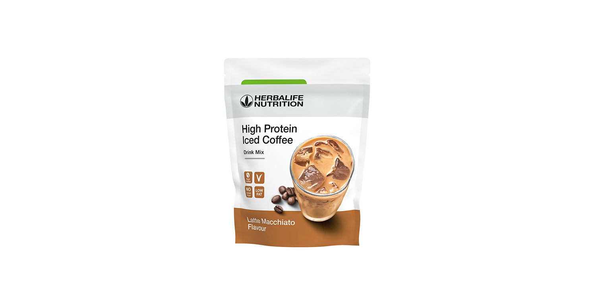
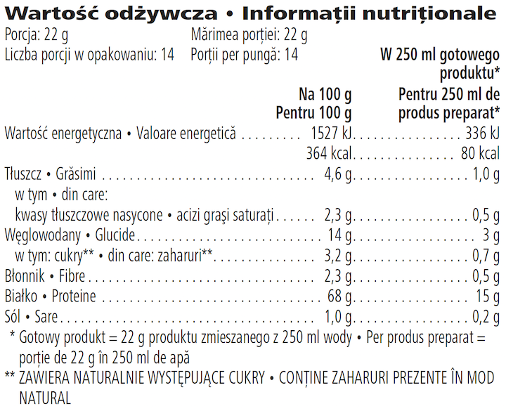

# High Protein Iced Coffee

*Aromă: Latte Macchiato · Mărime: 308 g · Cod: 012K*

Un amestec perfect, formulat cu proteine din zer de înaltă calitate și boabe de cafea espresso 100 % Robusta.

## Prezentare generală

Pentru toți iubitorii de cafea, acest produs este pentru voi!

High Protein Iced Coffee, conține 15 grame de proteine de calitate din zer, nu are zahăr adăugat și are 80 de miligrame de cofeină pe porție. Fiecare lot a fost preparat cu grijă cu boabe de cafea espresso 100 % Robusta, pentru a oferi un gust fin și îndrăzneț. Atunci când este preparată conform instrucțiunilor, High Protein Iced Coffee se evidențiază ca o băutură răcoritoare și hrănitoare, potrivită pentru orice moment al zilei.

Atunci când pasiunea nu este suficientă pentru a-ți oferi motivația necesară următoarei provocări, încearcă High Protein Iced Coffee. Creat pentru aventurile tale de zi cu zi, mari și mici, acest amestec de cafea și proteine este conceput pentru a se integra în stilul tău de viață, exact așa cum ai nevoie.

## Caracteristici

High Protein Iced Coffee:

- Oferă 15 g de proteine din zer pe porție
- Conține 80 mg de cofeină pe porție\*
- Are 80 de calorii pe porție
- Este preparat cu boabe de cafea espresso 100% Robusta
- Nu are zahăr adăugat
- Este potrivit pentru vegetarieni
- Conține 14 porții

*\*Se recomandă să nu se depășească un aport zilnic de 400 mg de cofeină din toate sursele (200 mg pentru femeile însărcinate sau care alăptează). Nu trebuie depășită o doză unică de 200 mg de cofeină (EFSA Journal 2015;13(5):4102. 2015).*

## Ce este înăuntru

### Ingrediente

Concentrat proteic din zer (**lapte**) (85 %), cafea pudră solubilă (12 %), arome, sare de mare, pudră de ulei de cocos [ulei de nucă de cocos, maltodextrină, cazeinat de sodiu (**lapte**)], îndulcitor (glicozide derivate din steviol).

### Informații despre alergeni

CONȚINE LAPTE.

### Informații nutriționale

## Cum se utilizează

High Protein Iced Coffee poate fi savurată acasă sau când ești în deplasare. Este perfectă pentru a fi consumată dimineața sau după-amiaza.

Umple shaker-ul cu 250 ml de apă rece. Agită ușor punga înainte de fiecare utilizare. Adaugă 2 linguri (22 g) de High Protein Iced Coffee, conform recomandărilor de pe etichetă. Agită și toarnă gheață peste. Dacă nu ai un shaker, folosește un mixer la viteză mică timp de 5 secunde.

Savurează acest produs în cadrul unei diete echilibrate și variate, ca parte a unui stil de viață sănătos și activ.

A se păstra sigilat, într-un loc răcoros și uscat.

---

*Alimentele prezentate în imagini și/sau videoclipuri sunt ilustrative și nu reprezintă conținutul produsului.*
