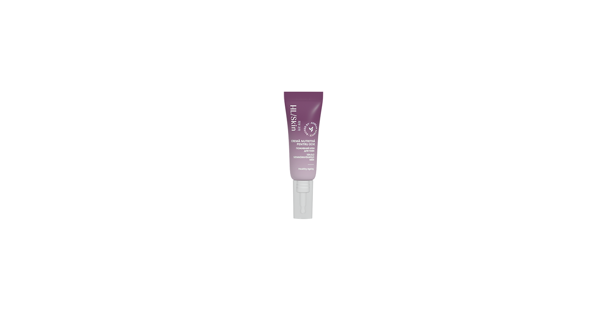

# HL/Skin Cremă Nutritivă Pentru Ochi

*Mărime: 15 ml · Cod: 515K*

O cremă cu absorbție rapidă, textură ușoară și non-grasă, special creată pentru pielea delicată din jurul ochilor.

## Prezentare generală

HL/Skin Crema nutritivă pentru ochi are o textură ușoară și absorbție rapidă și este susținută de știința coreeană a îngrijirii pielii. Este îmbogățită cu adenozină, niacinamide, squalane, unturi și uleiuri naturale. Această formulă avansată vizează ridurile, liniile fine și uscăciunea din zona delicată a ochilor. Oferă hidratare de lungă durată, ajută la menținerea umidității din piele și îmbunătățește aspectul neted, luminos și strălucitor al pielii. Nu este grasă și este potrivită pentru utilizarea sub machiaj.

HL/Skin Crema nutritivă pentru ochi nu conține parabeni adăugați. Pentru cele mai bune rezultate, folosește-o împreună cu celelalte produse din gama HL/Skin. Masează o cantitate mică de cremă în jurul conturului ochilor.

## Caracteristici

HL/Skin Cremă Nutritivă Pentru Ochi:

- Este susținută de știința avansată coreeană a îngrijirii pielii
- Este testată dermatologic
- Este testată oftalmologic
- Oferă hidratare timp de 8 ore¹
- Îmbunătățirea aspectului ridurilor din jurul ochilor², a catifelării², luminozității³, fermității³ și a cearcănelor²
- 100% sunt de acord că textura produsului se simte plăcut pe piele⁵
- 100% sunt de acord că produsul îmbunătățește nivelul de hidratare al pielii⁵
- 94% sunt de acord că produsul sporește elasticitatea, catifelarea și hidratarea pielii⁵
- Textură lejeră, non-grasă, cu absorbție rapidă⁴
- Potrivită pentru aplicare sub machiaj
- Potrivită pentru diverse tipuri de piele
- Nu conține parabeni adăugați

*¹ Testată pe 32 de femei, cu vârste între 25 și 60 de ani. Rezultatele evaluate prin măsurători instrumentale.*

² Testată pe 33 de femei, cu vârste între 43 și 65 de ani. Rezultatele evaluate prin măsurători instrumentale după 30 de zile de utilizare.

³ Testată pe 33 de femei, cu vârste între 43 și 65 de ani. Rezultatele evaluate prin măsurători instrumentale după 60 de zile de utilizare.

⁴ Pe baza rezultatelor autoevaluării realizate cu 33 de femei, cu vârste între 43 și 65 de ani, după utilizarea imediată.

⁵ Pe baza rezultatelor autoevaluării realizate cu 33 de femei, cu vârste între 43 și 65 de ani, după 60 de zile de utilizare.

## Ce este înăuntru

### Ingrediente

Aqua, Glycerin, Squalane, Polyglyceryl-3 Methylglucose Distearate, Niacinamide, Macadamia Integrifolia Seed Oil, Methyl Trimethicone, Propanediol, Butyrospermum Parkii (Shea) Butter, Cetyl Alcohol, Panthenol, Phytosteryl/Behenyl/ Octyldodecyl Lauroyl Glutamate, Adenosine, Ceramide NP, Tocopherol, Dimethicone/Vinyl Dimethicone Crosspolymer, Polyglycery -2 Stearate, Polyacrylate-13, 1,2-Hexanediol, Glyceryl Stearate, Behenyl Alcohol, Dimethiconol, Trisiloxane, Stearyl Alcohol, Polyglyceryl-10 Myristate, Polyglyceryl-10 Stearate, Sodium Stearoyl Glutamate, Cetearyl Alcohol, Hydrogenated Lecithin, Hydroxyacetophenone, Hydrogenated Polyisobutene, Glyceryl Stearate SE, Parfum, Ethylhexylglycerin, Polyglyceryl-10 Laurate, Xanthan Gum, Ethylhexyl Palmitate, Cholesterol, Sorbitan Isostearate, Disodium EDTA, Tetramethyl Acetyloctahydronaphthalenes, Linalyl Acetate, Terpineol, Acetyl Cedrene, Pinene, Geranyl Acetate, Beta-Caryophyllene.

## Cum se utilizează

Se aplică dimineața și seara pe fața curată. Apasă delicat tubul și aplică o cantitate mică de cremă în zona conturului ochilor, masând ușor.

Nu uita să folosești protecție SPF pe timpul zilei.

---

*Alimentele prezentate în imagini și/sau videoclipuri sunt ilustrative și nu reprezintă conținutul produsului.*
