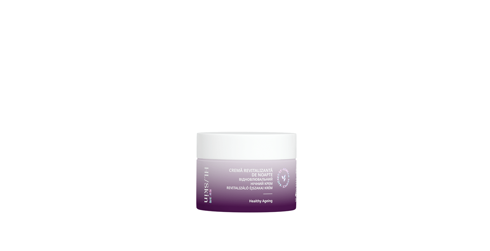

# HL/Skin Cremă Revitalizantă de noapte

*Mărime: 50 ml · Cod: 539K*

O cremă luxuriantă de noapte, care hrănește și revitalizează pielea în timp ce dormi.

## Prezentare generală

HL/Skin Cremă revitalizantă de noapte este o cremă inspirată de știința coreeană avansată a îngrijirii pielii, creată pentru a reface și revitaliza tenul în timpul nopții. Această formulă bogată și luxuriantă îmbogățită cu 4% squalane și glicerină, oferă până la 8 ore de hidratare1, contribuind la estomparea vizibilă a semnelor de îmbătrânire, susținând diminuarea adâncimii ridurilor și volumului acestora.2

Se aplică ușor și se absoarbe rapid, oferind pielii hidratare de lungă durată. Contribuie la reducerea uscăciunii tenului și la o mai bună hidratare a pielii până dimineața. Rezultatul: un ten ferm și radiant pe tot parcursul zilei.

Potrivită pentru toate tipurile de ten și fără parabeni adăugați, crema îmbunătățește netezimea3, textura2 și nivelul de catifelare al pielii, sporind în același timp luminozitatea, strălucirea și vitalitatea3, pentru o piele cu aspect mai sănătos și mai revitalizat.4

## Caracteristici

HL/Skin Crema revitalizantă de noapte:

- Bazată pe știința coreeană avansată a îngrijirii pielii
- Testată dermatologic
- Testată oftalmologic
- Îmbogățită cu 4% squalan, pentru a asigura până la 8 ore de hidratare1
- Acționează asupra semnelor vizibile ale îmbătrânirii, prin diminuarea adâncimii ridurilor și volumului acestora2
- Îmbunătățește netezimea3, textura2 și nivelul de catifelare2 al pielii
- Conferă luminozitate, strălucire și un aspect radiant3, pentru un ten sănătos, plin de vitalitate4
- 86% dintre utilizatoare sunt de părere că pielea lor s-a simțit instant mai suplă, hidratată și catifelată4
- 97% dintre utilizatoare simt că pielea lor este revitalizată peste noapte4
- 97% dintre utilizatoare consideră că pielea lor se simte fermă, radiantă și perfect hidratată pe parcursul întregii zile4
- Se aplică fără efort, se absoarbe rapid și oferă o senzație plăcută pielii4
- Potrivită pentru diferite tipuri de piele
- Fără parabeni adăugați

*1Testată pe 32 de femei cu vârste cuprinse între 25 și 60 de ani, rezultatele fiind evaluate prin măsurători instrumentale cu ajutorul Corneometer® CM 825.*

2Testată pe 34 de femei cu vârste cuprinse între 41 și 64 de ani, rezultatele fiind evaluate cu ajutorul dispozitivului PRIMROS® CR, după 60 de zile de utilizare.

3Testată pe 36 de femei cu vârste cuprinse între 41 și 64 de ani, rezultatele fiind evaluate de Expert Grader după 30 și 60 de zile de utilizare.

4Testată pe 36 de femei cu vârste cuprinse între 41 și 64 de ani, rezultatele fiind evaluate printr-un chestionar de auto-percepție după 60 de zile de utilizare.

## Ce este înăuntru

### Ingrediente

Aqua, Glycerin, Butylene Glycol, Squalane, Trehalose, Pentaerythrityl Tetraisostearate, Dimethicone, Diisostearyl Malate, Phytosteryl/Octyldodecyl Lauroyl Glutamate, Cetearyl Alcohol, PEG-40 Stearate, Ethylhexyl Stearate, Myristyl Myristate, Glyceryl Stearate, PEG-100 Stearate, Sodium Hyaluronate, Centella Asiatica Extract, Scutellaria Baicalensis Root Extract, Glycyrrhiza Glabra (Licorice) Root Extract, Camellia Sinensis Leaf Extract, Chamomilla Recutita (Matricaria) Flower Extract, Polygonum Cuspidatum Root Extract, Rosmarinus Ocinalis (Rosemary) Leaf Extract, Retinyl Palmitate, Tocopherol, Ethylhexylglycerin, Hydroxyacetophenone, 1,2-Hexanediol, Disodium EDTA, Ammonium Acryloyldimethyltaurate/VP Copolymer, Polyacrylate-13, Polysorbate 20, Sorbitan Isostearate, Polyisobutene, Copernicia Cerifera (Carnauba) Wax.

## Cum se utilizează

Aplică în fiecare seară pe pielea curată și uscată. Masează ușor pe față și gât, cu mișcări ascendente, până la absorbția completă.

---

*Alimentele prezentate în imagini și/sau videoclipuri sunt ilustrative și nu reprezintă conținutul produsului.*
