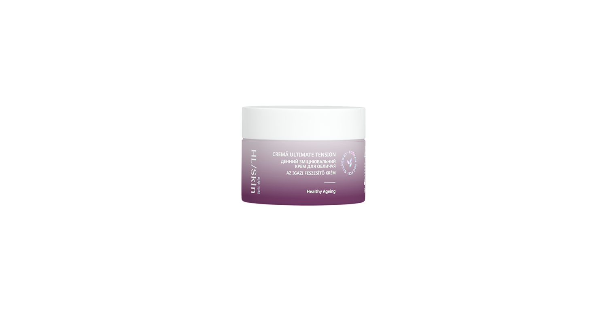

# HL/Skin Cremă Ultimate Tension

*Mărime: 50 ml · Cod: 513K*

O cremă de față bogată și catifelată, formulată pentru a acționa asupra ridurilor și a stimula elasticitatea pielii.

## Prezentare generală

Răsfață-ți pielea cu HL/Skin Cremă Ultimate Tension, o cremă hidratantă bogată și catifelată, inspirată de știința avansată coreeană a îngrijirii pielii. Formulată cu adenosină, niacinamidă și vitamina B5, oferă hidratare intensă timp de până la 8 ore, întărește bariera pielii și conferă un aspect mai neted, mai fin și mai luminos.

Această cremă hrănitoare amplifică strălucirea, elasticitatea și luminozitatea tenului, îmbunătățind treptat textura pielii și reducând senzația de asprime în timp³. Potrivită pentru toate tipurile de ten și fără parabeni adăugați, este delicată, dar eficientă—lăsând pielea mai moale, sănătoasă, hidratată și radiantă.

## Caracteristici

HL/Skin Cremă Ultimate Tension:

- Este susținută de știința avansată coreeană a îngrijirii pielii.
- Este testată dermatologic
- Este testată oftalmologic
- Oferă hidratare timp de 8 ore²
- Îmbunătățește aspectul ridurilor și sporește elasticitatea pielii³
- Îmbunătățește aspectul catifelat al pielii¹,³ și textura³
- 100% declară că produsul le-a îmbunătățit nivelul de elasticitate, catifelare și hidratare al pielii⁴
- 97% sunt de acord că produsul a contribuit la efectul de “glass skin”⁴
- Are textură bogată și catifelată
- Potrivită pentru aplicare sub machiaj
- Potrivită pentru toate tipurile de ten
- Nu conține parabeni adăugați

*¹ Testată pe 35 de femei, cu vârste între 41-60. Rezultatele au fost evaluate prin măsurători instrumentale după 30 de zile de utilizare.*

² Testată pe 32 de femei, cu vârste între 25-60. Rezultatele au fost evaluate prin măsurători instrumentale.

³ Testată pe 35 de femei, cu vârste între 41-60. Rezultatele au fost evaluate prin măsurători instrumentale după 60 de zile de utilizare.

⁴ Pe baza rezultatelor autoevaluării realizate cu 35 de femei, cu vârste între 41 și 60 de ani, după 60 de zile de utilizare.

## Ce este înăuntru

### Ingrediente

Aqua, Hydrogenated Polydecene, Dipropylene Glycol, Cetyl Ethylhexanoate, Glyceryl Stearate, Pentaerythrityl Tetraethylhexanoate, Methyl Trimethicone, Niacinamide, Cetearyl Alcohol, Polyglyceryl-6 Distearate, Panthenol, Adenosine, Sodium Hyaluronate, Tocopherol, Acetyl Hexapeptide-8, Copper Tripeptide-1, Palmitoyl Tetrapeptide-7, Nonapeptide-1, Tripeptide-1, Palmitoyl Pentapeptide-4, Palmitoyl Tripeptide-1, Hexapeptide-9, Dicaprylyl Ether, Polyglyceryl-10 Laurate, 1,2-Hexanediol, Beeswax, Cocos Nucifera (Coconut) Oil, Sodium Stearoyl Glutamate, Hydroxyethyl Acrylate/Sodium Acryloyldimethyl Taurate Copolymer, Jojoba Esters, Hydroxyacetophenone, Cetyl Alcohol, Polyglyceryl-3 Beeswax, Parfum, Ethylhexylglycerin, Disodium EDTA, Sorbitan Isostearate, Malt Extract, Sodium Laurate, Butylene Glycol, Glycerin, Lauric Acid, Linalyl Acetate, Caprylyl Glycol.

## Cum se utilizează

Aplică dimineața pe pielea curată și uscată, masând ușor fața și gâtul prin mișcări ascendente.

Nu uita să folosești protecție SPF pe timpul zilei.

Masează delicat pielea folosind instrumentul nostru Gua Sha din jad alb.

---

*Alimentele prezentate în imagini și/sau videoclipuri sunt ilustrative și nu reprezintă conținutul produsului.*
