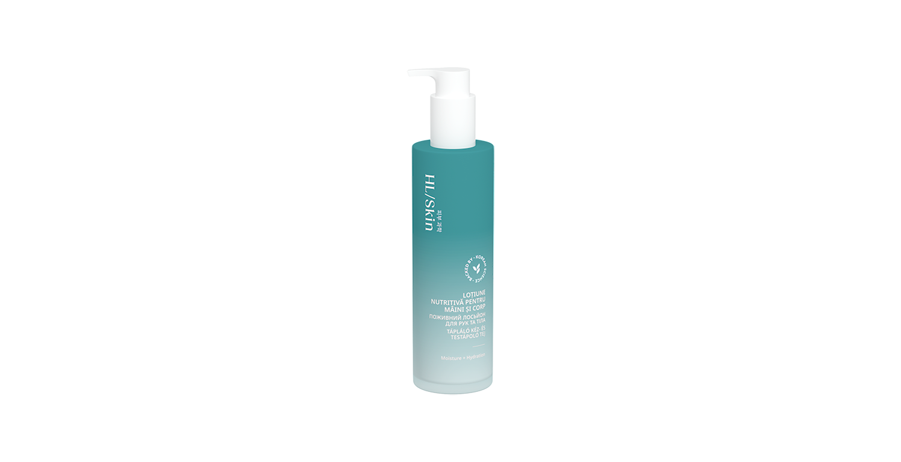

# HL/Skin Loțiune Nutritivă Pentru Mâini și Corp

*Mărime: 147 ml · Cod: 514K*

O loțiune ușoară și hrănitoare pentru mâini și corp, pentru hidratare și catifelare de lungă durată.

## Prezentare generală

Răsfață-ți pielea cu HL/Skin Loțiune nutritivă pentru mâini și corp cu o formulă ușoară și cu absorbție rapidă, susținută de știința avansată coreeană a îngrijirii pielii. Îmbogățită cu 6% squalane, oferă hidratare timp de 24 de ore—crește nivelul de hidratare a pielii cu 37% după 24 de ore¹, pentru o piele mai moale, mai netedă și cu un aspect sănătos.

Această loțiune hrănitoare ajută la menținerea hidratării, redând suplețea pielii încă de la prima aplicare. Textura sa mătăsoasă, non-grasă, se absoarbe rapid și plăcut, lăsând pielea catifelată la atingere.

Delicată pentru utilizare zilnică și potrivită pentru toate tipurile de piele, HL/Skin Loțiune nutritivă pentru mâini și corp nu conține parabeni adăugați — doar hidratare de lungă durată și confort pentru pielea ta.

## Caracteristici

HL/Skin Loțiune Nutritivă Pentru Mâini și Corp:

- Este susținută de știința avansată coreeană a îngrijirii pielii
- Este testată dermatologic
- Formulată cu 6% squalan pentru a susține hidratarea pielii
- Oferă hidratare intensă și de lungă durată pentru mâini și corp
- Crește nivelul de hidratare cu 37% după 24 de ore¹
- 96% sunt de acord că nu lasă senzație grasă pe piele²
- 93% declară că pielea absoarbe rapid produsul²
- Textură lejeră, non-grasă, care se absoarbe rapid și oferă confort²
- Potrivită pentru toate tipurile de piele
- Nu conține parabeni adăugați

*¹ Testată pe 32 de femei, cu vârste între 25-60. Rezultatele au fost evaluate prin măsurători instrumentale.*

² Pe baza rezultatelor autoevaluării realizate cu 32 de femei, cu vârste între 25 și 60 de ani, după utilizarea imediată.

## Ce este înăuntru

### Ingrediente

Aqua, Glycerin, Squalane, Ethylhexyl Stearate, Polyglyceryl-3 Distearate, 1,2-Hexanediol, Niacinamide, Betaine, Phenyl Trimethicone, Methyl Trimethicone, Cetearyl Alcohol, Adenosine, Ulmus Davidiana Root Extract, Amaranthus Caudatus Seed Extract, Centella Asiatica Extract, Ficus Carica (Fig) Fruit Extract, Ceramide NP, Tocopherol, Hydrolyzed Hyaluronic Acid, Butyrospermum Parkii (Shea) Butter, Simmondsia Chinensis (Jojoba) Butter, Theobroma Grandiflorum Seed Butter, Glyceryl Glucoside, Glyceryl Stearate, Parfum, Butylene Glycol, Glyceryl Stearate Citrate, Arginine, Carbomer, Sodium Stearoyl Glutamate, Ethylhexylglycerin, Tetramethyl Acetyloctahydronaphthalenes, Glucose, Disodium EDTA, Linalyl Acetate, Hydrogenated Lecithin, Terpineol, Acetyl Cedrene, Pinene, Geranyl Acetate, Beta-Caryophyllene.

## Cum se utilizează

Aplică zilnic, la nevoie, pe pielea curată și uscată, până se absoarbe complet.

---

*Alimentele prezentate în imagini și/sau videoclipuri sunt ilustrative și nu reprezintă conținutul produsului.*
