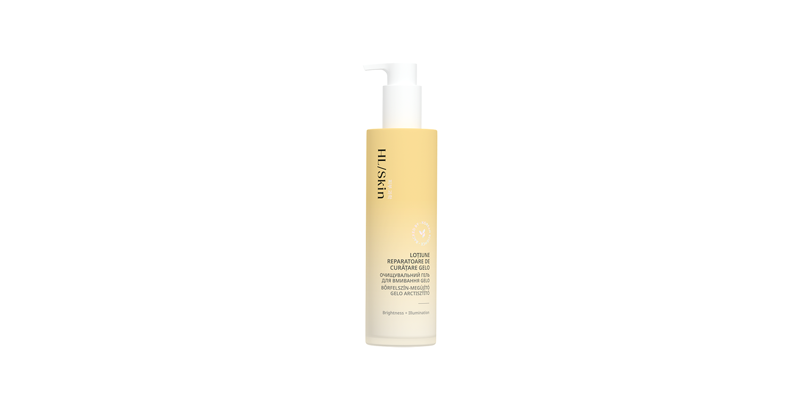

# HL/Skin Loțiune Reparatoare de Curățare Gelo

*Mărime: 147 ml · Cod: 511K*

Un gel spumant care curăță delicat, fără a usca excesiv pielea.

## Prezentare generală

Transformă rutina zilnică de curățare a tenului într-un ritual revigorant cu HL/Skin Loțiune reparatoare de curățare Gelo — un gel spumant ușor care purifică fără să agreseze pielea. Bazat pe știința coreeană avansată a îngrijirii pielii, această loțiune delicată de curățare este formulată cu grijă pentru a îndepărta machiajul, impuritățile și excesul de sebum, fără să usuce pielea. HL/Skin Loțiune reparatoare de curățare Gelo reduce imediat excesul de sebum, lăsând tenul curat, catifelat și plăcut revigorat.

HL/Skin Loțiune reparatoare de curățare Gelo nu conține parabeni adăugați sau sulfați. Folosește dimineața și seara pentru a curăța delicat pielea.

## Caracteristici

HL/Skin Loțiunea Reparatoare de Curățare Gelo:

- Este susținută de știința avansată coreeană a îngrijirii pielii
- Este testată dermatologic
- Este testată oftalmologic
- Curăță delicat fără să usuce pielea¹
- Ajută la refacerea pielii prin îndepărtarea machiajului, a impurităților³, și a excesului de sebum¹
- 100% sunt de acord că produsul reduce excesul de sebum și elimină toate impuritățile și murdăria³
- 96% sunt de acord că purifică și curăță porii, lăsând pielea cu un aspect sănătos și o senzație de prospețime³
- 93% sunt de acord că pielea lor se simte instantaneu mai catifelată după o singură utilizare²
- Lasă pielea curată, echilibrată și revigorată
- Potrivită pentru diverse tipuri de piele
- Nu are parabeni adăugați sau sulfați

*¹ Testată pe 32 de femei, cu vârste între 25-60. Rezultatele au fost evaluate prin măsurători instrumentale după utilizare imediată și după 30 de zile de utilizare.*

² Pe baza rezultatelor autoevaluării realizate cu 32 de femei, cu vârste între 25 și 60 de ani, după utilizarea imediată.

³ Pe baza rezultatelor autoevaluării realizate cu 32 de femei, cu vârste între 25 și 60 de ani, după 30 de zile de utilizare.

## Ce este înăuntru

### Ingrediente

Aqua, Glycerin, Disodium Cocoamphodiacetate, Disodium Cocoyl Glutamate, Sodium Chloride, Betaine, Citric Acid, Hydroxypropyl Starch Phosphate, Eclipta Prostrata Leaf Extract, Fructooligosaccharides, Centella Asiatica Extract, Ficus Carica (Fig) Fruit Extract, Beta-Glucan, Hydrolyzed Hyaluronic Acid, Ceramide NP, Sodium Hyaluronate, Sodium Acetylated Hyaluronate, Acrylates/C10-30 Alkyl Acrylate Crosspolymer, Coco-Betaine, Sodium Methyl Oleoyl Taurate, 1,2-Hexanediol, Caprylyl Glycol, Polyglyceryl-10 Laurate, Potassium Benzoate, Glyceryl Caprylate, Parfum, Coco-Glucoside, Ethylhexylglycerin, Tetramethyl Acetyloctahydronaphthalenes, Hexylene Glycol, Sodium Phytate, Dipropylene Glycol, Butylene Glycol, Linalyl Acetate, Laminaria Japonica Extract, Terpineol, Acetyl Cedrene, Pinene, Hydrogenated Lecithin, Zea Mays (Corn) Germ Oil, Caprylic/Capric Triglyceride, Pentaerythrityl Tetra-Di-T-butyl Hydroxyhydrocinnamate.

## Cum se utilizează

Aplică pe palmele umede și masează până obții o spumă fină. Masează ușor fața și gâtul, folosind mișcări circulare. Clătește bine cu apă călduță și usucă prin tapotare delicată cu prosopul. Folosește dimineața și seara pentru cele mai bune rezultate.

Folosește împreună cu bentița din bumbac și peria de curățare din silicon pentru un ritual de îngrijire complet și eficient.

---

*Alimentele prezentate în imagini și/sau videoclipuri sunt ilustrative și nu reprezintă conținutul produsului.*
