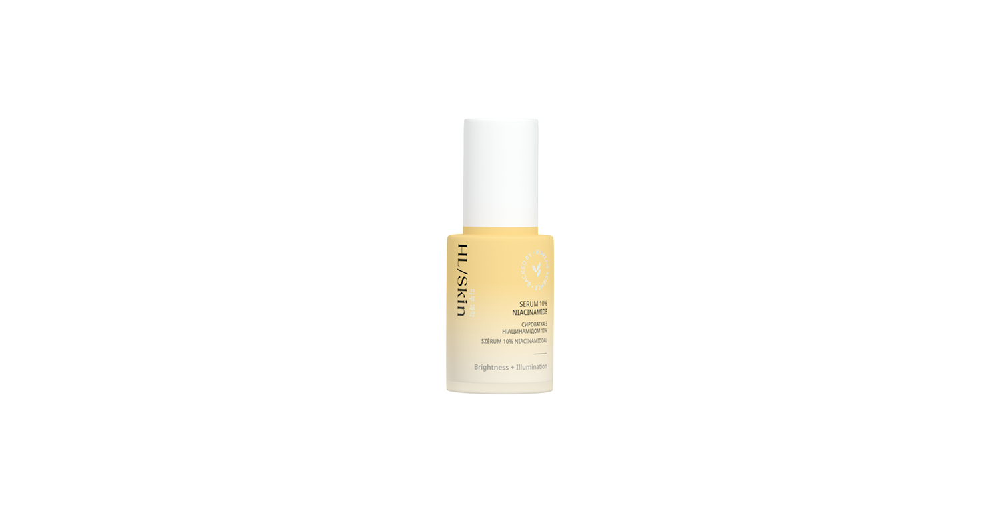

# HL/Skin Serum 10% Niacinamide

*Mărime: 30 ml · Cod: 508K*

Un serum pe bază de apă, care întărește bariera naturală a pielii și amplifică luminozitatea pentru un ten sănătos și strălucitor.

## Prezentare generală

Descoperă un ten mai luminos, mai neted și mai radiant cu HL/Skin Serum 10% Niacinamide, dezvoltat de experții în știința coreeană avansată a îngrijirii pielii. Datorită concentrației ridicate de niacinamide, acest serum ușor și cu absorbție rapidă ajută la îmbunătățirea aspectului porilor, uniformizarea tonului pielii și reducerea petelor, oferind un aspect sănătos și strălucitor.

Îmbogățit cu ingrediente care mențin echilibrul hidratării, formula susține bariera naturală a pielii și asigură până la 8 ore de hidratare continuă. Utilizat regulat, contribuie la îmbunătățirea texturii generale a pielii, netezimii și catifelării, reducând vizibilitatea, dimensiunea și adâncimea ridurilor. Pielea arată mai luminoasă, mai fină și mai radiantă, cu un ton uniform și pete vizibil diminuate.

HL/Skin Serum 10% Niacinamide nu conține parabeni adăugați și este potrivit pentru aplicare sub machiaj.

## Caracteristici

HL/Skin Serum 10% Niacinamide:

- Este susținut de știința avansată coreeană a îngrijirii pielii
- Este testat dermatologic
- Este testat oftalmologic
- Oferă până la 8 ore de hidratare²
- Îmbunătățiri observate pentru uniformitatea tonului pielii³, luminozitatea pielii³, vizibilitatea și dimensiunea ridurilor¹, netezime³, aspectul porilor³
- Este potrivit pentru aplicare sub machiaj
- Potrivit pentru toate tipurile de ten
- Nu are parabeni adăugați

*¹ Testat pe 34 de femei, cu vârste între 44-65. Rezultatele au fost evaluate prin măsurători instrumentale după 60 de zile de utilizare.*

² Testat pe 32 de femei, cu vârste între 25-60. Rezultatele au fost evaluate prin măsurători instrumentale.

³ Testat pe 36 de femei, cu vârste între 44-65. Rezultatele au fost evaluate prin măsurători instrumentale după 60 de zile de utilizare.

## Ce este înăuntru

### Ingrediente

Aqua, Niacinamide, Glycerin, Butylene Glycol, 1,2-Hexanediol, Panthenol, Fructooligosaccharides, Beta-Glucan, Hydrolyzed Hyaluronic Acid, Tocopherol, Dipropylene Glycol, Laminaria Japonica Extract, Eclipta Prostrata Leaf Extract, Acrylates/ C10-30 Alkyl Acrylate Crosspolymer, Tromethamine, Xanthan Gum, Ethylhexylglycerin, Disodium EDTA, Hydrogenated Lecithin.

## Cum se utilizează

Aplică câteva picături pe pielea curată și uscată de pe față și gât. Masează ușor pielea până când serumul este absorbit. Se aplică o dată pe zi.

Nu uita să folosești protecție SPF pe timpul zilei.

Masează delicat pielea folosind instrumentul nostru Gua Sha din jad alb.

---

*Alimentele prezentate în imagini și/sau videoclipuri sunt ilustrative și nu reprezintă conținutul produsului.*
