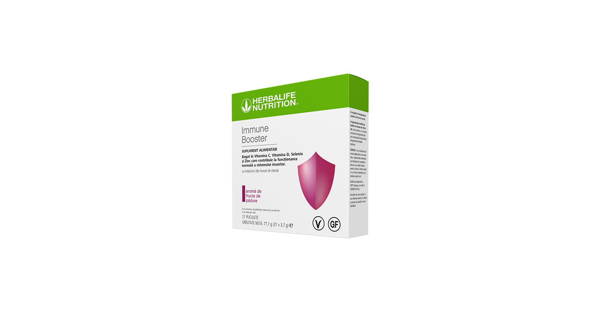
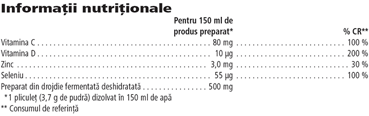

# Immune Booster

*Aromă: Fructe de pădure · Mărime: 21 pliculețe · Cod: 233K*

Formulat exclusiv cu EpiCor® și o combinație unică de vitamine și minerale cheie.

## Prezentare generală

Sistemul imunitar este o rețea incredibil de complexă care funcționează armonios și neîncetat în fiecare zi. Susține-ți sistemul imunitar cu Immune Booster.

Immune Booster este un supliment alimentar sub formă de pudră, formulat exclusiv cu EpiCor®, ingredient dovedit științific, preparat din drojdie fermentată deshidratată. Immune Booster este, de asemenea, formulat cu un amestec de vitamine și minerale cheie, cum ar fi vitamina C, seleniu și zinc, care contribuie la protejarea celulelor împotriva stresului oxidativ și vitamina D, care contribuie la funcționarea normală a sistemului imunitar.

Integrează cu ușurință Immune Booster în rutina ta zilnică. Cu o aromă bogată de fructe de pădure, fiecare porție din acest supliment unic este disponibil într-un pliculeț individual. Amestecă pur și simplu într-un pahar de apă și savurează aroma delicioasă de fructe de pădure.

Bucură-te de Immune Booster acasă, la birou sau atunci când ești în deplasare. Preia controlul asupra sistemului tău imunitar, oriunde te-ai afla.

## Caracteristici

Immune Booster:

- Este formulat cu EpiCor®
- Este bogat în vitamina C, seleniu și zinc
- Este bogat în vitamina D
- Este potrivit pentru vegani și vegetarieni
- Nu conține gluten
- Este formulat cu îndulcitor din frunze de Stevia
- Disponibil într-o cutie cu 21 de pliculețe individuale

## Ce este înăuntru

### Ingrediente

Maltodextrină, preparat din drojdie fermentată deshidratată EpiCor® (produs cu *Saccharomyces cerevisiae*), pulbere din suc concentrat din fructe de soc (sambucus nigra), corector de aciditate (acid citric), agenți de îngroșare (gumă de acacia, gumă de xantan), acid L-ascorbic, aromă naturală, colorant (roșu sfeclă), îndulcitor (glicozide steviolice din *Stevia*), citrat de zinc, colecalciferol, agent antiaglomerant (dioxid de siliciu), selenit de sodiu.

*EpiCor® este marcă înregistrată a Embria Health Sciences, LLC.*

### Informații nutriționale

## Cum se utilizează

Adaugă un pliculeț (3,7 g) în 150 ml de apă și amestecă până se dizolvă. Consumă 1 pahar pe zi în timpul unei mese\*.

Savurează acest produs în cadrul unei diete echilibrate şi variate, ca parte a unui stil de viaţă activ şi sănătos.

A se păstra la temperatura camerei, într-un loc uscat.

*\*A nu se depăși doza zilnică recomandată. Suplimentele alimentare sunt destinate să completeze dieta și nu ar trebui folosite pentru a înlocui o dietă variată. A nu se lăsa la îndemâna şi la vederea copiilor mici.*

---

*Alimentele prezentate în imagini și/sau videoclipuri sunt ilustrative și nu reprezintă conținutul produsului.*
