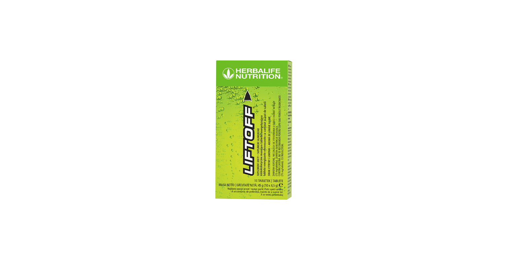
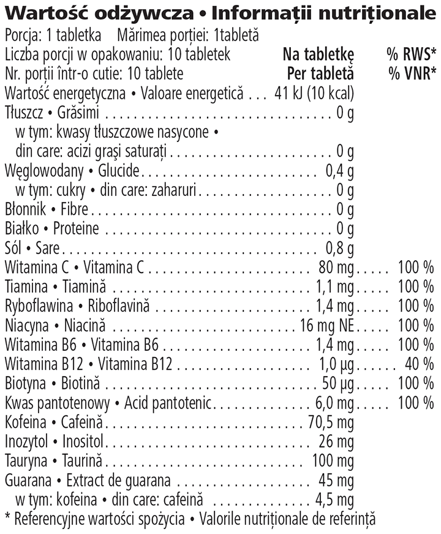

# LiftOff®

*Aromă: Lămâie and lime · Mărime: 10 pliculețe · Cod: 3152*

O tabletă energizantă efervescentă cu un conținut scăzut de calorii, formulată cu cofeină și vitamine esențiale.

## Prezentare generală

Bucură-te de efervescența subtilă și de gustul revigorant al LiftOff®.

Cu doar 10 calorii pe porție, LiftOff® este un supliment energizant efervescent cu un conținut scăzut de calorii, care oferă un gust deosebit într-o tabletă ușor de utilizat. Ambalat convenabil în pliculețe individuale, LiftOff® este formulat cu un amestec de vitamine cheie, inclusiv vitamina C și vitaminele B1, B2, B3, B6 și B12. În plus, fiecare comprimat furnizează 75 miligrame de cofeină\*, inclusiv cofeină naturală derivată din planta guarana.

Fiecare tabletă LiftOff® se transformă într-o băutură delicioasă și răcoritoare cu aromă de lămâie și lime. Pur și simplu dizolvă o tabletă într-un pahar de apă și bucură-te de o porție zilnică din acest supliment alimentar răcoritor cu un conținut scăzut de calorii, oricând și oriunde, ori de câte ori ai nevoie de un boost de energie\*.

*\*Se recomandă să nu se depășească un aport zilnic de 400 mg de cofeină din toate sursele (200 mg pentru femeile însărcinate sau care alăptează). Nu trebuie depășită o doză unică de 200 mg de cofeină (EFSA Journal 2015;13(5):4102. 2015).*

## Caracteristici

LiftOff®:

- Furnizează 75 mg de cofeină\*
- Conține cofeină pulbere și cofeină naturală din guarana
- Este formulat cu vitamine B (B1, B2, B3, B6, B12, acid pantotenic și biotină)
- Este formulat cu vitamina C
- Are doar 10 calorii per tabletă
- Este ambalat individual pentru comoditate și este disponibil într-o cutie cu 10 tablete

*\*Se recomandă să nu se depășească un aport zilnic de 400 mg de cofeină din toate sursele (200 mg pentru femeile însărcinate sau care alăptează). Nu trebuie depășită o doză unică de 200 mg de cofeină (EFSA Journal 2015;13(5):4102. 2015).*

## Ce este înăuntru

### Ingrediente

Acidifiant (acid citric), corector de aciditate (bicarbonat de sodiu), maltodextrină, arome, taurină, acid ascorbic, pudră de cafeină, îndulcitori (acesulfam-K, sucraloză), extract de guarana (*Paullinia cupana* Kunth), inositol, nicotinamidă, agent de încărcare (sorbitol), D-Pantotenat de Calciu, riboflavină-5’-fosfat de sodiu, clorhidrat de piridoxină, mononitrat de tiamină, D-biotină, cianocobalamină.

### Informații nutriționale

## Cum se utilizează

Se pune o tabletă în 250 ml de apă și se lasă să se dizolve. Bucură-te de 1 porție pe zi\*.

Savurează acest produs în cadrul unei diete echilibrate și variate, ca parte a unui stil de viață sănătos și activ.

Depozitează într-un loc răcoros și uscat.

*\*Nu depăși doza zilnică recomandată. Suplimentele alimentare sunt destinate să completeze dieta și nu trebuie folosite ca substitut al unei diete variate. A nu se păstra la îndemâna și la vederea copiilor mici. Acest produs conține aproximativ 75 mg de cofeină pe porție și nu este recomandat copiilor, femeilor însărcinate sau care alăptează sau persoanelor sensibile la cofeină. Nu se recomandă utilizarea cu alcool.*

---

*Alimentele prezentate în imagini și/sau videoclipuri sunt ilustrative și nu reprezintă conținutul produsului.*
