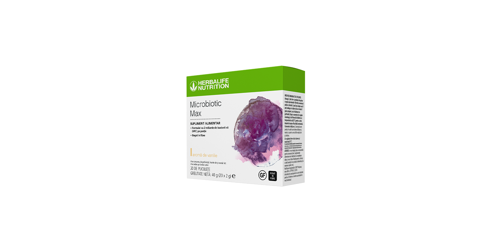
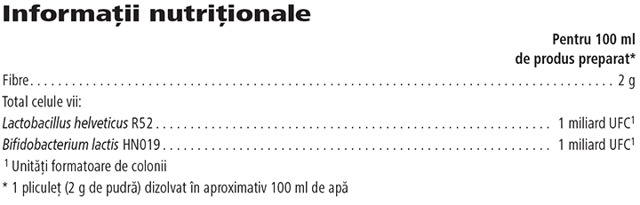

# Microbiotic Max

*Aromă: Vanilie · Mărime: 20 pliculețe · Cod: 173K*

​​Formulat exclusiv cu o combinație de bacterii vii și fibre.​

## Prezentare generală

Microbiotic Max este un supliment alimentar sub formă de pudră, formulat pentru a oferi o combinație de probiotice și fibre prebiotice, care lucrează împreună în armonie pentru a sprijini obiectivele nutriționale. Acest produs este bogat în fibre și fiecare porție conține 2 miliarde de bacterii vii din tulpini de *Bifidobacterium lactis* și *Lactobacillus helveticus*.

Include cu ușurință Microbiotic Max în rutina ta zilnică. Acest supliment unic nu are nevoie de refrigerare și fiecare porție este ambalată într-un plic individual convenabil. Pur și simplu amestecă într-o jumătate de pahar cu apă sau adaugă-l în shake-ul preferat și savurează aroma subtilă de vanilie. Susține-ți obiectivele nutriționale, oriunde te-ai afla.

## Caracteristici

Microbiotic Max:

- Conține o combinație de bacterii vii și fibre
- Oferă 2 miliarde de bacterii vii (CFU) per porție
- Este bogat în fibre
- Nu conține gluten
- Nu conține îndulcitori sau coloranți
- Nu necesită refrigerare
- Disponibil într-o cutie cu 20 de pliculețe individuale

## Ce este înăuntru

### Ingrediente

Pulbere de galacto-oligozaharide (galacto-oligozaharide (**lapte**), lactoză (**lapte**), glucoză (**lapte**), galactoză (**lapte**)), maltodextirină, *Lactobacillus helveticus* R52, *Bifidobacterium lactis* HN019, aromă, agent antiaglomerant (dioxid de siliciu).

### Informații despre alergeni

CONȚINE LAPTE. POATE CONȚINE BOABE DE SOIA.

### Informații nutriționale

## Cum se utilizează

Adaugă 1 plic într-o jumătate de pahar cu apă (aproximativ 100 ml), amestecă până se dizolvă și savurează-l. Îl poți bea simplu sau îl poți adăuga în shake-ul tău preferat Formula 1. Adaugă-l în shake sau smoothie, doar după ce acestea au fost preparate deja, iar ingredientele au fost amestecate bine. Te rugăm să adaugi și să folosești lichidele cu o temperatură sub 25°C pentru a evita impactul asupra eficacității produsului. Consumă o dată pe zi\*.

Savurează acest produs în cadrul unei diete echilibrate şi variate, ca parte a unui stil de viaţă activ şi sănătos.

A se păstra într-un loc răcoros şi uscat sub 25°C.

*\*A nu se depăşi doza recomandată pentru consumul zilnic. Suplimentele alimentare sunt destinate să completeze dieta și nu ar trebui folosite pentru a înlocui o dietă variată. A nu se lăsa la îndemâna şi vederea copiilor mici.*

---

*Alimentele prezentate în imagini și/sau videoclipuri sunt ilustrative și nu reprezintă conținutul produsului.*
