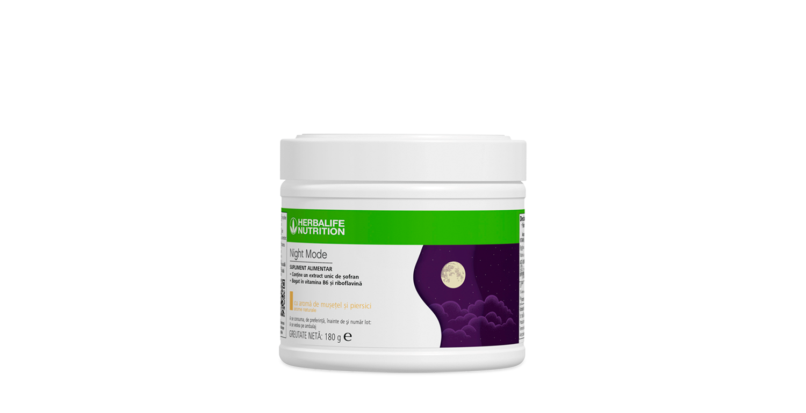
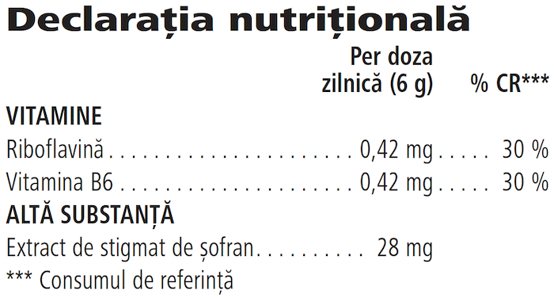

# Night Mode

*Aromă: Mușețel și piersici · Mărime: 180 g · Cod: 282K*

Un supliment alimentar, creat pentru rutina ta de noapte, infuzat cu un extract unic de șofran.

## Prezentare generală

Bucură-te de serile tale cu Night Mode, un supliment alimentar infuzat cu un extract de șofran studiat științific, creat pentru rutina ta de noapte.

Acordă-ți un moment de mindfulness cu Night Mode și încântă-ți simțurile cu aromele subtile de mușețel și piersici, iar ziua de mâine o vei vedea într-o lumină cu totul nouă.

Night Mode conține, de asemenea, un amestec de vitamine atent selecționate care contribuie la menținerea sănătății psihice\* și la funcționarea normală a sistemului nervos\*\*.

Pentru un somn bun, integrează Night Mode în rutina ta de seară. Așază-te confortabil, relaxează-te și savurează o cană din această băutură cu aromă de mușețel și piersici.

*\*Vitamina B6*

\*\*Vitamina B6 și Riboflavină

## Caracteristici

Night Mode:

- Este infuzat cu extract de șofran demonstrat științific
- Bogat în vitamina B6
- Are un conținut ridicat de riboflavină
- Conține coloranți din sursă naturală și nu conține arome artificiale
- Este potrivit pentru vegani
- Fără zahăr
- Fără gluten
- 30 de porții

## Ce este înăuntru

### Ingrediente

Fibre solubile de **grâu** fără gluten, arome naturale, colorant (complecși de cupru ai clorofilinelor), extract de stigmat de șofran (*Crocus sativus* L.), riboflavină, vitamina B6 (clorhidrat de piridoxină), agent antiaglomerant (dioxid de siliciu).

### Informații despre alergeni

CONȚINE GRÂU.

### Informații nutriționale

## Cum se utilizează

Adăugă o măsură (6 g) la o jumătate de cană de apă rece sau caldă (aproximativ 150 ml), amestecă și savurează cu aproximativ o oră înainte de culcare. Consumă o dată pe zi\*.

Savurează acest produs în cadrul unei diete echilibrate și variate, ca parte a unui stil de viață sănătos și activ. Acest produs nu este un medicament.

A se pastra cu capacul închis intr-un loc răcoros și uscat.

*\*A nu se depăși doza zilnică recomandată. Suplimentele alimentare sunt destinate să completeze dieta și nu tar trebui folosite pentru a înlocui o dietă variată. A nu se plăsa la îndemâna copiilor. Nu este recomandat copiilor, femeilor care alăptează sau care sunt însărcinate.*

---

*Alimentele prezentate în imagini și/sau videoclipuri sunt ilustrative și nu reprezintă conținutul produsului.*
