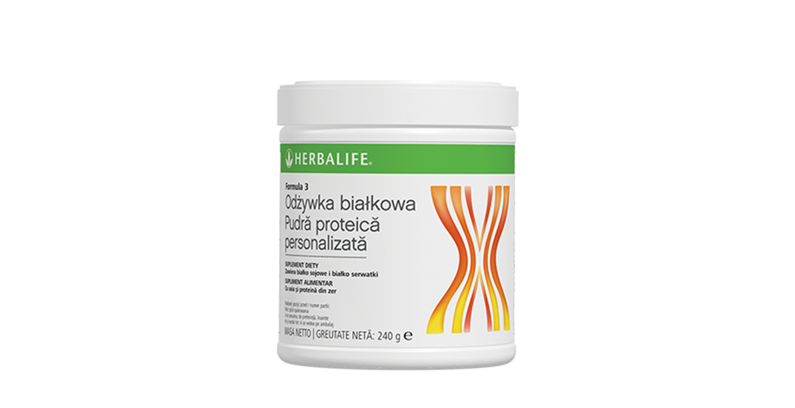
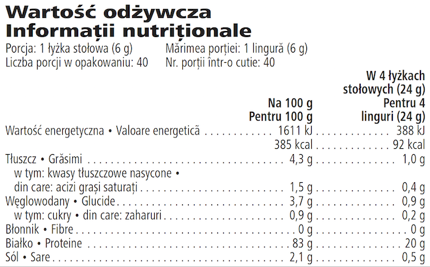

# Pudră Proteică Personalizată Formula 3

*Aromă: Neutră · Mărime: 240 g · Cod: 0242*

Optimizează-ți aportul de proteine cu acest amestec ce conține soia și concentrat proteic din zer.

## Prezentare generală

Această formulă versatilă de proteine, este creată special pentru a te ajuta să îți optimizezi nutriția și să îți satisfaci necesarul zilnic de proteine.

Pudra Proteică Personalizată Formula 3 este realizată dintr-un amestec de proteine din zer și proteine de soia de înaltă calitate, ce contribuie la menținerea și creșterea masei musculare.

Pudra Proteică Personalizată Formula 3 te ajută să îți îmbunătățești aportul zilnic de proteine. Cu o aromă neutră, această formulă simplă se poate amesteca cu ușurință cu alte alimente sau băuturi, ori de câte ori simți nevoia de acel plus de proteine. Adaugă această formulă în shake-uri, smoothie-uri, supe sau sosuri și crește-ți necesarul zilnic de proteine, într-un mod simplu și ușor.

## Caracteristici

Pudră Proteică Personalizată Formula 3:

- Conține 5 g de amestec de proteine din soia și zer de înaltă calitate per porție
- Conține 23 de calorii per porție
- Este versatilă datorită aromei sale neutre
- Crește aportul de proteine
- Conține 40 de porții

## Ce este înăuntru

### Ingrediente

Izolat proteic din **soia** (74,9 %), concentrat proteic din zer (24,5 %) (**lapte**), arome, agent antiaglomerant (dioxid de siliciu).

### Informații despre alergeni

CONȚINE SOIA ȘI LAPTE.

### Informații nutriționale

## Cum se utilizează

O măsură de pudră (6 g) conţine 5 g de proteine. Consumă între una şi patru porţii pe zi. Agită ușor recipientul înainte de fiecare utilizare. Această formulă simplă se poate amesteca cu alte alimente sau băuturi, inclusiv sosuri și supe.

Savurează acest produs în cadrul unei diete echilibrate şi variate, ca parte a unui stil de viaţă activ şi sănătos.

A nu se depăşi doza recomandată pentru consumul zilnic. Suplimentele alimentare sunt destinate să completeze dieta și nu ar trebui folosite pentru a înlocui o dietă variată. A nu se lăsa la îndemâna copiilor.

A se pastra cu capacul închis într-un loc răcoros și uscat.

---

*Alimentele prezentate în imagini și/sau videoclipuri sunt ilustrative și nu reprezintă conținutul produsului.*
