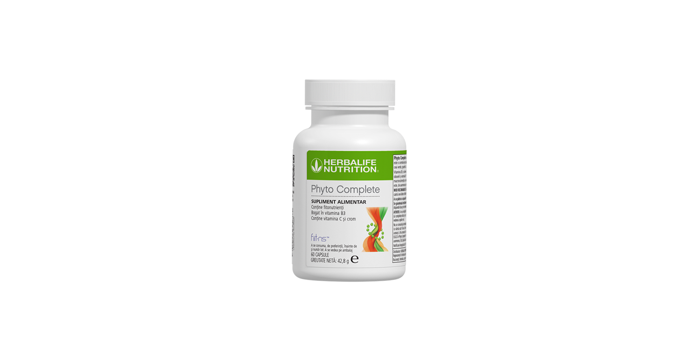
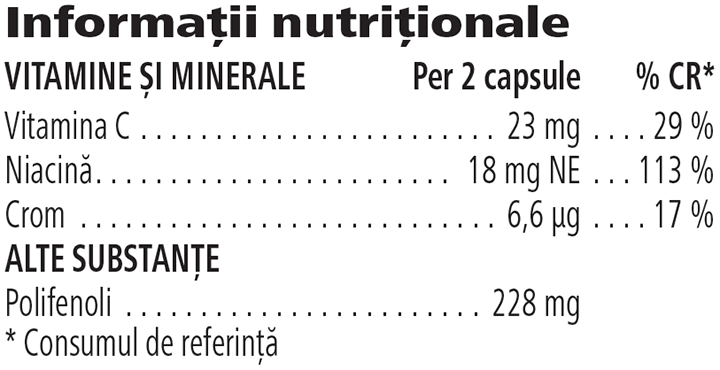

# Phyto Complete

*Mărime: 60 capsule · Cod: 236K*

​​Descoperă Phyto Complete, o capsulă bogată în fitonutrienți formulată cu Fiit-NS™.​

## Prezentare generală

Descoperă beneficiile naturii concentrate într-o capsulă Phyto Complete.

Această capsulă cu multiple proprietăți, bogată în fitonutrienți este formulată cu grijă cu Fiit-NS™, un ingredient studiat științific ce conține micronutrienți cheie și o combinație de extracte botanice.

Phyto Complete conține cofeină naturală și este bogată în vitamina C, vitamina B3, crom și extracte botanice, inclusiv guarana, ceai verde, grapefruit, struguri și morcov negru.

Susține-ți rutina de zi cu zi cu doza zilnică de Phyto Complete – provenit din natură și susținut de știință.

*\*Vitamina B3 și vitamina C contribuie la un metabolism energetic normal și la reducerea oboselii și epuizării, în timp ce cromul susține metabolismul normal al macronutrienților și menținerea nivelului normal de glucoză din sânge.*

## Caracteristici

Phyto Complete:

- Este formulat cu Fiit-NS™
- Conține cofeină naturală din guarana
- Conține crom
- Conține vitaminele C și B3 (niacina)
- Este bogat în fitonutrienți
- Este potrivit pentru vegani
- Nu conține gluten
- Conține 60 de capsule

## Ce este înăuntru

### Ingrediente

Fiit-NS™ (63 %) (extract din frunze de ceai verde (*Camellia sinensis* (L.) Kuntze) (20 %), extract de semințe de guarana (*Paullinia cupana* Kunth) (20 %), extract de sâmburi și pielițe de struguri (*Vitis vinifera* L.) (16 %), extract de grapefruit (*Citrus paradisi* Macfad.) (15 %), extract de rădăcină de morcov negru (*Daucus carota* L.) (12 %), nicotinamidă), agenți de încărcare (fosfați de calciu, celuloză microcristalină), învelișul capsulei (hidroxipropilmetilceluloză, colorant (complecși de cupru ai clorofilinelor)), acid L-ascorbic, agenți antiaglomeranți (Săruri de magneziu ale acizilor grași, dioxid de siliciu), clorură de crom (III).

*Fiit-NS™ este marcă înregistrată a Fytexia.*

### Informații nutriționale

## Cum se utilizează

Ia 2 capsule pe zi, în timpul mesei\*.

Utilizează acest produs în cadrul unei diete echilibrate şi variate, ca parte a unui stil de viaţă activ şi sănătos.

A se păstra cu capacul închis într-un loc răcoros și uscat.

*\*A nu se depăşi doza recomandată pentru consumul zilnic. Suplimentele alimentare sunt destinate să completeze dieta și nu ar trebui folosite pentru a înlocui o dietă variată. A nu se păstra la îndemâna și la vederea copiilor mici. Se recomandă să nu fie consumat pe stomacul gol. Se recomandă să nu fie consumat de femeile însărcinate sau care alăptează și de copiii cu vârsta sub 18 ani. Se recomandă să nu fie consumat dacă în aceeași zi se administrează și alte produse care conțin ceai verde. Nu consuma o cantitate zilnică de 800 mg de (-)-epigalocatechin-3-galat (EGCG) sau mai mult. EGCG în Phyto Complete: 90 mg (per 2 capsule).*

---

*Alimentele prezentate în imagini și/sau videoclipuri sunt ilustrative și nu reprezintă conținutul produsului.*
