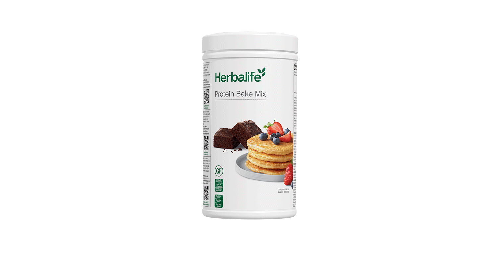
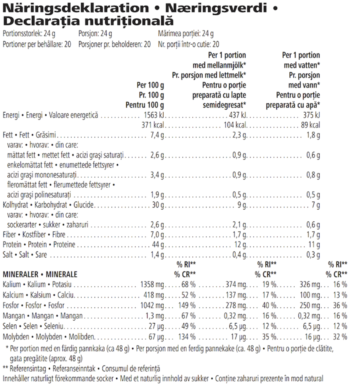

# Protein Bake Mix

*Aromă: Neutră · Mărime: 480 g · Cod: 528K*

Oferă rețetelor tale un plus de proteine.

## Prezentare generală

Cu Protein Bake Mix transforma rețetele preferate în gustări proteice delicioase.

Protein Bake Mix este formulat cu atenție pentru a oferi un aport echilibrat de nutrienți, astfel încât preparatele tale să fie delicioase și să-ți ofere o nutriție excelentă. Formulat cu proteine din zer de înaltă calitate, acest amestec conține, de asemenea, minerale cheie și reprezintă o sursă bună de fibre.

Cu o aromă neutră, Protein Bake Mix se amestecă ușor în rețetele tale preferate și îți transformă preparatele în alternative gustoase, ce îți vor oferi un aport suplimentar de proteine. De la fursecuri sau brioșe și până la clătite sau waffles, cu Protein Bake Mix ai posibilități nelimitate.

Cu Protein Bake Mix poți savura rețetele tale preferate și în același timp vei răspunde nevoilor tale nutriționale. Combină bucuria preparatelor cu beneficiile proteinelor și bucură-te de fiecare rețetă care te va aduce cu un pas mai aproape de atingerea necesarului zilnic de proteine.

## Caracteristici

Protein Bake Mix:

- Bogat în proteine
- Sursă de fibre
- Conține un amestec de minerale cheie
- Este versatil datorită aromei sale neutre
- Nu conține adaos de zahăr, coloranți, arome sau îndulcitori
- Conține 20 de porții

## Ce este înăuntru

### Ingrediente

Concentrat proteic din zer (**lapte**), făină de **ovăz** integral fără gluten, praf de **ou** întreg, cazeinat de calciu (**lapte**), praf de copt (agenți de afânare (carbonat acid de potasiu, difosfat disodic), făină de orez), dextrină de **grâu** fără gluten.

### Informații despre alergeni

CONȚINE LAPTE, OVĂZ, OU ȘI GRÂU.

### Informații nutriționale

## Cum se utilizează

Pentru a găti clătite hrănitoare, preîncălzește o tigaie antiaderentă la foc mic. Amestecă 24 g (3 linguri) de Protein Bake Mix cu 30 ml (2 linguri) de lapte semi-degresat (1,5 % grăsime) sau 30 ml (2 linguri) de apă. Odată omogenizat, toarnă aluatul în mijlocul tigăii și întinde clătitele până la grosimea dorită.

Gătește la foc mic timp de 2-3 minute până când aluatul devine auriu, apoi întoarce clătita și repetă acest pas pe cealaltă parte.

A se păstra cu capacul închis, într-un loc răcoros şi uscat.

---

*Alimentele prezentate în imagini și/sau videoclipuri sunt ilustrative și nu reprezintă conținutul produsului.*
