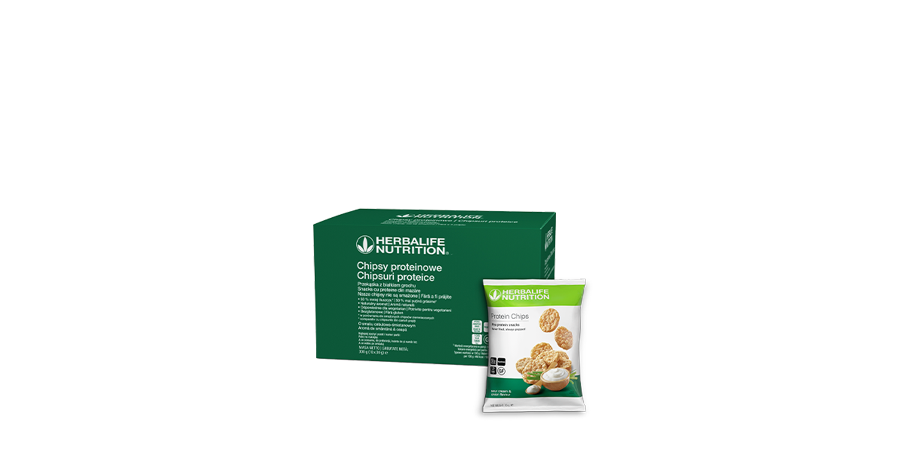
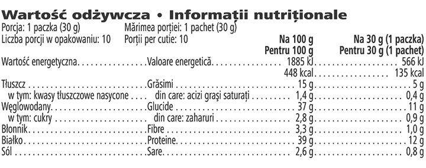

# Chipsuri Proteice

*Aromă: Smântână și Ceapă · Mărime: 10 pachete · Cod: 142K*

Fără a fi prăjite.

## Prezentare generală

Amplifică-ți experiența gustărilor cu Chipsurile Proteice. Obținută prin coacere, această gustare proteică delicioasă combină textura crocantă irezistibilă cu proteina din mazăre de înaltă calitate.

Cu o textură crocantă și savuroasă, fiecare chips obținut prin coacere, conține cu 50% mai puține grăsimi decât chipsurile prăjite din cartofi. Fiecare pungă de chipsuri este plină de savoare, este bogată în proteine și, de asemenea, nu conține gluten.

Indiferent dacă vizionezi un film sau ai o zi de muncă agitată, chipsurile proteice sunt partenerul perfect pentru o gustare savuroasă. Delicioase și cu o textură crocantă deosebită, aceste chipsuri sunt create pentru a-ți oferi un plus de proteine ori de câte ori simți nevoia.

## Caracteristici

Chipsuri Proteice:

- Oferă 12 g de proteine din mazăre per pachet
- Conțin cu 50 % mai puține grăsimi decât chipsurile din cartofi prăjiți
- Potrivite pentru vegetarieni
- Nu conțin gluten
- Sunt gustarea proteică perfectă
- Disponibile într-o cutie de 10 pachete

## Ce este înăuntru

### Ingrediente

Bază din mazăre (izolat proteic din mazăre 41 %, făină de linte, amidon de cartof, făină de porumb), uleiuri vegetale (floarea-soarelui, canola) în proporții variate, produse de asezonare [ceapă pudră, zer pudră (**lapte**), sare, smântână acră pudră (**lapte**), branză pudră (branză (**lapte**), **lapte** praf, emulsifiant (fosfat disodic)), dextroză, extract de drojdie, aromă naturală, pătrunjel deshidratat, corector de aciditate (acid citric)], antioxidant (extract de rozmarin).

### Informații despre alergeni

CONȚINE LAPTE. POATE CONȚINE SOIA.

### Informații nutriționale

## Cum se utilizează

Poți să le consumi direct din pachet, nu necesită nicio pregătire. Savurează acest produs în cadrul unei diete echilibrate şi variate, ca parte a unui stil de viaţă activ şi sănătos.

A se păstra într-un loc răcoros și uscat.

---

*Alimentele prezentate în imagini și/sau videoclipuri sunt ilustrative și nu reprezintă conținutul produsului.*
