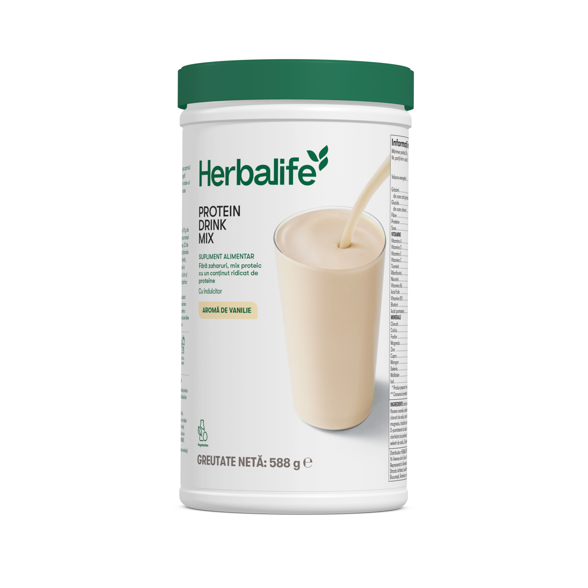
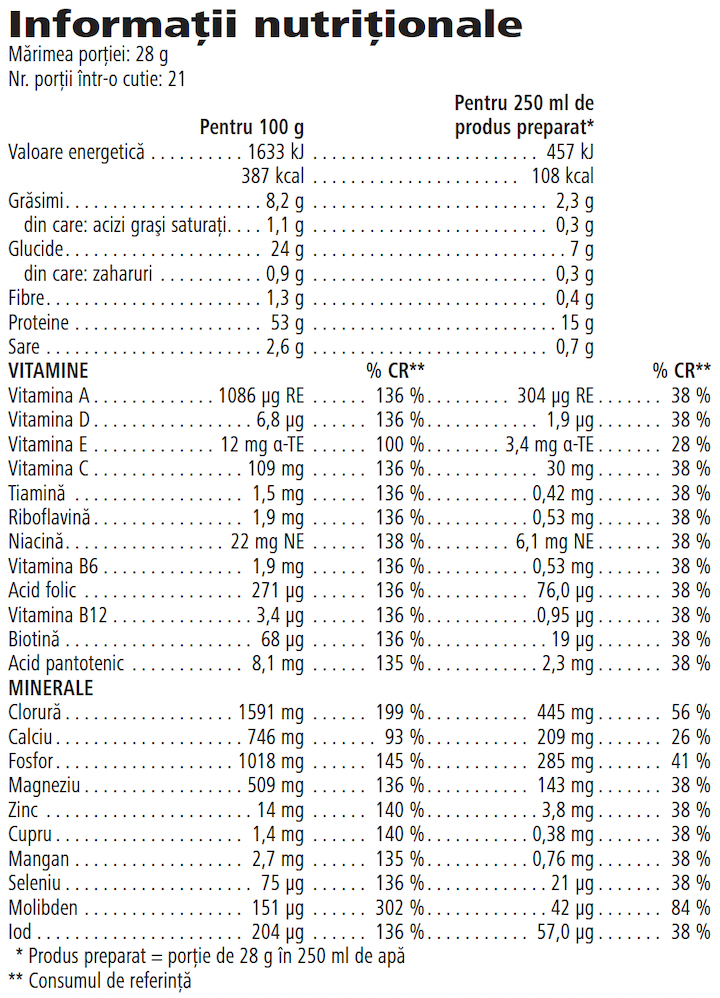

# Protein Drink Mix

*Aromă: Vanilie · Mărime: 588 g · Cod: 2600*

​​Un mix cu aromă subtilă de vanilie pentru un plus de proteine.​

## Prezentare generală

Protein Drink Mix te ajută să crești aportul zilnic de proteine, vitamine și minerale cheie.

Savurează Protein Drink Mix ca supliment proteic sau ca o băutură proteică nutritivă. Fiecare porție furnizează 15 g de proteine de înaltă calitate și 22 de vitamine și minerale cheie. Pentru un plus de proteine, adaugă-l în shake-ul sau smoothie-ul preferat.

Integrează cu ușurință această pudră proteică versatilă în rutina ta zilnică. Protein Drink Mix este potrivit pentru vegetarieni, are o aromă subtilă de vanilie și poate fi personalizat în funcție de stilul de viață, gustul și nevoile tale nutriționale. Îl poți amesteca cu apă rece sau îl poți adăuga în shake-ul preferat Formula 1 pentru a obține o băutură nutritivă, bogată și cremoasă.

Îmbunătățește-ți aportul zilnic de proteine cu o băutură proteică delicioasă cu aromă subtilă de vanilie, care se prepară rapid și ușor. Răspunde nevoilor tale nutriționale și obține un plus de proteine oricând simți că ai nevoie.

## Caracteristici

Protein Drink Mix:

- Furnizează 15 g de proteine de înaltă calitate per porție
- Conține 22 de vitamine și minerale cheie
- Conține vitamine cheie din complexul B
- Potrivit pentru vegetarieni
- Nu conține zahăr
- Oferă un aport rapid de proteine
- Conține 21 de porții

## Ce este înăuntru

### Ingrediente

Izolat proteic din **soia** (47 %), maltodextrină, cazeinat de calciu (**lapte**), grăsimi vegetale pudră (ulei de floarea-soarelui, maltodextrină, cazeinat de sodiu (**lapte**)), arome, fosfat de magneziu, emulsifiant (lecitină din **soia**), clorură de sodiu, clorură de potasiu, agenți de îngroșare (gumă de guar, gumă de xantan), fosfat de calciu, oxid de magneziu, îndulcitor (sucraloză), acid L-ascorbic, beta-caroten, acetat de DL-alfa-tocoferil, nicotinamidă, oxid de zinc, D-pantotenat de calciu, carbonat de mangan, agent antiaglomerant (dioxid de siliciu), ciancobalamină, colecalciferol, clorhidrat de piridoxină, clorhidrat de tiamină, riboflavină, citrat de cupru, acid pteroilmonoglutamic, iodură de potasiu, selenit de sodiu, D-biotină.

### Informații despre alergeni

CONȚINE SOIA ȘI LAPTE.

### Informații nutriționale

## Cum se utilizează

Savurează Protein Drink Mix ca o băutură proteică nutritivă. Agită ușor recipientul înainte de fiecare utilizare. Amestecă două măsuri (28 g) de pudră cu 250 ml de apă rece și savurează. Consumă ca și gustare dimineața sau după prânz pentru a atinge necesarul zilnic de proteine.

Suplimentele alimentare sunt destinate să completeze dieta și nu ar trebui folosite pentru a înlocui o dietă variată și echilibrată și un stil de viață sănătos.

A se păstra cu capacul închis într-un loc răcoros și uscat.

---

*Alimentele prezentate în imagini și/sau videoclipuri sunt ilustrative și nu reprezintă conținutul produsului.*
