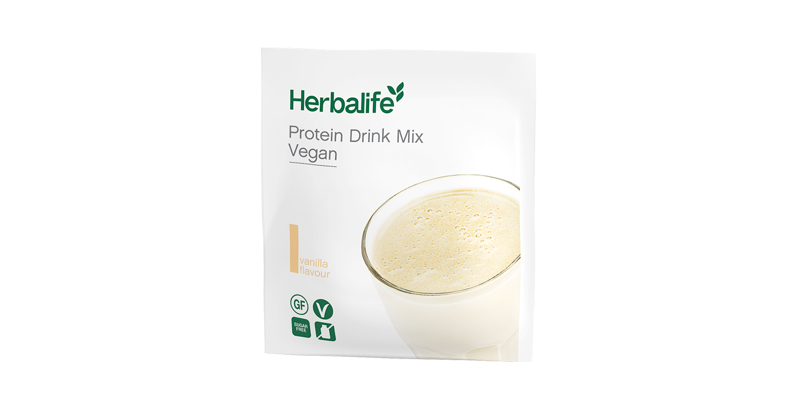
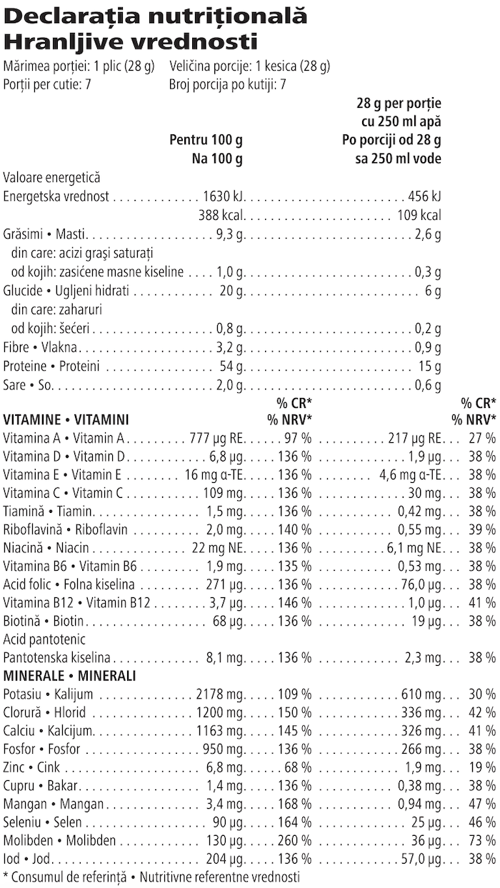

# Protein Drink Mix Vegan

*Aromă: Vanilie · Mărime: 7 pliculețe · Cod: 441K*

Un amestec pe bază de plante, cu o aromă subtilă de vanilie, pentru un boost proteic suplimentar.

## Prezentare generală

Crește-ți aportul zilnic de proteine, vitamine și minerale esențiale cu Protein Drink Mix Vegan.

Protein Drink Mix Vegan este 100% vegan, bogat în proteine, fără gluten, fără zahăr, fără lactoză, cu o textură cremoasă. Cu doar 2 măsuri ce furnizează 15 g de proteine, 22 de vitamine și minerale esențiale și mai puțin de 1g de zahăr per porție, poți savura Protein Drink Mix Vegan sub formă de shake sănătos sau adaugă-l în shake-ul sau smoothie-ul tău preferat pentru un boost proteic suplimentar.

Integrează cu ușurință această pudră versatilă, bogată în proteine în rutina ta zilnică. Protein Drink Mix Vegan are o aromă subtilă de vanilie și poate fi personalizat în funcție de stilul tău de viață, gusturile și nevoile dietetice. Amestecă-l ca atare cu apă sau adaugă-l în shake-ul tău preferat Formula 1 pentru o masă vegană sănătoasă și nutritivă.

Crește-ți aportul zilnic de proteine cu o băutură vegană delicioasă cu aromă subtilă de vanilie, ușor de preparat. Preia controlul asupra nevoilor tale nutriționale și obține acel boost de proteine ori de câte ori simți nevoia.

## Caracteristici

Protein Drink Mix:

- 100 % vegan
- Oferă 15 g de proteine de înaltă calitate per porție
- Fără gluten
- Conținut scăzut de zahăr
- Fără lactoză
- Oferă un boost proteic suplimentar
- Conține 20 de porții
- Disponibil într-o cutie cu 7 pliculețe individuale

## Ce este înăuntru

### Ingrediente

Izolat proteic din **soia**, amestec de minerale și vitamine (citrat de potasiu, clorură de potasiu, citrat de calciu, fostat de calciu, vitamina C (acid L-ascorbic), vitamina E (acetat de DL-alfa-tocoferil), vitamina A (beta-caroten), niacină (nicotinamida), citrat de zinc, acid pantotenic (D-pantotenat de calciu), biotină (D-biotină), selenit de sodiu, carbonat de mangan, vitamina B12 (ciancobalamina), vitamina D (colecalciferol), acid folic (acid pteroilmonoglutamic), vitamina B6 (clorhidrat de piridoxină), iodură de potasiu, riboflavină, tiamină (mononitrat de tiamină), citrat de cupru), maltodextrină, ulei de floarea-soarelui, arome naturale, emulsifiant (lecitina din **soia**), agenți de îngroșare (gumă de xantan, gumă de guar), clorură de sodiu, îndulcitor (glicozide steviolice din stevia).

### Informații despre alergeni

CONȚINE SOIA.

### Informații nutriționale

## Cum se utilizează

Amestecă un pliculeț (28 g) de pudră cu 250 ml de apă rece si savurează. Consumă dimineața sau după prânz.

Pentru o masă echilibrată, vegană si delicioasă, încearcă Protein Drink Mix Vegan împreună cu shake-ul tău Formula 1 preferat si apă.

A se păstra într-un loc răcoros si uscat.

---

*Alimentele prezentate în imagini și/sau videoclipuri sunt ilustrative și nu reprezintă conținutul produsului.*
