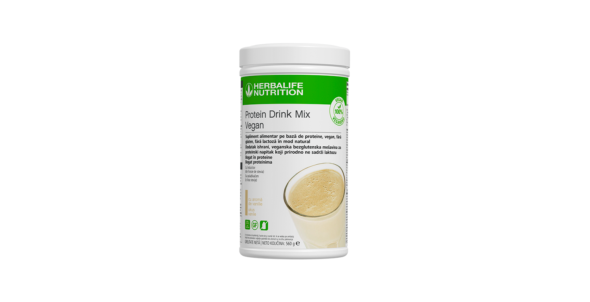
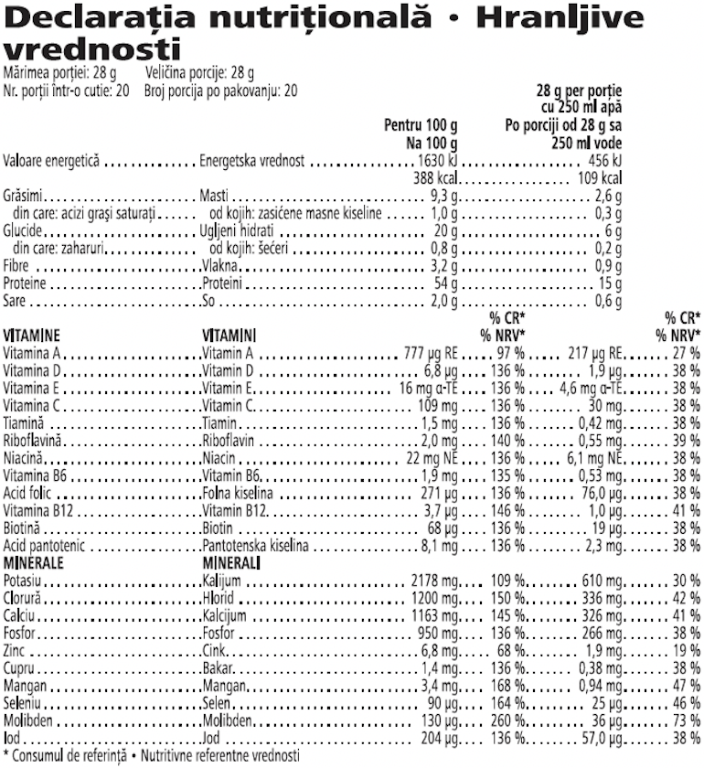

# Protein Drink Mix Vegan

*Aromă: Vanilie · Mărime: 560 g · Cod: 172K*

Un amestec pe bază de plante, cu o aromă subtilă de vanilie, pentru un boost proteic suplimentar.

## Prezentare generală

Crește-ți aportul zilnic de proteine, vitamine și minerale esențiale cu Protein Drink Mix Vegan.

Protein Drink Mix Vegan este 100% vegan, bogat în proteine, fără gluten, fără zahăr, fără lactoză, cu o textură cremoasă. Cu doar 2 măsuri ce furnizează 15 g de proteine, 22 de vitamine și minerale esențiale și mai puțin de 1g de zahăr per porție, poți savura Protein Drink Mix Vegan sub formă de shake sănătos sau adaugă-l în shake-ul sau smoothie-ul tău preferat pentru un boost proteic suplimentar.

Integrează cu ușurință această pudră versatilă, bogată în proteine în rutina ta zilnică. Protein Drink Mix Vegan are o aromă subtilă de vanilie și poate fi personalizat în funcție de stilul tău de viață, gusturile și nevoile dietetice. Amestecă-l ca atare cu apă sau adaugă-l în shake-ul tău preferat Formula 1 pentru o masă vegană sănătoasă și nutritivă.

Crește-ți aportul zilnic de proteine cu o băutură vegană delicioasă cu aromă subtilă de vanilie, ușor de preparat. Preia controlul asupra nevoilor tale nutriționale și obține acel boost de proteine ori de câte ori simți nevoia.

## Caracteristici

Protein Drink Mix:

- 100 % vegan
- Oferă 15 g de proteine de înaltă calitate per porție
- Fără gluten
- Conținut scăzut de zahăr
- Fără lactoză
- Oferă un boost proteic suplimentar
- Conține 20 de porții

## Ce este înăuntru

### Ingrediente

Izolat proteic din **soia**, amestec de minerale si vitamine (citrat de potasiu, clorurà de potasiu, citrat de calciu, fosfat de calciu, vitamina C (acid L-ascorbic), vitamina E (acetat de DL-alfa-tocoferil), vitamina A (beta-caroten), niacina (nicotinamidã), citrat de zinc, acid pantotenic (D-pantotenat de calciu), biotinà (D-biotinā), selenit de sodiu, carbonat de mangan, vitamina B12 (ciancobalamina), vitamina D (colecalciferol), acid folic (acid pteroilmonoglutamic), vitamina B6 (clorhidrat de piridoxinà), iodurà de potasiu, riboflavina, tiamina (mononitrat de tiaminà), citrat de cupru), maltodextrina, ulei de floarea-soarelui, arome naturale, emulsifiant (lecitina din **soia**), agenti de ingrosare (gumà de xantan, gumà de guar), clorurà de sodiu, indulcitor (glicozide steviolice ¡ din stevia).

### Informații despre alergeni

CONȚINE SOIA.

### Informații nutriționale

## Cum se utilizează

Obține o masă sănătoasă vegană, echilibrată din punct de vedere nutrițional și bogată în proteine. Agită ușor cutia înainte de fiecare utilizare. Adaugă două măsuri (28 g) de Protein Drink Mix Vegan și două măsuri (26 g) din shake-ul tău preferat Formula 1 la 300 ml de apă, amestecă și savurează.

Pentru a consuma Protein Drink Mix Vegan ca atare, amestecă 2 măsuri (28 g) de pudră cu 250 ml de apă rece, sau trei măsuri (42 g) de pudră cu 375 ml de apă rece, în funcție de necesitățile tale proteice.

Bucură-te de acest produs în cadrul unei diete echilibrate și variate, ca parte a unui stil de viață sănătos și activ.

Păstrează produsul cu capacul închis într-un loc răcoros și uscat.
