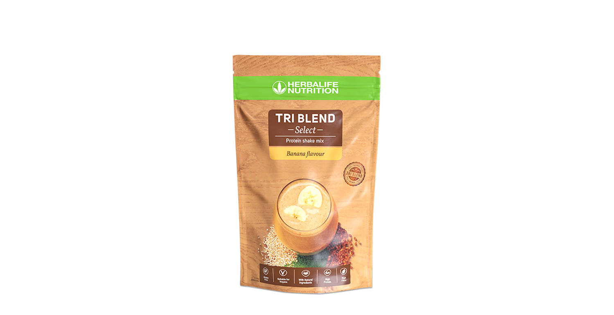
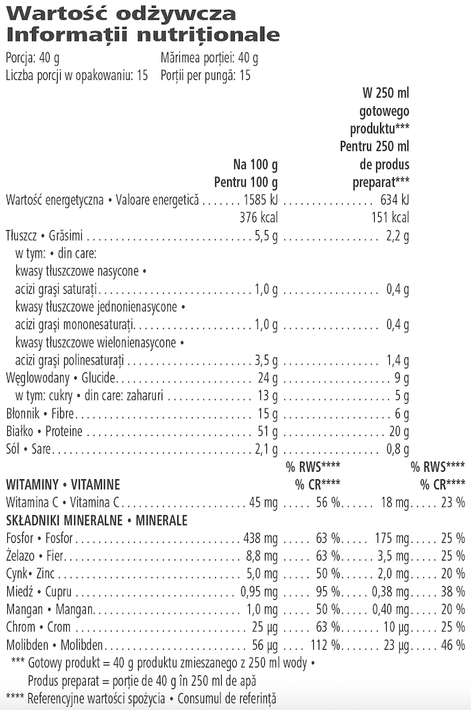

# Tri Blend Select

*Aromă: Banană · Mărime: 600 g · Cod: 013K*

Un shake proteic premium pe bază de plante, formulat cu ingrediente din surse naturale.

## Prezentare generală

Hrănește-ți corpul cu ingrediente pe bază de plante.

Tri Blend Select este un shake nutritiv premium, creat exclusiv cu ingrediente pe bază de plante atent selectate și provenite din surse naturale. Cu amestecul său unic de proteine din mazăre, proteine din orez, quinoa și semințe de in, Tri Blend Select este 100 % fără compromisuri, fiecare porție oferind 20 de grame de proteine vegane complete.

În plus față de un profil complet de aminoacizi, fiecare porție de Tri Blend Select oferă, de asemenea, 6 grame de fibre dietetice, vitamina C și minerale selectate. Disponibil în 2 arome gustoase, acest delicios shake proteic pe bază de plante are un conținut scăzut de zahăr și nu are arome sau coloranți artificiali.

Perfect pentru stilul de viață vegetarian sau vegan, Tri Blend Select este conceput pentru a te ajuta să îți satisfaci nevoile nutriționale.

## Caracteristici

Tri Blend Select:

- Oferă 20 g de proteine de înaltă calitate pe bază de plante pe porție
- Oferă 6 g de fibre pe porție
- Are 151 calorii pe porție
- Oferă un profil complet de aminoacizi\*
- Conține vitamina C și minerale selectate
- Are un conținut scăzut de zahăr
- Nu are coloranți sau arome artificiale
- Este potrivit pentru vegani și vegetarieni
- Conține 15 porții

*\*Adăugarea de proteine din orez oferă o proteină completă.*

## Ce este înăuntru

### Ingrediente

Tri Blend Protein™ (Izolat proteic din mazăre (50 %), pudră de semințe de in (11 %), quinoa pulbere (5 %)), pulbere de nectar din flori de cocos organice1, inulină (cicoare), izolat proteic din orez, arome naturale, fibre din **ovăz** fără gluten, extract organic2 din cireșe acerola, îndulcitor (glicozide steviolice din *Stevia*), fibră de orez organic1.

*1,2,313 % din ingredientele agricole derivate din culturi organice*

1DE-ÖKO-003

2FR-BIO-01

3IT-BIO-006

### Informații despre alergeni

CONȚINE OVĂZ.

### Informații nutriționale

## Cum se utilizează

Bucură-te de Tri Blend Select în orice moment al zilei.

Agită ușor punga înainte de utilizare, deoarece conținutul se poate sedimenta. Amestecă 3 măsuri (40 g) de pudră cu 250 ml de apă, alternativa ta preferată de lapte sau chiar suc de fructe. Ajustează cantitatea de lichid pentru consistența de care ai nevoie. Dacă este amestecat cu suc de fructe sau altă băutură sau dacă cantitatea de lichid este ajustată, valorile nutriționale vor fi diferite.

Bucură-te de acest produs într-o dietă echilibrată și variată, ca parte a unui stil de viață activ și sănătos.

A se păstra sigilat, într-un loc răcoros și uscat.

---

*Alimentele prezentate în imagini și/sau videoclipuri sunt ilustrative și nu reprezintă conținutul produsului.*
