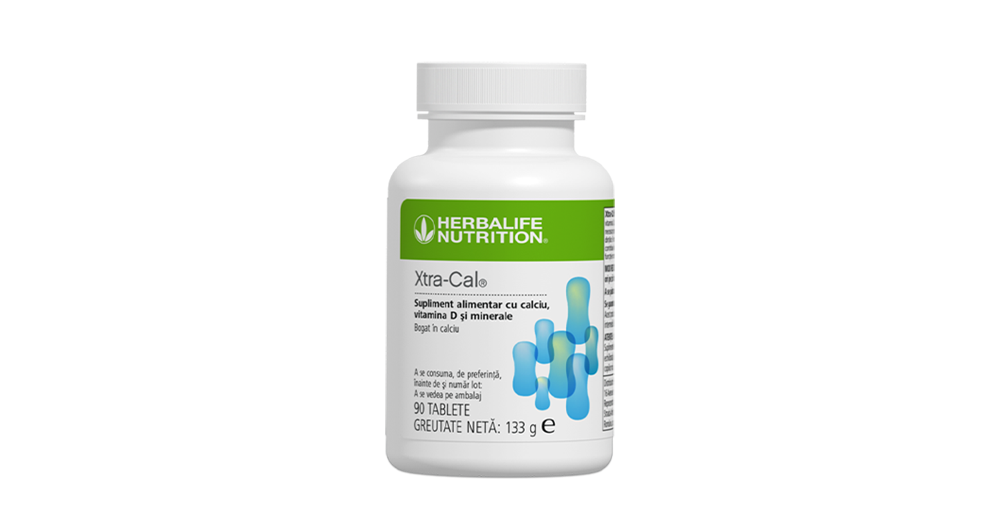
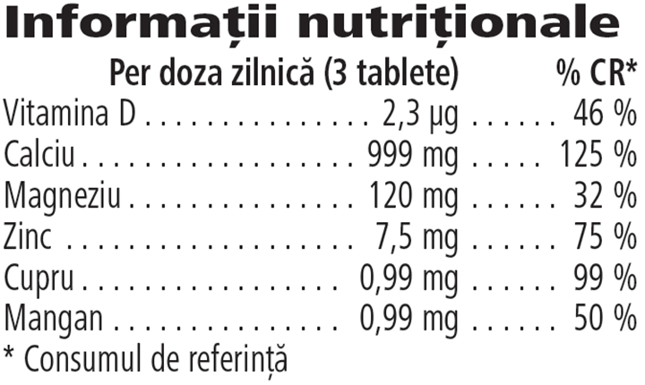

# Xtra -Cal®

*Mărime: 90 tablete · Cod: 0020*

Un supliment alimentar pentru consumul zilnic, bogat în calciu.

## Prezentare generală

Asigură-ți necesarul zilnic de calciu cu Xtra-Cal®.

Xtra-Cal® este un supliment alimentar pentru consumul zilnic, formulat exclusiv cu calciu și o combinație de alte minerale atent selecționate, precum magneziu, cupru, mangan și zinc. Xtra-Cal® conține, de asemenea, vitamina D, care contribuie la absorbția normală a calciului și la menținerea nivelului normal de calciu în sânge. În plus, vitamina D contribuie la menținerea funcţiei normale a sistemului muscular.

Calciul este necesar pentru menţinerea sănătăţii sistemului osos şi a dinţilor. Acest supliment alimentar bogat în calciu este disponibil sub formă de tablete pe care le poți integra cu ușurință în rutina ta zilnică. Ia 1 tabletă de trei ori pe zi în timpul meselor principale. O porție zilnică de 3 comprimate îți furnizează peste 100 % din necesarul zilnic de calciu (CR\*).

*\*Consum de referință*

## Caracteristici

Xtra-Cal®:

- Este formulat cu calciu
- Oferă peste 100 % calciu din CR\* per porție zilnică
- Este formulat cu vitamina D
- Este formulat cu minerale cheie magneziu, cupru, mangan și zinc
- Conține 90 tablete

*\*Consum de referință*

## Ce este înăuntru

### Ingrediente

Carbonat de calciu, agenţi de încărcare (celuloză microcristalină, carboximetilceluloză de sodiu reticulată), citrat de calciu, oxid de magneziu, agenți antiaglomeranţi (acizi graşi, dioxid de siliciu, săruri de calciu ale acizilor graşi), amidon din porumb, agenți de glazurare (hidroxipropilmetilceluloză, glicerină), colorant (carbonat de calciu), sulfat de zinc, gluconat de cupru, sulfat de mangan, colecalciferol.

### Informații nutriționale

## Cum se utilizează

Ia o tabletă, de trei ori pe zi, în timpul meselor principale\*.

Utilizează acest produs în cadrul unei diete echilibrate şi variate, ca parte a unui stil de viaţă activ şi sănătos.

A se păstra cu capacul închis într-un loc răcoros și uscat.

*\*Te rog adaugă o declarație de avertisment pentru suplimentele alimentare. Risc mediu. A nu se depăși doza zilnică de consum recomandată. Suplimentele alimentare sunt destinate să completeze dieta și nu ar trebui folosite pentru a înlocui o dietă variată. A nu se lăsa la îndemâna copiilor mici.*

---

*Alimentele prezentate în imagini și/sau videoclipuri sunt ilustrative și nu reprezintă conținutul produsului.*
